# Mock Paper 1 · Predicted Paper

**B.Tech (Seventh Semester) Examination 2026-27 · CS-453T · Cyber Security** 
**Time: Three Hours · Maximum Marks: 70** 
**Note:** Attempt any **five** questions. All questions carry equal marks (14 each).

This paper is built from the topics already asked in the 2025-26 end-sem and mids (see [PYQ analysis](#analysis)). Write it in 3 hours first, then read the answers. Each 7-mark answer below is written at the MJPRU length: in handwriting each fills about 2–2½ pages, so a full question fills 4–5 pages. Copy the diagrams as boxes and arrows.

## Question paper

| Q | (a) 7 marks | (b) 7 marks |
|---|---|---|
| 1 | How many types of information system are there? Explain all types in detail. | What is cyber security? Describe the information characteristics of the CIA model. |
| 2 | Describe the development of an information system (SDLC). | Describe the ethical and professional issues of information security. |
| 3 | Explain all the components of information security with a neat diagram. | How many types of security attacks are there? Explain each with an example. |
| 4 | Describe the security services and security mechanisms of X.800. | Describe the Playfair cipher with an example. Encrypt INSTRUMENTS with the key MONARCHY. |
| 5 | What is a one-way hash function? Describe it using the MD5 algorithm. | What is public key cryptography? Describe RSA with an example. |
| 6 | What is a digital signature? Explain the Digital Signature Algorithm (DSA). | What is digital watermarking? Explain its characteristics and types. |
| 7 | Why should security policies be developed? Explain an e-mail security policy with an example. | What is web security? Explain the WWW policy. |
| 8 | Write short notes on any two: (i) IT Act 2000 (ii) ISO 27001 (iii) Copyright law (iv) Software licence. | |

---

## Q1 (a) Types of information system

::: ans Answer

**Introduction.** Every organisation has people at different levels: clerks who record daily work, managers who control departments and executives who plan the future. Each level needs a different kind of information, so different information systems are built for each level. Together they are drawn as a pyramid.

**Definition.** <u>An information system is an organised combination of people, hardware, software, data, procedures and networks that collects, processes, stores and distributes information to support operations and decision-making. Information systems are classified by the level of management and the type of decision they support.</u>

**Number of types.** There are **six main types**: TPS, OAS, KWS, MIS, DSS and ESS. Expert Systems (ES) are added as a seventh, knowledge-based type.

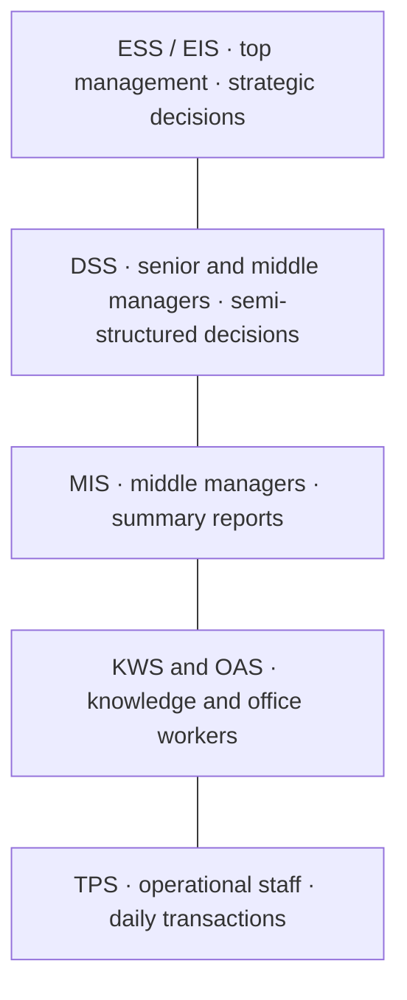
*Fig. 1: Pyramid of information systems.*

**Explanation of each type.**

1. **Transaction Processing System (TPS).** Records the routine, day-to-day transactions of the business, such as sales, payments, bookings and salaries. It handles a very large number of transactions quickly and accurately, using fixed rules. It works in **batch** mode (monthly payroll) or **online/real-time** mode (ATM withdrawal). *Examples:* IRCTC ticket booking, supermarket billing, ATM network. It is the base of the pyramid; all other systems take data from it.

2. **Office Automation System (OAS).** Helps office staff do everyday work faster: word processing, spreadsheets, e-mail, calendars, video conferencing and document management. *Examples:* MS Office, Google Workspace.

3. **Knowledge Work System (KWS).** Supports professionals such as engineers, scientists and designers who create new knowledge. It needs powerful graphics and computation. *Examples:* AutoCAD, simulation and 3-D modelling software.

4. **Management Information System (MIS).** Takes data from the TPS and produces **scheduled summary reports** and **exception reports** for middle managers, who use them to plan, monitor and control their departments. Decisions are structured. *Example:* a monthly sales report by region; an attendance-shortage list in a college.

5. **Decision Support System (DSS).** An interactive system that helps managers take **semi-structured** decisions. It has three parts: a database, a model base (statistical and financial models) and a user interface. It supports **what-if analysis**. *Example:* "What happens to profit if we reduce the price by 10%?"; loan-approval analysis in a bank.

6. **Executive Support System (ESS / EIS).** Serves top management. It gives graphical dashboards that summarise the whole organisation together with external data (competitors, market, economy), with drill-down to details. Supports **unstructured, strategic** decisions. *Example:* a CEO dashboard showing revenue and market share of all branches.

7. **Expert System (ES).** An Artificial Intelligence system that copies the reasoning of a human expert. Parts: knowledge base (facts and IF–THEN rules), inference engine, user interface and explanation facility. *Examples:* MYCIN for medical diagnosis; credit-card fraud detection.

**Comparison.**

| Type | Level | Decision | Example |
|---|---|---|---|
| TPS | Operational | Structured, routine | ATM, IRCTC |
| OAS | Clerical | — | E-mail, MS Office |
| KWS | Knowledge workers | — | AutoCAD |
| MIS | Middle management | Structured | Monthly sales report |
| DSS | Middle/senior | Semi-structured | Price planning |
| ESS | Top management | Unstructured | CEO dashboard |
| ES | Any | Expert advice | MYCIN |

**Security note.** Each type holds sensitive data: the TPS holds customer and payment records, the ESS holds strategic plans. All need access control, encryption and backups.

**Conclusion.** Information systems form a pyramid from the TPS at the base, which records every transaction, to the ESS at the top, which supports strategic decisions. Each level depends on the one below it for data, so all must be protected as one whole.
:::

## Q1 (b) Cyber security and the CIA model

::: ans Answer

**Introduction.** Today banking, shopping, education and government services all run on the Internet. UPI payments, Aadhaar, DigiLocker and online exams depend on computers and networks that attackers constantly target. Protecting them is the job of cyber security, and its basic goals are given by the CIA model.

**Definition of cyber security.** <u>Cyber security is the practice of protecting computers, servers, mobile devices, networks, programs and data from digital attacks, unauthorised access, damage or disruption.</u> Information security protects information in every form; cyber security is the part of it that deals with cyberspace.

**Domains of cyber security:** network security, application security, data security, cloud security, endpoint and mobile security, identity and access management, operational security, disaster recovery and business continuity, and end-user education.

**Definition of the CIA model.** <u>The CIA model (CIA triad) gives the three essential characteristics of information that must be preserved for it to be secure: Confidentiality, Integrity and Availability.</u>

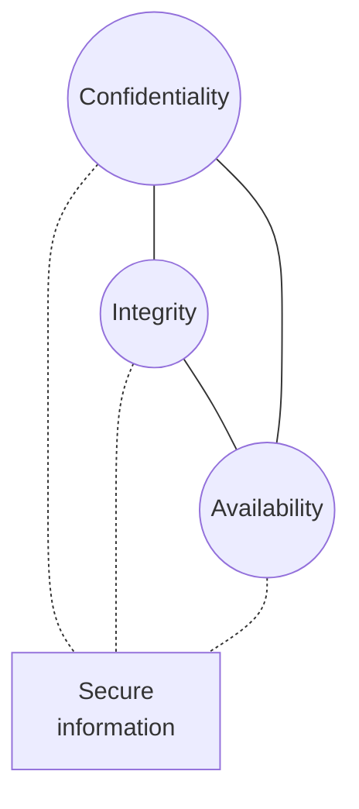
*Fig. 2: The CIA triad.*

**1. Confidentiality.**
- *Meaning:* information is disclosed only to authorised persons, processes or systems. It includes **privacy**: individuals control what information about them is collected and shared.
- *Threats:* eavesdropping on networks, shoulder surfing, stolen laptops, phishing, insiders leaking data.
- *Controls:* encryption, passwords and access control, data classification (public, internal, confidential, secret), training.
- *Example:* only the account holder and the bank can see an account balance.

**2. Integrity.**
- *Meaning:* information is complete, accurate and unaltered; it can be changed only by authorised people in authorised ways. Covers data integrity and system integrity.
- *Threats:* modification of messages in transit, viruses corrupting files, an insider changing marks, accidental errors.
- *Controls:* hash functions and checksums, message authentication codes, digital signatures, access rights, audit logs.
- *Example:* during an online transfer, nobody may change "Rs 100" to "Rs 10,000".

**3. Availability.**
- *Meaning:* authorised users can access information and systems in the required format whenever they need them.
- *Threats:* denial-of-service attacks, ransomware, hardware failure, power cuts, floods and fire.
- *Controls:* backups, redundant servers, anti-DDoS services, UPS, disaster-recovery plans.
- *Example:* the university result website must stay up on result day.

**Other characteristics (Whitman, X.800):** authenticity, accuracy, utility, possession, accountability and non-repudiation extend the triad.

**Balance.** The three goals pull against each other: very strict confidentiality can reduce availability. Security policy chooses the right balance for each system.

**Conclusion.** Cyber security protects systems and data in cyberspace, and every cyber-security control can be explained by which part of the CIA triad it protects. The CIA model is therefore the foundation of the whole subject.
:::

## Q2 (a) Development of information system

::: ans Answer

**Introduction.** An information system is not bought ready-made like a pen; it is planned and built step by step, like a house. The standard method for this is the System Development Life Cycle (SDLC).

**Definition.** <u>The System Development Life Cycle (SDLC) is a structured, phased methodology for planning, analysing, designing, building, testing, implementing and maintaining an information system, in which the output of each phase is the input to the next.</u>

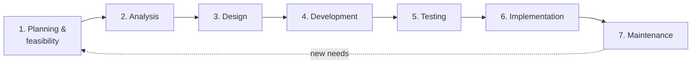
*Fig. 3: Waterfall model of the SDLC.*

**Phases.**

1. **Planning / preliminary investigation.** The problem or opportunity is defined and the scope fixed. A **feasibility study** checks technical, economic (cost–benefit), legal, operational and schedule feasibility (TELOS). *Output:* feasibility report and a go/no-go decision by management.

2. **System analysis.** The existing system is studied and user requirements are collected by interviews, questionnaires, observation and study of records. Data flow diagrams model the system. *Output:* Software Requirement Specification (SRS).

3. **System design.** **Logical design** describes what the system will do (DFDs, ER diagrams). **Physical design** describes how: input screens, output reports, database tables, hardware, network and **security controls** such as login, access rights and encryption. *Output:* design document.

4. **Development (coding).** Programmers write code to the design using coding standards, code reviews and secure-coding practices. *Output:* program modules.

5. **Testing.** Unit testing (each module), integration testing (modules together), system testing (whole system against the SRS, including security testing) and acceptance testing (alpha at the developer, beta at the user). *Output:* tested system.

6. **Implementation.** The system is installed, old data is converted and users are trained. Changeover may be **direct** (cheapest, riskiest), **parallel** (old and new together; safest), **pilot** (one branch first) or **phased** (module by module).

7. **Maintenance and review.** Corrective (fixing bugs), adaptive (new OS or law), perfective (new features) and preventive (security patches) maintenance. A post-implementation review checks whether goals were met.

**Security in the SDLC (SecSDLC).** Whitman applies the same phases to security: investigation (security policy and goals), analysis (threats, risks, laws), logical design (security blueprint, incident-response and continuity plans), physical design (choice of firewalls, IDS, encryption), implementation (install and train) and maintenance (monitor and patch). Security added at the end is costly and weak.

**Other models.** Prototyping (users see a quick model), spiral (risk analysis in each loop), incremental, agile (short sprints), RAD and V-model.

**Example.** A college fee-payment system: feasibility shows online payment saves staff time; analysis collects fee rules; design adds a payment-gateway interface and encrypted storage; it is coded, tested with dummy payments, piloted in one department and then maintained each semester.

**Conclusion.** The SDLC gives a disciplined path from idea to working system, keeps cost and time under control, and, when security is built in from the first phase, produces a system that is both useful and safe.
:::

## Q2 (b) Ethical and professional issues of information security

::: ans Answer

**Introduction.** Security professionals have access to passwords, personal data and the inner workings of systems. How they use this power is governed by law, by ethics and by professional codes. The syllabus calls these the ethical and professional issues of security.

**Definitions.** <u>Laws are rules that mandate or prohibit certain behaviour and are enforced by the state. Ethics are socially acceptable standards of right and wrong conduct, based on cultural values. Professional ethics are the codes of conduct that a profession expects its members to follow.</u> The difference: laws carry state penalties; ethics do not, but breaking them destroys trust and careers.

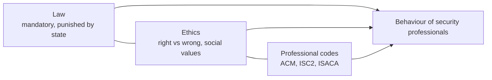
*Fig. 4: Law, ethics and professional codes together shape behaviour.*

**Ethical issues.**
1. **Privacy:** collect and share personal data only with consent and for a stated purpose; monitor employees only under a published policy.
2. **Unauthorised access:** entering a system without permission is wrong even "just to look"; ethical hacking needs written authorisation.
3. **Software piracy:** copying or using unlicensed software violates copyright and is unethical.
4. **Intellectual property:** respecting others' code, designs and content; no plagiarism.
5. **Misuse of resources:** using office computers for personal business, gaming or illegal downloads.
6. **Accuracy:** not spreading false or misleading information.
7. **Whistle-blowing:** reporting an employer's security failures may conflict with loyalty.
8. **Cultural differences:** attitudes to piracy and privacy differ between countries.

**Ten Commandments of Computer Ethics** (Computer Ethics Institute), in short: do not use a computer to harm others, interfere with their work, snoop in their files, steal, or bear false witness; do not copy unpaid software, use others' resources without permission or take their intellectual output; think about the social effects of your programs; use computers with respect.

**Why people act unethically (Whitman):** ignorance, accident and intent. Deterrence works only when there is fear of penalty, a probability of being caught and a probability that the penalty will be applied.

**Professional issues.**
1. **Codes of ethics** of professional bodies: ACM, (ISC)², ISACA, SANS, IEEE.
2. **Certifications** such as CISSP, CISA, CISM and CEH prove competence and bind holders to codes of conduct.
3. **Due care and due diligence:** professionals must take reasonable steps to protect data; negligence brings legal liability.
4. **Confidentiality of client data** and honest reporting of vulnerabilities.
5. **Avoiding conflicts of interest** and continuous learning.
6. **Legal duties** under the IT Act 2000 (Sections 43, 66, 72) and the DPDP Act 2023.

**Example.** A system administrator who reads the HR manager's e-mails out of curiosity breaks no technical control, but acts unethically and may be liable under Section 72 of the IT Act for breach of confidentiality.

**Conclusion.** Technology can stop many attacks, but it cannot make people honest. Laws, ethics and professional codes together make security professionals trustworthy, which is the base of every security programme.
:::

## Q3 (a) Components of information security

::: ans Answer

**Introduction.** Information security is not a single product like an antivirus. It is made of several parts that must work together, and a weakness in any one of them lets an attacker in.

**Definition.** <u>The components of information security are the parts of an information system that must be protected (hardware, software, data, people, procedures and networks), together with the areas of protection (management of information security, computer and data security, and network security, joined by security policy) that preserve the confidentiality, integrity and availability of information.</u>

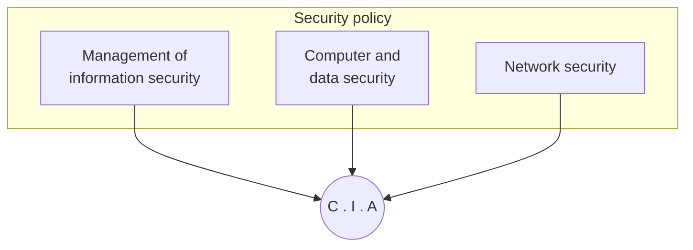
*Fig. 5: Components of information security (Whitman).*

**A. Areas of protection.**
1. **C.I.A. at the centre:** the goal of all the components.
2. **Management of information security:** planning, risk assessment, budgets, roles (CISO), audits and awareness programmes.
3. **Computer security:** protecting individual computers and servers: OS hardening, antivirus, patches, login control.
4. **Data security:** protecting data at rest, in use and in transit: encryption, backups, database access rights.
5. **Network security:** protecting network devices, connections and traffic: firewalls, IDS/IPS, VPN, secure Wi-Fi.
6. **Policy:** the outer layer; written rules that guide every other area (password policy, acceptable-use policy).

**B. Components of an information system that must be protected.**

| Component | Main risk | Control |
|---|---|---|
| Hardware | Theft, damage | Locks, CCTV, asset tags |
| Software | Bugs, malware | Patching, secure coding |
| Data | Theft, corruption | Encryption, backup |
| People | Phishing, mistakes | Training, awareness |
| Procedures | Leaked or ignored | Keep confidential, enforce |
| Networks | Intrusion | Firewalls, VPN, IDS |

**C. Three safeguards (CNSS / McCumber cube):** policy, education and technology, applied to information in storage, processing and transmission.

**D. Layers of security:** physical, personnel, operations, communications, network and information security.

**Example.** A college's exam system: hardware (server room locked), software (patched portal), data (encrypted question papers), people (staff trained not to share passwords), procedures (two-person approval to publish results), network (firewall and HTTPS), all under an exam-security policy.

**Conclusion.** A system is only as strong as its weakest component, and people are usually the weakest link. All components must therefore be protected together, under one policy.
:::

## Q3 (b) Types of security attacks

::: ans Answer

**Introduction.** A security attack is any action that compromises the security of information owned by an organisation. Knowing the types of attacks tells us which services and mechanisms are needed.

**Definition.** <u>A security attack is an assault on system security that derives from an intelligent threat: a deliberate attempt to evade security services and violate the security policy of a system (RFC 4949).</u>

**Number of types.** There are **two types**: **passive attacks** and **active attacks** (X.800).

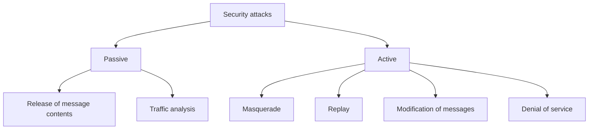
*Fig. 6: Classification of security attacks.*

**1. Passive attacks.** The attacker only monitors or eavesdrops; nothing is changed.
- **(i) Release of message contents:** the opponent reads the contents of an e-mail, phone call or file in transit. *Example:* capturing login details sent over open café Wi-Fi.
- **(ii) Traffic analysis:** even if messages are encrypted, the opponent studies their pattern: who communicates with whom, how often and how much. *Example:* heavy traffic between two companies hints at a merger.
- Passive attacks are **very hard to detect** because no data changes, so the defence is **prevention**, mainly encryption and traffic padding.

**2. Active attacks.** The attacker modifies the data stream or creates a false stream.
- **(i) Masquerade:** one entity pretends to be another, usually together with another active attack. *Example:* logging in to the exam portal with a teacher's stolen password.
- **(ii) Replay:** a captured data unit is retransmitted later to produce an unauthorised effect. *Example:* resending a captured "transfer Rs 500" message to repeat the payment.
- **(iii) Modification of messages:** part of a genuine message is altered, delayed or reordered. *Example:* "Allow Ram to read file Accounts" changed to "Allow Shyam to read file Accounts".
- **(iv) Denial of service (DoS):** normal use of the system is prevented, by flooding the server or disabling the network. *Example:* a botnet DDoS attack that takes a bank's website offline.
- Active attacks are **hard to prevent** completely, so the defence is **detection and recovery**.

**Comparison.**

| Basis | Passive | Active |
|---|---|---|
| Action | Reads, monitors | Modifies, fakes, blocks |
| Goal violated | Confidentiality | Integrity, authenticity, availability |
| Detection | Very hard | Easier |
| Defence | Prevention (encryption) | Detection and recovery |
| Examples | Eavesdropping, traffic analysis | Masquerade, replay, modification, DoS |

**Conclusion.** Passive attacks threaten confidentiality and must be prevented; active attacks threaten integrity and availability and must be detected and recovered from. X.800 services such as confidentiality, authentication and integrity are designed against exactly these attacks.
:::

## Q4 (a) X.800 security services and mechanisms

::: ans Answer

**Introduction.** ITU-T Recommendation **X.800**, the *Security Architecture for OSI*, gives a systematic way to define security requirements. It has three aspects: attacks, services and mechanisms. Services are what the user receives; mechanisms are the tools that provide them.

**Definitions.**
- <u>Security service: a service provided by a protocol layer of communicating open systems that ensures adequate security of the systems or of data transfers.</u>
- <u>Security mechanism: a process (or a device incorporating it) designed to detect, prevent or recover from a security attack.</u>

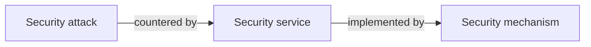
*Fig. 7: Relation between attacks, services and mechanisms.*

**A. Security services (5 categories, 14 specific services).**
1. **Authentication:** assures that the communicating entity is the one it claims to be.
   - *Peer-entity authentication* (during a connection) and *data-origin authentication* (in connectionless transfer).
2. **Access control:** prevents unauthorised use of a resource; controls who can access, under what conditions, and what they may do.
3. **Data confidentiality:** protects data from unauthorised disclosure: *connection*, *connectionless*, *selective-field* and *traffic-flow* confidentiality.
4. **Data integrity:** assures that received data is exactly as sent, with no modification, insertion, deletion or replay: *connection integrity with recovery*, *without recovery*, *selective-field connection integrity*, *connectionless integrity*, *selective-field connectionless integrity*.
5. **Non-repudiation:** protects against denial by one of the parties: *non-repudiation of origin* (sender cannot deny sending) and *of destination* (receiver cannot deny receiving).

Availability is also treated as a service that protects a system against denial-of-service attacks.

**B. Specific security mechanisms (8).**
1. **Encipherment:** mathematical transformation of data to make it unreadable (encryption).
2. **Digital signature:** data appended to a message that proves its source and integrity.
3. **Access control:** mechanisms that enforce access rights (ACLs, passwords).
4. **Data integrity:** mechanisms that assure the integrity of data (hash, MAC, check values).
5. **Authentication exchange:** proving identity by exchanging information (challenge–response, passwords).
6. **Traffic padding:** inserting dummy bits into gaps in the data stream to frustrate traffic analysis.
7. **Routing control:** choosing physically secure routes and changing routes when a breach is suspected.
8. **Notarization:** using a trusted third party to assure properties of a data exchange.

**C. Pervasive mechanisms:** trusted functionality, security label, event detection, security audit trail, security recovery.

**D. Which mechanism provides which service.**

| Service | Mechanisms |
|---|---|
| Peer-entity authentication | Encipherment, digital signature, authentication exchange |
| Data-origin authentication | Encipherment, digital signature |
| Access control | Access control |
| Confidentiality | Encipherment, routing control |
| Traffic-flow confidentiality | Encipherment, traffic padding, routing control |
| Data integrity | Encipherment, digital signature, data integrity |
| Non-repudiation | Digital signature, data integrity, notarization |
| Availability | Data integrity, authentication exchange |

**Example.** In net banking, TLS encipherment gives confidentiality, the bank's certificate and digital signature give authentication, MACs give integrity, and the signed transaction record gives non-repudiation.

**Conclusion.** X.800 separates *what* protection is needed (services) from *how* it is provided (mechanisms). This makes it the standard checklist for designing and evaluating secure systems.
:::

## Q4 (b) Playfair cipher with an example

::: ans Answer

**Introduction.** Simple substitution ciphers such as Caesar are easily broken by letter-frequency analysis. The Playfair cipher, invented by Charles Wheatstone in 1854 and promoted by Lord Playfair, encrypts **pairs of letters** instead of single letters, which hides single-letter frequencies. It was used by British forces in World War I.

**Definition.** <u>The Playfair cipher is a polygram (digraph) substitution cipher that encrypts the plaintext two letters at a time, using a 5×5 matrix of letters built from a keyword.</u>

**Step 1: build the key square.** Write the keyword (without repeated letters) row by row, then the remaining letters of the alphabet in order. I and J share one cell. Key = **MONARCHY**:

| | | | | |
|---|---|---|---|---|
| **M** | **O** | **N** | **A** | **R** |
| **C** | **H** | **Y** | B | D |
| E | F | G | I/J | K |
| L | P | Q | S | T |
| U | V | W | X | Z |

*Fig. 8: Playfair key square for MONARCHY.*

**Step 2: prepare the plaintext.** Split it into pairs. If both letters of a pair are the same, insert a filler **X** between them. If one letter is left at the end, add **X**.

**Step 3: encryption rules.**
1. **Same row:** replace each letter with the letter to its right (the last wraps to the first).
2. **Same column:** replace each letter with the letter below it (the bottom wraps to the top).
3. **Rectangle (different row and column):** replace each letter with the letter in its own row but in the column of the other letter.

**Example.** Plaintext = **INSTRUMENTS** → pairs **IN ST RU ME NT SX**.

| Pair | Position | Rule | Cipher |
|---|---|---|---|
| IN | I row 3 col 4; N row 1 col 3 | Rectangle | **GA** |
| ST | both row 4 | Same row → right | **TL** |
| RU | R row 1 col 5; U row 5 col 1 | Rectangle | **MZ** |
| ME | both column 1 | Same column → below | **CL** |
| NT | N row 1 col 3; T row 4 col 5 | Rectangle | **RQ** |
| SX | both column 4 | Same column → below | **XA** |

**Ciphertext = GATLMZCLRQXA.**

**Decryption** uses the reverse rules (left for same row, up for same column, the same rectangle rule): GA TL MZ CL RQ XA → IN ST RU ME NT SX → INSTRUMENTS(X). ✓

**Advantages.** 25 × 25 = 600 possible digraphs, so single-letter frequency analysis fails; easy to use by hand.

**Limitations.** Digraph frequencies still show; it can be broken with a few hundred letters of ciphertext; I/J merge; a digraph and its reverse encrypt to reversed outputs (AB → XY, BA → YX).

**Conclusion.** Playfair was the first practical digraph cipher and a big step beyond monoalphabetic ciphers, but it still leaves enough structure for modern cryptanalysis, so it is now only of historical and teaching value.
:::

## Q5 (a) One-way hash function and MD5

::: ans Answer

**Introduction.** Encryption gives confidentiality, but we also need to know whether a message or file has been changed. A one-way hash function produces a short "fingerprint" of the data for this purpose. It is used in digital signatures, password storage and integrity checking.

**Definition.** <u>A one-way hash function H takes an input message M of any length and produces a fixed-length output h = H(M), called the message digest or hash value, such that h is easy to compute from M, but it is computationally infeasible to find M from h or to find two messages with the same hash.</u>

**Properties.**
1. Accepts input of any length; output has a fixed length.
2. **Easy to compute** H(M) for any M.
3. **Pre-image resistance (one-way):** given h, infeasible to find M.
4. **Second pre-image resistance (weak collision resistance):** given M, infeasible to find M′ ≠ M with H(M′) = H(M).
5. **Collision resistance (strong):** infeasible to find any pair M ≠ M′ with H(M) = H(M′).
6. **Avalanche effect:** a one-bit change in M changes about half of the output bits.

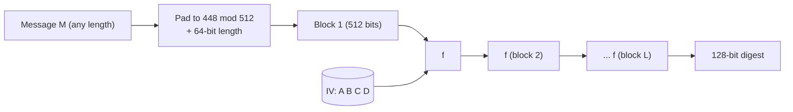
*Fig. 9: Processing a message with MD5.*

**MD5 algorithm (Ron Rivest, 1991).** Produces a **128-bit** digest from input processed in **512-bit blocks**.

1. **Append padding bits.** Add a single 1 bit followed by 0 bits, so that the length becomes 448 mod 512 (64 bits short of a multiple of 512). Padding is always added, from 1 to 512 bits.
2. **Append length.** Add the original message length as a 64-bit number. The total length is now a multiple of 512 bits.
3. **Initialise the MD buffer.** Four 32-bit registers: A = 67452301, B = EFCDAB89, C = 98BADCFE, D = 10325476 (hex).
4. **Process each 512-bit block.** The compression function has **4 rounds of 16 steps** (64 steps). Each round uses a different non-linear function of B, C, D: F = (B∧C)∨(¬B∧D), G = (B∧D)∨(C∧¬D), H = B⊕C⊕D, I = C⊕(B∨¬D). Each step adds a 32-bit word of the block, a constant from a table T[1…64] (derived from the sine function), rotates left and adds mod 232. The output of the fourth round is added to the input buffer.
5. **Output.** After the last block, A‖B‖C‖D is the 128-bit message digest.

**Example.** MD5("abc") = 900150983cd24fb0d6963f7d28e17f72, while MD5("Abc") = 35593b7ce5020eae3ca68fd5b6f3e031. Changing one letter gives a completely different digest (avalanche effect).

**Applications.** (i) Digital signatures: the hash is signed, not the whole message. (ii) Password storage: systems store H(password). (iii) File integrity: download sites publish the hash. (iv) Message authentication codes (HMAC). (v) Blockchain.

**Security note.** MD5 is no longer collision-resistant (collisions found in 2004), so SHA-256 (SHA-2) is used today for security. SHA-1 works the same way with 5 registers, 80 steps and a 160-bit output.

**Conclusion.** A one-way hash function turns any message into a short, unique fingerprint that cannot be reversed. MD5 shows the standard structure (padding, length, buffer, compression rounds), which SHA-1 and SHA-2 follow with longer outputs.
:::

## Q5 (b) Public key cryptography and RSA

::: ans Answer

**Introduction.** In symmetric cryptography both parties share one secret key, so the key must somehow reach the receiver safely, and n users need n(n−1)/2 keys. In 1976 Diffie and Hellman proposed public key cryptography, which removes the need to share a secret key in advance.

**Definition.** <u>Public key (asymmetric) cryptography uses a pair of related keys for each user: a public key that is published and a private key that is kept secret. Data encrypted with one key can be decrypted only with the other, and the private key cannot feasibly be derived from the public key.</u>

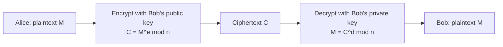
*Fig. 10: Public key encryption.*

**Uses.** Encryption (confidentiality), digital signatures (authentication and non-repudiation) and key exchange.

**RSA algorithm (Rivest, Shamir, Adleman, MIT, 1977).**

*Key generation*
1. Select two large primes **p** and **q**.
2. Compute **n = p × q**.
3. Compute **φ(n) = (p − 1)(q − 1)**.
4. Select **e** such that 1 < e < φ(n) and gcd(e, φ(n)) = 1.
5. Compute **d** such that **d × e ≡ 1 (mod φ(n))**.
6. **Public key = {e, n}; private key = {d, n}.**

*Encryption:* **C = Me mod n** (M < n). *Decryption:* **M = Cd mod n**.

**Example.**
1. p = 3, q = 11.
2. n = 3 × 11 = **33**.
3. φ(n) = 2 × 10 = **20**.
4. e = **3** (gcd(3, 20) = 1).
5. d: 3 × d ≡ 1 (mod 20) → d = **7** (3 × 7 = 21 = 1 × 20 + 1).
6. Public key {3, 33}; private key {7, 33}.

*Encrypt M = 4:* C = 43 mod 33 = 64 mod 33 = **31**.

*Decrypt C = 31:* M = 317 mod 33. Since 31 ≡ −2 (mod 33): (−2)7 = −128; −128 + 4 × 33 = −128 + 132 = **4**. ✓ The original message is recovered.

**Security of RSA.** Breaking RSA needs n to be factored into p and q, which is infeasible for large n (2048 bits or more). Possible attacks: brute force, mathematical (factoring), timing attacks and chosen-ciphertext attacks.

**Symmetric vs asymmetric.**

| Basis | Symmetric | Public key |
|---|---|---|
| Keys | One shared secret key | Public + private key |
| Speed | Fast | Slow |
| Key distribution | Difficult | Easy |
| Examples | DES, AES | RSA, DSA, ECC |

In practice, RSA encrypts a random session key, and the session key encrypts the data with AES (hybrid encryption, as in TLS).

**Conclusion.** Public key cryptography solved the key-distribution problem and made digital signatures possible. RSA, based on the difficulty of factoring, is the most widely used public key algorithm.
:::

## Q6 (a) Digital signature and DSA

::: ans Answer

**Introduction.** A handwritten signature proves who signed a paper document. In electronic communication, a digital signature does the same job, and does it better: it also proves that the document was not changed after signing.

**Definition.** <u>A digital signature is a mathematical scheme that lets the creator of a message attach a code, computed from the hash of the message using the signer's private key, which anyone can verify using the signer's public key.</u>

**Properties.** It must verify the author and the date and time of signing, authenticate the contents at the time of signing, and be verifiable by third parties to settle disputes. It provides **authentication, data integrity and non-repudiation**.

**Digital Signature Algorithm (DSA).** Published by NIST in the **Digital Signature Standard (DSS), FIPS 186 (1991)**. Based on the difficulty of computing **discrete logarithms**; uses SHA as the hash. DSA can only sign; it cannot encrypt.

**1. Global public components**
- **p:** a prime of L bits (512 to 1024 bits in the original standard).
- **q:** a 160-bit prime factor of (p − 1).
- **g = h(p−1)/q mod p**, where 1 < h < p − 1 and g > 1.

**2. User's private and public key**
- Private key **x**: random integer, 0 < x < q.
- Public key **y = gx mod p**.

**3. Signing** (per message, choose a new secret random **k**, 0 < k < q)
- **r = (gk mod p) mod q**
- **s = [k−1 (H(M) + x·r)] mod q**
- Signature = **(r, s)**, sent with M.

**4. Verifying** received (M′, r′, s′)
- **w = (s′)−1 mod q**
- **u1 = [H(M′) · w] mod q**
- **u2 = (r′ · w) mod q**
- **v = [(gu1 · yu2) mod p] mod q**
- **If v = r′, the signature is valid.**

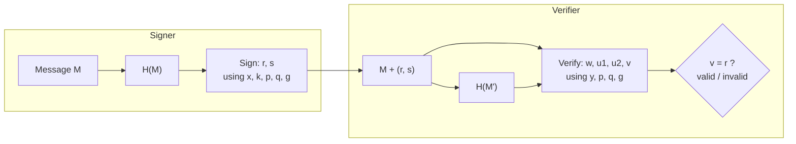
*Fig. 11: DSA signing and verification.*

**Small example (to show the working).** p = 23, q = 11, h = 2 → g = 22 mod 23 = 4. x = 3 → y = 43 mod 23 = 18. Take H(M) = 6, k = 5.
- r = (45 mod 23) mod 11 = 12 mod 11 = **1**; k−1 = 9; s = 9 × (6 + 3 × 1) mod 11 = **4**. Signature (1, 4).
- Verify: w = 3, u1 = 7, u2 = 3, v = (47 × 183 mod 23) mod 11 = (8 × 13 mod 23) mod 11 = 12 mod 11 = **1 = r** ✓.

**Why it works.** Only the holder of x can produce s that satisfies the verification equation; any change to M changes H(M), so v ≠ r.

**Advantages.** Short signatures (two 160-bit numbers), fast signing, a government standard. **Limitations:** slower verification than RSA; k must never be reused or revealed (it would expose x); signs only.

**Conclusion.** A digital signature binds a message to its signer and proves integrity and non-repudiation. DSA, the NIST standard, does this using discrete logarithms, with the four-step process of global parameters, keys, signing and verification.
:::

## Q6 (b) Digital watermarking: characteristics and types

::: ans Answer

**Introduction.** Digital images, music and films can be copied perfectly and shared instantly, which makes piracy easy. Digital watermarking hides an ownership mark inside the content itself, so that ownership can be proved and copies traced.

**Definition.** <u>Digital watermarking is the process of embedding a secret signal (the watermark: a logo, text, ID number or pattern) into digital content such as an image, audio, video or document, in a way that is usually imperceptible, so that it can later be detected or extracted to prove ownership, authenticate the content or trace copies.</u>

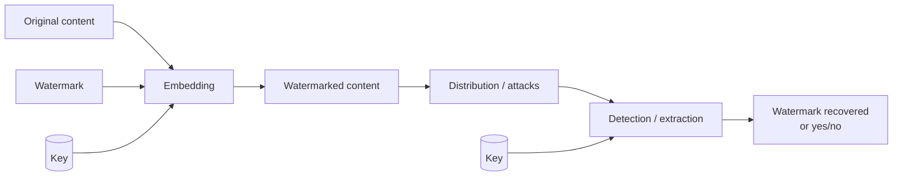
*Fig. 12: Watermark embedding and extraction.*

**Characteristics (requirements).**
1. **Imperceptibility (fidelity):** the watermark should not reduce the visual or audio quality.
2. **Robustness:** it should survive compression, cropping, scaling, rotation, noise and filtering.
3. **Security:** it cannot be detected, removed or forged without the secret key.
4. **Capacity:** the number of bits that can be embedded.
5. **Unambiguity:** the extracted mark clearly identifies the owner.
6. **Low computational cost** for embedding and detection.
7. **Trade-off:** more capacity or robustness usually means less imperceptibility.

**Types of watermarking.**
1. **By perception:** **visible** (a semi-transparent logo, as on TV channels and stock photos) and **invisible** (hidden in the data).
2. **By robustness:** **robust** (survives attacks; used for copyright), **fragile** (destroyed by any change; used for tamper detection) and **semi-fragile** (survives normal compression but breaks on malicious edits).
3. **By media:** image, audio, video and text/document watermarking.
4. **By domain:** **spatial domain** (directly change pixel values, for example the least significant bit) and **frequency (transform) domain** (embed in DCT, DFT or DWT coefficients; more robust to JPEG).
5. **By detection:** **non-blind** (needs the original), **semi-blind** (needs the watermark) and **blind** (needs neither).
6. **Fingerprinting:** a different watermark for each buyer, to trace who leaked a copy.

**Applications.** Copyright protection and proof of ownership; tracing pirated pre-release films; tamper detection in medical images and legal evidence; broadcast monitoring of advertisements; copy control in media players.

**Watermarking vs steganography.** Steganography hides the existence of a secret message, and the cover does not matter; watermarking protects the cover itself and must be robust.

**Conclusion.** Watermarking adds a hidden, robust identity to digital content. Its usefulness depends on balancing imperceptibility, robustness and capacity, and the choice of type depends on the goal: robust for copyright, fragile for authentication.
:::

## Q7 (a) Need for security policies; e-mail security policy

::: ans Answer

**Introduction.** Firewalls and antivirus software cannot work without rules that say what is allowed. Those rules are written down in security policies, which are the foundation of every security programme.

**Definition.** <u>A security policy is a formal statement, approved by management, of the rules that people who access an organisation's information assets must follow; it states what must be protected, why, and who is responsible.</u>

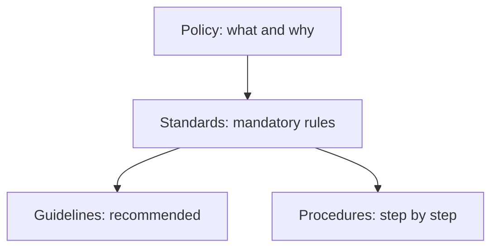
*Fig. 13: Policy hierarchy.*

**Why policies should be developed.**
1. **Foundation of security:** every control, configuration and training programme is based on policy.
2. **Protect assets:** define which information is valuable and how to protect its CIA.
3. **Define roles and responsibilities:** owners, custodians, users, incident handlers.
4. **Set acceptable behaviour** and reduce mistakes and misuse.
5. **Legal compliance:** IT Act 2000, DPDP Act 2023, CERT-In directions, ISO 27001.
6. **Enforcement and legal protection:** a signed policy allows disciplinary action and shows due care in court.
7. **Consistency** across departments and branches.
8. **Incident response:** tells staff what to do when something goes wrong.
9. **Basis for awareness training.**
10. **Shows management commitment** and builds customer trust.

**E-mail security policy.** <u>An issue-specific policy that defines acceptable use of the organisation's e-mail system and the controls for sending, receiving and storing e-mail.</u>

*Main clauses:*
1. E-mail system and messages are the organisation's property; users have no expectation of privacy.
2. Use for official purposes; no offensive, chain or spam mails.
3. Confidential data must be encrypted (S/MIME or PGP) and never sent to personal accounts.
4. No executable attachments; all mail is virus-scanned.
5. Do not click unknown links; verify payment or password requests by phone; report phishing to IT.
6. Strong passwords and multi-factor authentication; SPF, DKIM and DMARC to stop spoofing.
7. No automatic forwarding to external addresses.
8. Retention: mail kept for the legally required period, then deleted.
9. The organisation may monitor e-mail for security.
10. Violations lead to disciplinary action.

**Example.** In a college: "Question papers must be sent only from official @college accounts, as encrypted attachments, with the password sent separately by SMS. Any mail asking for exam-portal passwords must be reported to the IT cell." This protects confidentiality, prevents phishing and is enforceable.

**Conclusion.** Policies turn security from scattered tools into an organised, enforceable programme. The e-mail policy is one of the most important because e-mail is the main route for phishing and data leaks.
:::

## Q7 (b) Web security and WWW policy

::: ans Answer

**Introduction.** The World Wide Web is the main interface for banking, shopping, education and government. Web servers are exposed to the whole Internet, browsers run code from unknown sites, and data crosses many networks, so web security needs special attention.

**Definition.** <u>Web security is the protection of web servers, web applications, browsers and the data exchanged between them from threats to confidentiality, integrity, availability and authentication.</u>

**Web threats.**

| Type | Threats | Consequence |
|---|---|---|
| Integrity | Modifying data, Trojan in browser, changing messages in transit | Loss of information, compromised machine |
| Confidentiality | Eavesdropping, theft of server or client data | Loss of privacy |
| Denial of service | Flooding the server, killing threads | Site unavailable |
| Authentication | Impersonation, forged data | Fraud |
| Application attacks | SQL injection, cross-site scripting (XSS), CSRF, session hijacking, phishing sites | Data theft, account takeover |

**Approaches to web security (Stallings).**

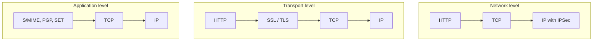
*Fig. 14: Security at the network, transport and application levels.*

1. **SSL/TLS:** sits between HTTP and TCP; the handshake authenticates the server with a certificate and agrees a session key; the record protocol encrypts and adds a MAC to every message.
2. **HTTPS:** HTTP over TLS; encrypts the URL, page contents, form data and cookies; shown by the padlock.
3. **Other controls:** web application firewall, input validation against SQL injection and XSS, secure and HttpOnly cookies, patched servers, strong authentication with MFA, CAPTCHA against bots.

**WWW policy (Internet-use policy): clauses.**
1. The Internet is provided for official work; limited personal use as stated.
2. Prohibited content (pornography, gambling, piracy, hacking tools) is blocked by a proxy.
3. Only licensed software may be downloaded, and all downloads are scanned.
4. Only authorised staff may publish on the organisation's website, after approval; web servers sit in a DMZ and are patched.
5. Confidential data must never be posted on public sites or forums; only HTTPS sites may be used for logins.
6. Browsing is logged and may be monitored.
7. Official statements on social media need approval.
8. Violations lead to disciplinary action.

**Example.** A university result portal uses HTTPS, validates roll-number input to block SQL injection, rate-limits requests against DDoS on result day, and its WWW policy allows only the exam controller's office to upload results.

**Conclusion.** Web security combines technology (TLS, HTTPS, WAF, secure coding) with policy (WWW and web-server policies). Both are needed because the web is the most exposed part of any organisation.
:::

## Q8 Short notes (write any two)

::: ans (i) IT Act 2000

The **Information Technology Act, 2000** is India's main cyber law. It came into force on **17 October 2000** and was based on the UNCITRAL Model Law on Electronic Commerce (1996). It was substantially amended in **2008**.

**Objectives:** legal recognition of electronic records and transactions; legal recognition of digital (electronic) signatures; e-governance; defining cyber crimes and penalties; setting up the Controller of Certifying Authorities (CCA) and certifying authorities; amending the IPC and Evidence Act for electronic evidence.

**Important sections:**
- **S. 43:** unauthorised access, downloading, virus, damage to a computer: compensation.
- **S. 65:** tampering with source code: up to 3 years or Rs 2 lakh fine.
- **S. 66:** hacking (S. 43 acts done dishonestly): up to 3 years or Rs 5 lakh fine.
- **S. 66C:** identity theft; **S. 66D:** cheating by personation (phishing): up to 3 years and Rs 1 lakh.
- **S. 66E:** violation of privacy; **S. 66F:** cyber terrorism: up to life imprisonment.
- **S. 67, 67A, 67B:** obscene, sexually explicit and child sexual abuse material.
- **S. 69, 69A:** interception and blocking by government; **S. 70B:** CERT-In.
- **S. 72:** breach of confidentiality and privacy; **S. 79:** safe harbour for intermediaries.
- **S. 66A** (offensive messages) was struck down by the Supreme Court in *Shreya Singhal v. Union of India* (2015).

**Importance:** made e-commerce and e-governance legally valid and gave India its first law against cyber crime. Data protection is now covered by the DPDP Act 2023.
:::

::: ans (ii) ISO 27001

**ISO/IEC 27001** is the international standard that specifies requirements for establishing, implementing, maintaining and continually improving an **Information Security Management System (ISMS)**. It grew from British Standard **BS 7799** (1995) through ISO 17799; the current version is **ISO/IEC 27001:2022**.

**Structure:** clauses 4–10 (context, leadership, planning with risk assessment, support, operation, performance evaluation with internal audit, improvement) are mandatory. **Annex A** lists **93 controls** in four themes: organisational (37), people (8), physical (14) and technological (34). A **Statement of Applicability** records which controls apply.

**Approach:** the **PDCA cycle**: Plan (scope, policy, risk assessment) → Do (implement controls) → Check (monitor, audit, review) → Act (improve).

**Certification:** an accredited body audits the ISMS; the certificate is valid for three years with yearly surveillance audits.

**Benefits:** systematic risk management, legal compliance, customer trust, fewer incidents and an internationally recognised certificate. Related standards: ISO 27002 (control guidance), ISO 27005 (risk), ISO 27701 (privacy).
:::

::: ans (iii) Copyright law

**Copyright** is the exclusive legal right of the creator of an original literary, dramatic, musical or artistic work, film or sound recording to reproduce and distribute it. In India it is governed by the **Copyright Act, 1957** (amended 1994, 2012).

- **Computer programs are protected as literary works** (since 1994), and so are databases.
- **Rights (S. 14):** reproduce, issue copies, communicate to the public, adapt and translate; for software, also sell or rent copies.
- **Automatic protection:** no registration needed; protects the expression, not the idea.
- **Term:** life of the author + 60 years.
- **Fair dealing (S. 52):** private study, research, criticism, review, news; a backup copy of software.
- **Infringement (S. 63):** imprisonment 6 months to 3 years and fine Rs 50,000 to Rs 2 lakh. **S. 63B:** knowingly using a pirated computer program: 7 days to 3 years.
- **S. 65A:** circumventing technological protection (DRM) is an offence.
- **In cyberspace:** downloading pirated software, films or music and copying website content are infringement; intermediaries must remove infringing content on notice.
:::

::: ans (iv) Software licence

A **software licence** is a legal agreement between the copyright owner and the user that grants permission to use the software under stated conditions, without transferring ownership.

**Types:**
- **Proprietary/commercial (EULA):** paid, closed source, no copying (Windows, MS Office).
- **OEM:** comes with hardware, tied to that machine.
- **Volume/site licence:** many installations for one organisation.
- **Subscription/SaaS:** pay per period (Microsoft 365).
- **Freeware:** free, closed source (Chrome).
- **Shareware/trial:** free for a limited time or with limited features.
- **Open source, copyleft:** source open; derived works must stay open (GNU GPL, Linux).
- **Open source, permissive:** source open; can be used in closed products with credit (MIT, BSD, Apache).
- **Public domain:** no copyright.

**Common terms:** number of users or devices, duration, no reverse engineering, warranty disclaimer, limitation of liability, termination on breach.

**Importance:** using software beyond its licence is piracy and infringes copyright (S. 63B of the Copyright Act). Licence management is part of an organisation's security and compliance policy.
:::
