# Mock Paper 2

**B.Tech (Seventh Semester) Examination 2026-27 · CS-453T · Cyber Security**<br>
**Time: Three Hours · Maximum Marks: 70**<br>
**Note:** Attempt any **five** questions. All questions carry equal marks (14 each).

The core topics again, asked the other ways MJPRU phrases them, plus syllabus lines not yet asked (information system components, security models, threats, XOR and one-time pad, protocols, policy types and review, patents). Write it under a 3-hour timer, then check.

## Question paper

| Q | (a) 7 marks | (b) 7 marks |
|---|---|---|
| 1 | Define information system. Explain its components and functions with a neat diagram. | What is information security? Explain the need for information security and the business needs it serves. |
| 2 | Explain the model for network security and the network access security model. | How many aspects of information security are there? Explain any four with an example. |
| 3 | Define threat, vulnerability and attack. Explain the categories of threats to information security. | Differentiate between passive and active attacks. Explain masquerade, replay and denial of service. |
| 4 | Explain the terminology of cryptography. What is cryptanalysis? Explain the types of cryptanalytic attacks and the security of algorithms. | Differentiate between substitution cipher and transposition cipher with an example. |
| 5 | Explain simple XOR encryption and the one-time pad. Why is the one-time pad called unbreakable? | What is one-way hashing? Describe it with the SHA-1 algorithm. |
| 6 | What is a cryptographic protocol? Explain arbitrated, adjudicated and self-enforcing protocols. | Explain the RSA algorithm. Using p = 17, q = 11 and e = 7, find d and encrypt M = 88. |
| 7 | Explain the types of security policies. Describe the policy development and policy review process. | Explain corporate security policies. Write a sample password policy. |
| 8 | Write short notes on any two: (i) Cyber law (ii) Intellectual property rights (iii) Patent law (iv) 3DES with two keys. | |

---

## Q1 (a) Information system: components and functions

::: ans Answer

**Introduction.** Every organisation runs on information: a college needs marks and attendance, a bank needs balances and transactions. The organised set-up that turns raw data into this information is the information system.

**Definition.** <u>An information system (IS) is an organised combination of people, hardware, software, data, procedures and communication networks that collects, processes, stores and distributes information to support operations, decision-making and control in an organisation.</u>

**Data and information.** Data are raw facts (72, 65, 88); information is processed, meaningful data ("average 75%, first division"). The IS converts one into the other.

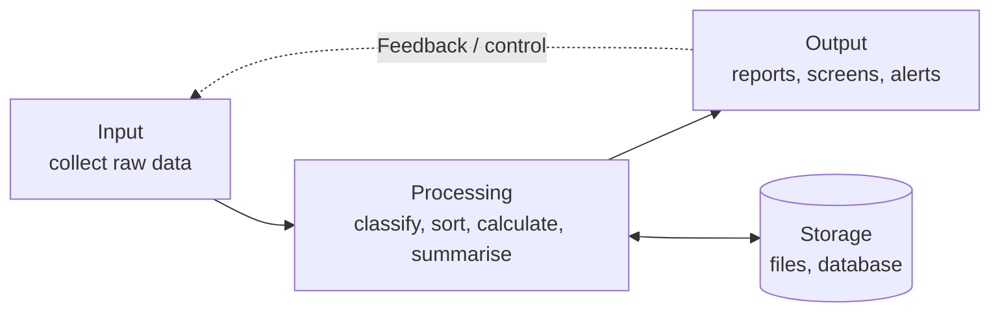
*Fig. 1: Functions of an information system (input–process–output with storage and feedback).*

**Components (Whitman's six).**
1. **People:** users, managers, IT staff, customers. Most important and the weakest link in security (they can be tricked by phishing).
2. **Hardware:** computers, servers, printers, storage, routers. Must be physically protected against theft and damage.
3. **Software:** operating systems, application programs, utilities. Bugs are the most common entry point for attackers, so patching matters.
4. **Data:** facts stored in files and databases; the main asset and the main target of attacks.
5. **Procedures:** written instructions for using the system (for example, how results are approved). If leaked, they help attackers.
6. **Networks:** LAN, WAN and Internet links that connect the parts. They expose the system to the outside world.

**Functions.**
1. **Input:** capturing data from inside and outside (a fee entry, a sales record).
2. **Processing:** converting data into information by classifying, sorting, calculating and summarising.
3. **Output:** giving information to users in reports, screens or alerts.
4. **Storage:** keeping data and information for later use.
5. **Feedback and control:** checking outputs and correcting inputs or processing.

**Qualities of good information:** accurate, timely, complete, relevant, reliable and cost-effective.

**Example.** A college result system: marks are entered (input), totals and grades are calculated (processing), stored in a database (storage), mark-sheets are printed (output), and errors reported by students lead to corrections (feedback).

**Conclusion.** An information system is more than a computer: it is people, technology, data and rules working together. Each component is also a possible point of attack, which is why information security must protect all six.
:::

## Q1 (b) Information security, its need and business needs

::: ans Answer

**Introduction.** Organisations now store their most valuable assets (customer data, money, designs, exam papers) as digital information. Information security exists to protect these assets.

**Definition (CNSS).** <u>Information security is the protection of information and its critical elements, including the systems and hardware that use, store and transmit that information, from unauthorised access, use, disclosure, disruption, modification or destruction, in order to provide confidentiality, integrity and availability.</u>

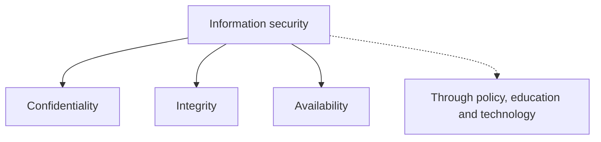
*Fig. 2: Goals of information security.*

**Need for information security.**
1. **Rising threats:** ransomware, phishing, insiders and state-sponsored attacks; CERT-In handles lakhs of incidents every year.
2. **Protecting data:** personal, financial and intellectual data is the main asset.
3. **Business continuity:** a successful attack can stop operations for days.
4. **Financial loss:** fraud, ransom, downtime and recovery costs.
5. **Legal compliance:** the IT Act 2000 and the DPDP Act 2023 require reasonable security; violations bring penalties.
6. **Reputation and trust:** customers leave after a data breach.
7. **Growth of online services:** UPI, e-commerce, e-governance and online exams work only if users trust them.
8. **Mobile and cloud:** data now lives outside the office, beyond physical locks.

**Business needs (Whitman).**
1. **Protecting the functionality of the organisation:** security is a management responsibility; leaders must fund and support it.
2. **Enabling the safe operation of applications:** e-mail, ERP and payment systems must run without interruption.
3. **Protecting data that organisations collect and use:** data at rest, in processing and in transit.
4. **Safeguarding technology assets:** servers, networks, PKI and cloud services must grow securely with the business.

**Example.** An online shopping company needs security so that its website stays up during a sale (availability), card numbers are not stolen (confidentiality), prices cannot be altered (integrity) and it obeys the law (compliance).

**Conclusion.** Information security is a business need, not only a technical one. It protects the organisation's ability to work, its data, its applications and its technology, and so protects its profits and reputation.
:::

## Q2 (a) Model for network security and network access security model

::: ans Answer

**Introduction.** A security model is a simple picture of who communicates, what can go wrong and where protection is placed. Stallings gives two general models: one for protecting a message in transit and one for protecting a system from unwanted access.

**Definition.** <u>An information security model is a framework that describes the parties, assets, threats and protective controls of a system and shows how the security goals are achieved.</u>

### A. Model for network security

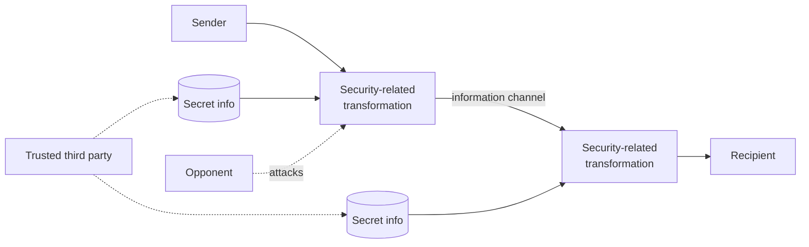
*Fig. 3: Model for network security.*

1. **Principals:** sender and receiver who co-operate to exchange the message.
2. **Information channel:** a logical route through the Internet, using protocols such as TCP/IP.
3. **Security-related transformation:** encryption of the message, and a code based on the contents so the receiver can verify the sender.
4. **Secret information:** a key shared by the principals and unknown to the opponent.
5. **Trusted third party:** distributes secret keys or arbitrates disputes about authenticity.
6. **Opponent:** the attacker who tries to read or alter the message.

**Four basic design tasks:** design the algorithm; generate the secret key; develop methods to distribute and share the key; specify a protocol that uses the algorithm and key to achieve a security service.

### B. Network access security model

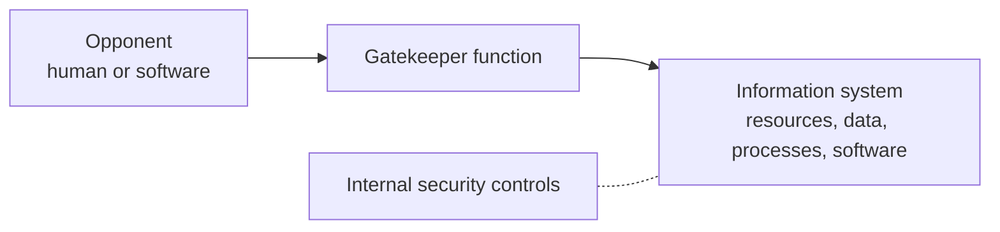
*Fig. 4: Network access security model.*

1. **Opponent:** a human hacker (sometimes just curious, sometimes a criminal or disgruntled employee) or software (virus, worm, Trojan).
2. **Access channel:** network connection, USB, e-mail attachment.
3. **Gatekeeper function:** first line of defence: password login, firewall, malware screening.
4. **Internal security controls:** second line: monitor activity and detect intruders (IDS, audit logs).
5. **Threats:** *information access threats* (reading or changing data) and *service threats* (stopping genuine users).

**Example.** Net banking: TLS protects each transaction (first model), while the bank's login page, firewall and fraud-monitoring system protect its servers (second model).

**Conclusion.** The first model secures data on the move; the second secures the system itself. A complete design needs both.
:::

## Q2 (b) Aspects of information security

::: ans Answer

**Introduction.** The OSI security architecture, ITU-T **X.800**, organises the study of security around three aspects. The question "explain any four with an example" also expects the security goals, so both are given.

**Definition.** <u>According to X.800, there are three aspects of information security: security attacks, security mechanisms and security services.</u>

1. **Security attack:** any action that compromises the security of information owned by an organisation. *Example:* eavesdropping on a Wi-Fi network.
2. **Security mechanism:** a process (or device) designed to detect, prevent or recover from a security attack. *Example:* encryption, digital signature.
3. **Security service:** a processing or communication service that enhances security, counters attacks and uses one or more mechanisms. *Example:* confidentiality, authentication.

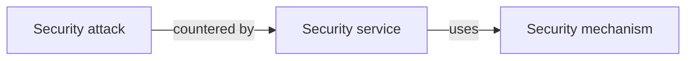
*Fig. 5: The three aspects.*

**Four security goals with examples.**

1. **Confidentiality.** Only authorised persons can read the information. *Example:* only the student and the university can see the student's marks before the result is declared. *Achieved by* encryption and access control.

2. **Integrity.** Information cannot be changed without authorisation. *Example:* nobody can alter a mark from 35 to 75 in the result database. *Achieved by* hashes, MACs, digital signatures and audit logs.

3. **Availability.** Systems and data are accessible when needed. *Example:* the online admit-card portal works in the week before exams. *Achieved by* backups, redundant servers and protection against DoS.

4. **Authenticity (authentication).** The user or source is genuine. *Example:* an OTP sent to the registered mobile number proves the account holder is logging in. *Achieved by* passwords, OTPs, certificates and biometrics.

*Also:* **non-repudiation** (a signed online order cannot be denied by the buyer) and **accountability** (audit logs trace every change to a person).

| Aspect / goal | Example | Tool |
|---|---|---|
| Attack | Eavesdropping, replay | — |
| Mechanism | Encryption, signature | — |
| Service | Confidentiality, authentication | — |
| Confidentiality | Marks hidden before result | Encryption |
| Integrity | Marks cannot be altered | Hash, signature |
| Availability | Portal up before exams | Backups, anti-DoS |
| Authenticity | OTP login | OTP, certificates |

**Conclusion.** Attacks, mechanisms and services are the three aspects of information security; they exist to achieve the security goals of confidentiality, integrity, availability and authenticity.
:::

## Q3 (a) Threats, vulnerabilities, attacks; categories of threats

::: ans Answer

**Introduction.** To protect a system we must know what can harm it. Security people separate the danger (threat), the weakness (vulnerability) and the actual act (attack).

**Definitions.**
- <u>Threat: a potential for violation of security; any circumstance or event that could harm an information asset.</u>
- <u>Vulnerability: a weakness in a system, procedure or control that a threat can exploit.</u>
- <u>Attack: an intentional act that exploits a vulnerability to compromise a system.</u>
- **Exploit:** the technique or code used in an attack. **Risk** = likelihood of a threat exploiting a vulnerability × impact.

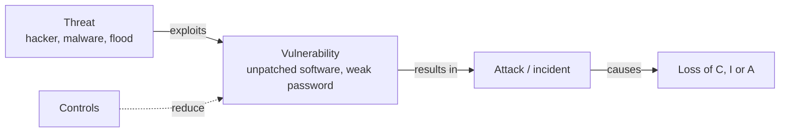
*Fig. 6: Threat, vulnerability and attack.*

**Categories of threats (Whitman & Mattord).**

| Category | Examples |
|---|---|
| 1. Human error or failure | Accidents, mistakes by employees, wrong e-mail recipient |
| 2. Compromises to intellectual property | Piracy, copyright infringement |
| 3. Espionage or trespass | Unauthorised access, hacking, shoulder surfing |
| 4. Information extortion | Ransomware, blackmail over stolen data |
| 5. Sabotage or vandalism | Defacing a website, destroying records |
| 6. Software attacks | Viruses, worms, Trojans, DoS, phishing |
| 7. Technical hardware failures | Disk crash, faulty equipment |
| 8. Technical software failures | Bugs, code problems, untested failures |
| 9. Forces of nature | Fire, flood, earthquake, lightning |
| 10. Deviations in quality of service | Power cuts, ISP or cloud outages |
| 11. Theft | Stolen laptops, phones, data |
| 12. Technological obsolescence | Old, unsupported systems (Windows XP) |

**Common attacks in practice.** Malware (virus, worm, Trojan, ransomware, spyware), phishing and spear-phishing, password attacks (brute force, dictionary), man-in-the-middle, SQL injection, DoS and DDoS, social engineering, zero-day exploits.

**Example.** An unpatched web server (vulnerability) faces a ransomware gang (threat); they use a known exploit to encrypt the database (attack), and the college loses access to results (loss of availability).

**Conclusion.** Threats cannot be removed, but vulnerabilities can be reduced with patches, training and controls. Understanding the categories of threats lets an organisation plan its defences and policies.
:::

## Q3 (b) Passive vs active attacks

::: ans Answer

**Introduction.** X.800 divides security attacks into passive and active attacks according to whether the attacker only observes or also changes the system.

**Definitions.** <u>A passive attack attempts to learn or make use of information from the system but does not affect system resources. An active attack attempts to alter system resources or affect their operation.</u>

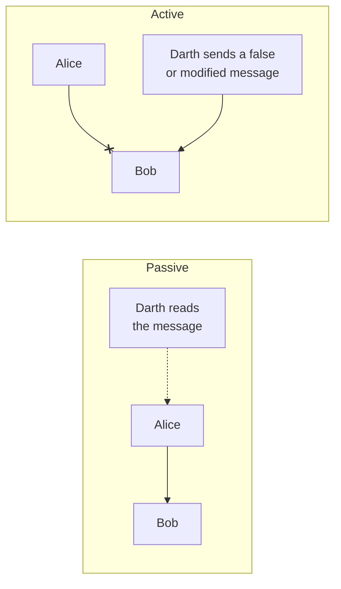
*Fig. 7: Passive attack (reading) vs active attack (changing or faking).*

| Basis | Passive attack | Active attack |
|---|---|---|
| Nature | Eavesdropping, monitoring | Modification, fabrication, interruption |
| Effect on data | None | Data or service changed |
| Goal threatened | Confidentiality | Integrity, authenticity, availability |
| Detection | Very difficult | Comparatively easy |
| Prevention | Possible (encryption) | Difficult; focus on detect and recover |
| Types | Release of message contents, traffic analysis | Masquerade, replay, modification, DoS |
| Example | Reading e-mails on public Wi-Fi | Fake bank site, DDoS |

**Masquerade.** One entity pretends to be a different entity. Usually it includes another active attack: authentication sequences are captured and replayed so that an attacker with few privileges gets extra privileges. *Example:* an attacker logs in to the university ERP with a teacher's stolen password and edits marks. *Defence:* strong authentication, MFA, digital certificates.

**Replay.** Passive capture of a data unit and its retransmission later to produce an unauthorised effect. *Example:* capturing an encrypted "pay Rs 500 to X" message and sending it again, so the payment happens twice, even without reading it. *Defence:* timestamps, sequence numbers, nonces.

**Denial of service (DoS).** Prevents or inhibits normal use of communication facilities: by sending so many requests that the server crashes, or by disrupting a whole network. A **distributed** DoS uses thousands of infected computers (a botnet). *Example:* flooding a result website on result day. *Defence:* firewalls, rate limiting, anti-DDoS services, redundant servers.

(**Modification of messages**, the fourth active attack, alters, delays or reorders a genuine message.)

**Conclusion.** Passive attacks are silent and must be prevented by encryption; active attacks are visible but hard to prevent and must be detected and recovered from. Masquerade, replay and DoS each attack a different goal: authenticity, integrity and availability.
:::

## Q4 (a) Cryptography terminology, cryptanalysis and security of algorithms

::: ans Answer

**Introduction.** Cryptography has been used from Julius Caesar's army to today's UPI apps. Before studying ciphers, we need its vocabulary, and we need to know how ciphers are attacked.

**Definition.** <u>Cryptography is the art and science of keeping messages secure by converting them into an unreadable form that only the intended recipient, holding the key, can convert back.</u>

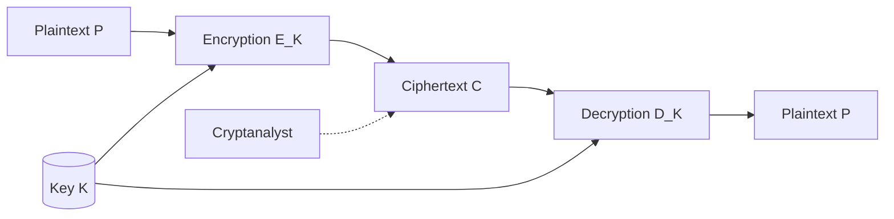
*Fig. 8: Basic model of encryption and decryption.*

**Terminology.**
1. **Plaintext:** the original message. **Ciphertext:** the encrypted message.
2. **Encryption:** C = E<sub>K</sub>(P). **Decryption:** P = D<sub>K</sub>(C), so D<sub>K</sub>(E<sub>K</sub>(P)) = P.
3. **Cipher (algorithm):** the mathematical function used.
4. **Key:** the secret value that controls the cipher; **key space:** all possible keys.
5. **Symmetric** (same key) and **asymmetric** (public/private key) algorithms.
6. **Cryptanalysis:** breaking a cipher without the key; **cryptology** = cryptography + cryptanalysis.
7. **Kerckhoffs's principle:** security must depend only on the secrecy of the key, not the algorithm.

**Cryptanalysis.** <u>The science of recovering plaintext or the key from ciphertext without access to the key.</u> A **brute-force** attack tries every key; on average half the key space must be tried.

**Types of cryptanalytic attacks (Schneier).**
1. **Ciphertext-only:** the attacker has only ciphertexts of several messages.
2. **Known-plaintext:** has some plaintext–ciphertext pairs.
3. **Chosen-plaintext:** can get chosen plaintexts encrypted.
4. **Adaptive chosen-plaintext:** chooses new plaintexts based on earlier results.
5. **Chosen-ciphertext:** can get chosen ciphertexts decrypted.
6. **Chosen-key:** knows relationships between different keys.
7. **Rubber-hose cryptanalysis:** threatens or bribes a person to get the key, often the easiest attack.

**Security of algorithms.**
- **Unconditionally secure:** cannot be broken whatever resources the attacker has; only the one-time pad.
- **Computationally secure:** cannot be broken with available resources in useful time; breaking costs more than the data is worth, or takes longer than the data's useful life.
- **Knudsen's levels of breaking:** total break (key found), global deduction (equivalent algorithm found), instance deduction (one plaintext found), information deduction (partial information).
- **Complexity of an attack:** data needed, processing time and storage.

**Example.** A 56-bit DES key has 2<sup>56</sup> keys and was broken by brute force in 1998; a 128-bit AES key (2<sup>128</sup> keys) is computationally secure.

**Conclusion.** Cryptography gives a common language of plaintext, ciphertext and keys; cryptanalysis tests how strong a cipher is. A good algorithm is computationally secure even against chosen-plaintext attacks.
:::

## Q4 (b) Substitution vs transposition cipher

::: ans Answer

**Introduction.** All classical ciphers are built from two basic techniques: substituting letters and rearranging letters. Modern ciphers such as DES and AES combine both in many rounds.

**Definitions.**
- <u>Substitution cipher: each letter (or group of letters) of the plaintext is replaced by another letter, number or symbol; positions stay, identities change.</u>
- <u>Transposition cipher: the letters of the plaintext are kept but their order is rearranged (permuted); identities stay, positions change.</u>

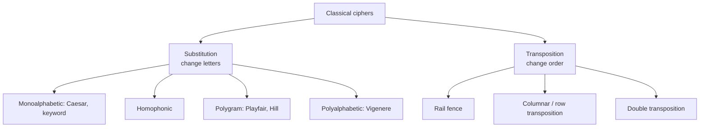
*Fig. 9: Classification of classical ciphers.*

**Example of substitution: Caesar cipher (key 3).** C = (P + 3) mod 26.

| Plain | A T T A C K A T D A W N |
|---|---|
| Cipher | D W W D F N D W G D Z Q |

Decryption: P = (C − 3) mod 26 gives ATTACKATDAWN.

**Example of transposition: rail fence (depth 3).** Write ATTACKATDAWN in a zig-zag on three rails and read row by row:

```text
A . . . C . . . D . . .
. T . A . K . T . A . N
. . T . . . A . . . W .
```
Ciphertext: **ACD TAKTAN TAW** → **ACDTAKTANTAW**.

**Differences.**

| Basis | Substitution | Transposition |
|---|---|---|
| What changes | Letters themselves | Positions of letters |
| Letter frequency | Changed | Same as plaintext |
| Key | Mapping, shift, keyword | Permutation, number of rails, column order |
| Examples | Caesar, Playfair, Vigenère, Hill | Rail fence, columnar, double transposition |
| Attack | Frequency analysis | Anagramming, trying permutations |
| Shannon property | Confusion | Diffusion |
| In DES/AES | S-boxes | P-boxes / permutation |

**Product cipher.** Using substitution and transposition together, for many rounds, gives strong ciphers (DES uses 16 rounds of S-boxes and permutations).

**Conclusion.** Substitution hides the identity of letters, transposition hides their order. Each alone is weak, but together they produce the confusion and diffusion that make modern ciphers secure.
:::

## Q5 (a) Simple XOR and one-time pad

::: ans Answer

**Introduction.** Computers work in bits, so the simplest computer cipher combines message bits with key bits using exclusive-OR (XOR). Used once with a truly random key, the same operation gives the only unbreakable cipher, the one-time pad.

**XOR operation.** 0 ⊕ 0 = 0, 0 ⊕ 1 = 1, 1 ⊕ 0 = 1, 1 ⊕ 1 = 0. Property: (A ⊕ B) ⊕ B = A.

**Simple XOR cipher.** <u>Each plaintext bit is XORed with the corresponding key bit: C = P ⊕ K, and decryption is P = C ⊕ K.</u>

| | H | I |
|---|---|---|
| Plaintext (ASCII) | 01001000 | 01001001 |
| Key | 10110011 | 01101100 |
| Ciphertext | 11111011 | 00100101 |
| Ciphertext ⊕ key | 01001000 = H | 01001001 = I |

**Weakness.** With a short repeating key, simple XOR is easily broken: find the key length (count coincidences when the ciphertext is shifted against itself), then XOR shifted ciphertext with itself to remove the key. Schneier calls it "an embarrassment" as a serious cipher.

**One-time pad (Vernam cipher, Mauborgne, 1917).**
<u>A one-time pad encrypts the message with a key that is truly random, at least as long as the message, and used only once.</u>

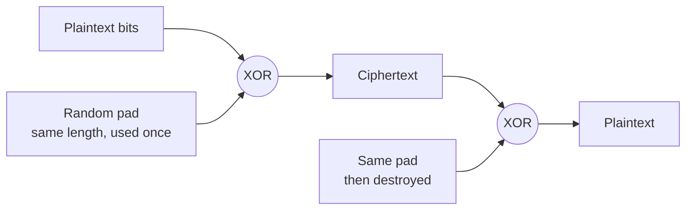
*Fig. 10: One-time pad.*

*Letter example:* HELLO + pad XMCKL (mod 26) = **EQNVZ**. *Bit example:* 1011 ⊕ 0110 = 1101.

**Why it is unbreakable.** Because the key is random and as long as the message, every possible plaintext of that length is equally likely: the ciphertext EQNVZ could come from HELLO with one pad, or from any other five-letter word with another pad. The ciphertext gives no information about the plaintext (Shannon's **perfect secrecy**), so the one-time pad is **unconditionally secure**.

**Conditions (all must hold).** The pad must be truly random, as long as the message, used only once and kept secret by both parties. Reusing a pad lets the attacker XOR two ciphertexts and cancel the key.

**Problems.** Generating large truly random keys; distributing and storing them securely; keys as large as all the traffic.

**Uses.** The Moscow–Washington hotline, diplomatic and military messages.

**Conclusion.** Simple XOR is fast but weak; the one-time pad uses the same operation and is perfectly secure, but its key-management problems limit it to special high-security uses.
:::

## Q5 (b) One-way hashing with SHA-1

::: ans Answer

**Introduction.** A hash function gives a short fixed-length fingerprint of any message. If even one bit of the message changes, the fingerprint changes completely, so hashes are used to check integrity and to make digital signatures efficient.

**Definition.** <u>A one-way hash function H maps a message M of any length to a fixed-length hash value h = H(M); it is easy to compute h from M but computationally infeasible to find M from h, or to find two different messages with the same hash.</u>

**Properties.** Variable input, fixed output; easy to compute; pre-image resistance (one-way); second pre-image resistance (weak collision resistance); collision resistance (strong); avalanche effect.

**SHA-1 (Secure Hash Algorithm 1).** Designed by NSA, published by NIST in FIPS 180-1 (1995). Input up to 2<sup>64</sup> − 1 bits, processed in 512-bit blocks; output **160 bits**.

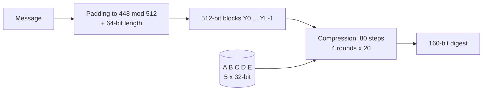
*Fig. 11: SHA-1 processing.*

**Steps.**
1. **Append padding:** a 1 bit followed by 0s so the length ≡ 448 (mod 512).
2. **Append length:** the original length as a 64-bit block; total is a multiple of 512.
3. **Initialise the buffer:** five 32-bit registers A = 67452301, B = EFCDAB89, C = 98BADCFE, D = 10325476, E = C3D2E1F0.
4. **Process each 512-bit block:** the block is expanded into 80 words W<sub>0</sub>…W<sub>79</sub> (W<sub>t</sub> = (W<sub>t−3</sub> ⊕ W<sub>t−8</sub> ⊕ W<sub>t−14</sub> ⊕ W<sub>t−16</sub>) rotated left by 1, for t ≥ 16). There are **4 rounds of 20 steps**; each round uses its own logical function f<sub>t</sub>(B, C, D) and constant K<sub>t</sub>. Each step: TEMP = (A <<< 5) + f<sub>t</sub>(B, C, D) + E + W<sub>t</sub> + K<sub>t</sub>; E = D; D = C; C = B <<< 30; B = A; A = TEMP. After 80 steps the result is added to the input buffer.
5. **Output:** A‖B‖C‖D‖E = 160-bit digest.

**Example.** SHA-1("abc") = a9993e364706816aba3e25717850c26c9cd0d89d.

| | MD5 | SHA-1 |
|---|---|---|
| Digest | 128 bits | 160 bits |
| Registers | 4 | 5 |
| Steps | 64 | 80 |
| Status | Broken (collisions) | Collisions found 2017; use SHA-256 |

**Applications.** Digital signatures (DSA signs the SHA hash), password storage, HMAC for message authentication, file integrity, Git version control.

**Conclusion.** SHA-1 turns any message into a 160-bit fingerprint with the standard pad–length–buffer–compress structure. It is stronger than MD5, and its successor SHA-2 is the hash used in today's systems.
:::

## Q6 (a) Cryptographic protocols

::: ans Answer

**Introduction.** Algorithms alone do not solve real problems; we need agreed steps for using them, such as how two people sign a contract over the Internet. These step sequences are cryptographic protocols.

**Definition.** <u>A protocol is a series of steps, involving two or more parties, designed to accomplish a task. A cryptographic protocol is a protocol that uses cryptography.</u>

**Characteristics.** Everyone involved must know the protocol and all its steps in advance; everyone must agree to follow it; it must be unambiguous; it must be complete (a defined action for every situation).

**Characters (Schneier).** Alice and Bob (the parties), Carol and Dave (more parties), **Eve** (eavesdropper), **Mallory** (active attacker), **Trent** (trusted arbitrator), Victor (verifier).

**1. Arbitrated protocol.**
<u>An arbitrator, a disinterested third party trusted by all, takes part in every execution of the protocol to make sure it is completed fairly.</u>

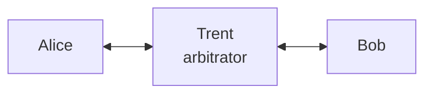
*Fig. 12: Arbitrated protocol.*

*Example:* in buying a car, Alice gives the cheque to a lawyer, Bob gives the title deed to the lawyer, and the lawyer completes the exchange. *Problems on computers:* hard to find a trusted neutral party; delay; the arbitrator becomes a bottleneck and an attractive target; costs money.

**2. Adjudicated protocol.**
<u>The protocol is split into a non-arbitrated sub-protocol, run every time, and an arbitrated sub-protocol, run only when there is a dispute. The special arbitrator is called an adjudicator.</u>

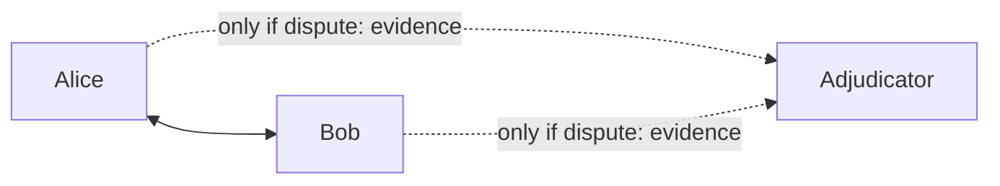
*Fig. 13: Adjudicated protocol.*

*Example:* a signed contract; normally Alice and Bob sign alone, and a judge sees the evidence only if one party claims the other cheated. The adjudicator **detects** cheating after the fact; it does not prevent it. Cheaper and faster than arbitrated protocols.

**3. Self-enforcing protocol.**
<u>The protocol itself guarantees fairness; no arbitrator is needed, because any attempt to cheat is detected immediately by the other party and the protocol stops.</u> This is the best kind, but not every problem has one.

**Comparison.**

| Basis | Arbitrated | Adjudicated | Self-enforcing |
|---|---|---|---|
| Third party | In every run | Only in disputes | None |
| Cheating | Prevented | Detected afterwards | Detected immediately |
| Cost and delay | High | Low | Lowest |

**Attacks on protocols.** Passive (eavesdropping) and active (inserting, deleting, replaying or changing messages); cheaters may be passive (follow the steps but try to learn more) or active.

**Conclusion.** Protocols turn cryptographic algorithms into practical services. Arbitrated protocols rely on a trusted party every time, adjudicated ones only in disputes, and self-enforcing ones not at all.
:::

## Q6 (b) RSA with p = 17, q = 11, e = 7, M = 88

::: ans Answer

**Introduction.** RSA (Rivest, Shamir and Adleman, 1977) is the most widely used public key algorithm. Its security rests on the difficulty of factoring the product of two large primes.

**Definition.** <u>RSA is a public key block cipher in which the plaintext and ciphertext are integers between 0 and n − 1; the public key {e, n} encrypts and the private key {d, n} decrypts.</u>

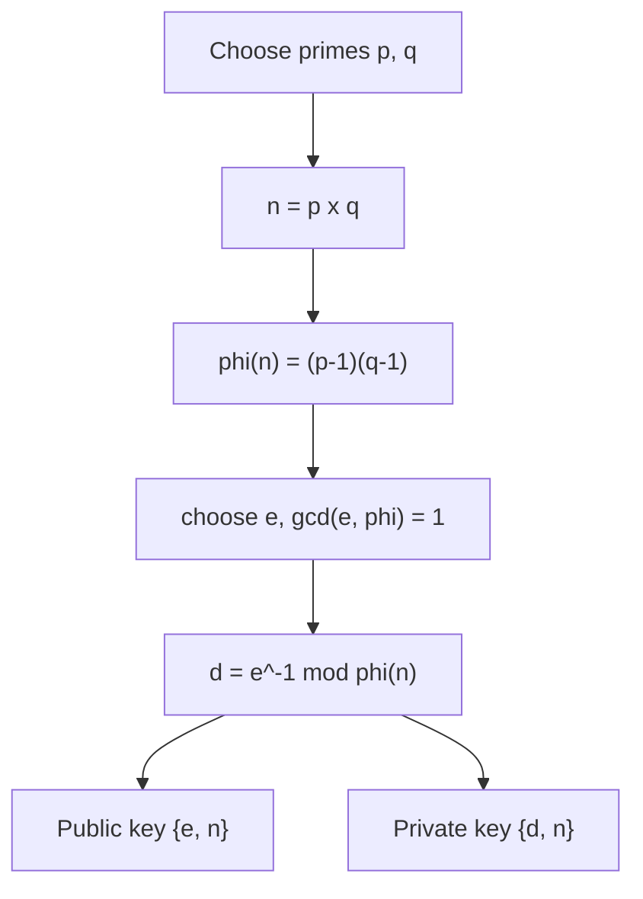
*Fig. 14: RSA key generation.*

**Algorithm.** Key generation as above; encryption **C = M<sup>e</sup> mod n**; decryption **M = C<sup>d</sup> mod n**.

**Solution.**
1. p = 17, q = 11.
2. **n** = 17 × 11 = **187**.
3. **φ(n)** = 16 × 10 = **160**.
4. **e = 7**: gcd(7, 160) = 1, so e is valid.
5. **d**: 7 × d ≡ 1 (mod 160). Try d = 23: 7 × 23 = 161 = 160 + 1. So **d = 23**.
6. Public key **{7, 187}**; private key **{23, 187}**.

**Encryption of M = 88:** C = 88<sup>7</sup> mod 187. Using repeated squaring:
- 88<sup>1</sup> mod 187 = 88
- 88<sup>2</sup> = 7744; 7744 mod 187 = 7744 − 41 × 187 = 7744 − 7667 = **77**
- 88<sup>4</sup> = 77<sup>2</sup> = 5929; 5929 mod 187 = 5929 − 31 × 187 = 5929 − 5797 = **132**
- 88<sup>7</sup> = 88<sup>4</sup> × 88<sup>2</sup> × 88<sup>1</sup> → 132 × 77 × 88 = 894,432; 894,432 mod 187 = **11**

**Ciphertext C = 11.**

**Decryption check:** M = 11<sup>23</sup> mod 187 = **88** ✓ (computed the same way by repeated squaring: 11<sup>2</sup> = 121, 11<sup>4</sup> = 55, 11<sup>8</sup> = 33, 11<sup>16</sup> = 154, and 11<sup>23</sup> = 11<sup>16</sup> × 11<sup>4</sup> × 11<sup>2</sup> × 11 mod 187 = 88).

**Security.** An attacker knows e = 7 and n = 187. To find d he needs φ(n), which needs the factors of n. For n = 187 that is easy (11 × 17), but for a 2048-bit n factoring is infeasible.

**Conclusion.** With p = 17, q = 11 and e = 7, the private exponent is d = 23 and M = 88 encrypts to C = 11, which decrypts back to 88, confirming the working.
:::

## Q7 (a) Types of policies; development and review process

::: ans Answer

**Introduction.** Security policies are the rules of the security programme. They come in levels, from one organisation-wide policy down to rules for single systems, and they must be developed and reviewed in an orderly way to stay useful.

**Definition.** <u>A security policy is a management-approved statement of rules that guide the protection of an organisation's information assets and the behaviour of the people who use them.</u>

**Types of security policy (Whitman).**

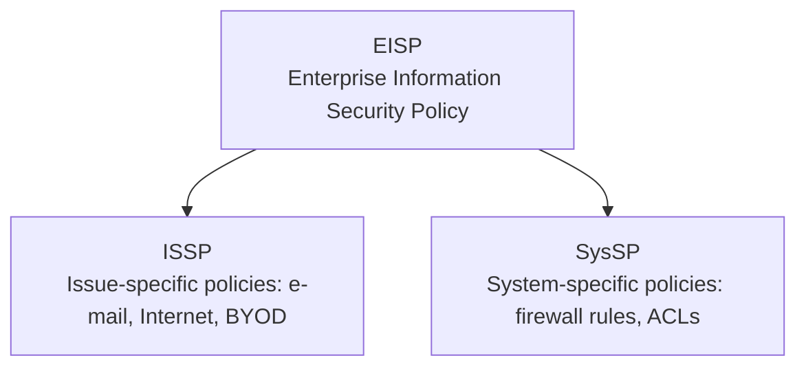
*Fig. 15: Three types of security policy.*

1. **Enterprise Information Security Policy (EISP):** the general, top-level policy, signed by the CEO; sets the strategic direction, scope and tone of all security efforts; assigns responsibilities; references laws.
2. **Issue-Specific Security Policy (ISSP):** addresses one technology or issue (e-mail, Internet use, removable media, social media, BYOD); states acceptable and prohibited use and penalties.
3. **System-Specific Security Policy (SysSP):** rules for configuring and operating one system: managerial guidance (who may access the payroll server) and technical specifications (access-control lists, firewall rule sets).

**Policy development process.**
1. **Identify the need:** risk assessment, legal requirements, incidents.
2. **Form a team:** management, IT security, legal, HR and user representatives.
3. **Draft** the policy with purpose, scope, statements, roles, enforcement.
4. **Review and approve** by management.
5. **Publish and distribute** to all users.
6. **Educate:** awareness sessions; users read and sign.
7. **Enforce and monitor** compliance.
8. **Review and revise** regularly.

**Policy review process.** Whitman: every policy needs a **review schedule**, a **responsible person (policy administrator)** and a **documented review procedure**.
1. Review at least yearly, and after major incidents, audits, legal changes or new technology.
2. The policy administrator collects comments, incident reports and audit findings.
3. Compare the policy with current practice and with standards such as ISO 27001 (gap analysis).
4. Draft changes; consult legal, HR and IT.
5. Management approves the revised version.
6. Maintain version control: version number, date, change log, and a sunset (expiry) date where useful.
7. Communicate the changes, retrain users and collect fresh acknowledgements.

**Conclusion.** The EISP sets direction, ISSPs control specific issues and SysSPs configure specific systems. A structured development and regular review keep all three current, enforceable and legally sound.
:::

## Q7 (b) Corporate policies and a sample password policy

::: ans Answer

**Introduction.** A corporate security programme is a set of related policies that together cover people, technology and processes across the whole organisation.

**Definition.** <u>Corporate security policies are the organisation-wide policies, approved by top management, that apply to all employees, contractors and systems and together define how the organisation protects its information.</u>

**Main corporate policies.**

| Policy | Key content |
|---|---|
| Information security policy (EISP) | Purpose, scope, roles, compliance |
| Acceptable use policy | Permitted and forbidden use of IT resources |
| Password and access control | Password rules, MFA, least privilege |
| E-mail and Internet (WWW) | Acceptable use, attachments, monitoring |
| Data classification and handling | Public / internal / confidential / secret |
| Remote access and BYOD | VPN, device encryption, MDM |
| Backup and disaster recovery | Frequency, off-site copies, restore tests |
| Incident response | Report, contain, eradicate, recover, learn; report to CERT-In within 6 hours |
| Physical security | ID cards, server-room access, CCTV |
| Third-party and vendor | NDAs, contract clauses, audits |
| Clean desk / clear screen | Lock screens, no papers left out |

**Structure of any sample policy.** Purpose · scope · policy statements · roles and responsibilities · enforcement · definitions · review and version history.


*Fig. 16: Sections of a sample policy.*

**Sample: Password Policy, ABC Institute of Technology (Version 1.0).**
1. **Purpose:** to protect institute accounts and data by defining standards for creating and protecting passwords.
2. **Scope:** all staff, students and contractors who have an account on any institute system.
3. **Policy statements:**
   - Passwords must be at least 12 characters, with upper-case and lower-case letters, digits and symbols.
   - Passwords must not contain the user name, name, date of birth or roll number.
   - The last 5 passwords may not be reused.
   - Multi-factor authentication is mandatory for e-mail, ERP and administrator accounts.
   - Passwords must never be shared, e-mailed or written down; the IT cell will never ask for a password.
   - Passwords must be changed immediately if a compromise is suspected.
   - Accounts are locked after 5 consecutive failed login attempts.
   - Default passwords on new devices must be changed before use.
4. **Responsibilities:** users keep passwords secret; the IT cell enforces the rules technically and audits them; HR covers this policy at induction.
5. **Enforcement:** violation may lead to disciplinary action, including suspension of access.
6. **Review:** reviewed annually by the IT security officer.

**Conclusion.** Corporate policies together cover every area of risk, and every policy follows the same structure. The password policy shows how a short, clear, enforceable policy protects the most common target of attackers: user accounts.
:::

## Q8 Short notes (write any two)

::: ans (i) Cyber law

**Cyber law** is the body of law dealing with legal issues of cyberspace: the use of computers, the Internet, electronic records and digital communication.

**Need:** older laws did not recognise electronic records, digital signatures or offences such as hacking; e-commerce and e-governance needed legal validity; cross-border crimes needed new rules.

**Areas:** cyber crimes; e-commerce and electronic contracts; electronic records and digital signatures; data protection and privacy; intellectual property in cyberspace (software piracy, domain names); intermediary liability; jurisdiction.

**Types of cyber crime:** against individuals (cyber stalking, identity theft, phishing, harassment); against property (hacking, virus attacks, credit-card fraud, IP theft); against organisations and government (DoS, data theft, cyber terrorism); against society (obscenity, online gambling, fake news).

**Indian cyber law:** the **IT Act 2000** (amended 2008) is the main law: S. 43 (damage to computers), S. 66 (hacking), 66C (identity theft), 66D (phishing), 66F (cyber terrorism), 67 (obscenity), 72 (breach of confidentiality). Related: the Copyright Act 1957, the DPDP Act 2023 (personal data) and the Bharatiya Nyaya Sanhita for general crimes. **CERT-In** is the national agency for cyber incidents.

**Importance:** gives legal validity to online transactions, punishes cyber criminals and protects citizens' rights online.
:::

::: ans (ii) Intellectual property rights

**Intellectual property** is the creation of the human mind: inventions, literary and artistic works, designs, symbols and names. **IPR** are the legal rights that give the creator exclusive control over its use for a limited time. International basis: WIPO, the Berne and Paris Conventions and the WTO's TRIPS agreement (1995).

| Type | Protects | Indian law | Term |
|---|---|---|---|
| Copyright | Literary and artistic works, software | Copyright Act 1957 | Life + 60 years |
| Patent | Inventions | Patents Act 1970 | 20 years |
| Trademark | Brand names, logos | Trade Marks Act 1999 | 10 years, renewable |
| Industrial design | Shape and look of products | Designs Act 2000 | 10 + 5 years |
| Geographical indication | Products tied to a place (Darjeeling tea) | GI Act 1999 | 10 years, renewable |
| Trade secret | Confidential business information | Contracts and NDAs | While secret |

**IPR issues in cyberspace:** software piracy, copying web content, cybersquatting (registering a famous name as a domain), illegal file sharing, plagiarism.

**Importance:** rewards creators and inventors, encourages innovation and investment, and protects brands and software.
:::

::: ans (iii) Patent law

A **patent** is an exclusive right granted by the government to an inventor to make, use, sell or import an invention for a limited period, in return for publicly disclosing how it works. In India it is governed by the **Patents Act, 1970** (amended 1999, 2002, 2005).

- **Term:** **20 years** from the date of filing; annual renewal fees.
- **Criteria for patentability:** (1) **novelty** (new, not published before), (2) **inventive step** (not obvious to an expert), (3) **industrial applicability**.
- **Not patentable (Section 3):** discoveries, laws of nature, **mathematical or business methods, computer programs per se and algorithms (S. 3(k))**, methods of agriculture and medical treatment.
- **Software:** a computer program by itself cannot be patented in India; a computer-related invention with a technical effect on hardware may be patented. Software code itself is protected by copyright.
- **Process:** application at the Indian Patent Office → publication after 18 months → request for examination → objections and reply → grant.
- **Rights and infringement:** the patentee can sue infringers for an injunction and damages; compulsory licensing is possible in public interest.

**Difference from copyright:** a patent protects the idea of an invention (must be registered, 20 years); copyright protects the expression (automatic, life + 60 years).
:::

::: ans (iv) 3DES with two keys

**DES** (Data Encryption Standard, 1977) uses a 56-bit key, which can now be broken by brute force. **Double DES** is weak against the meet-in-the-middle attack. **Triple DES (3DES) with two keys**, proposed by Tuchman, uses three DES operations with two keys K1 and K2 in an **Encrypt–Decrypt–Encrypt (EDE)** sequence:

**C = E<sub>K1</sub>( D<sub>K2</sub>( E<sub>K1</sub>(P) ) )** and **P = D<sub>K1</sub>( E<sub>K2</sub>( D<sub>K1</sub>(C) ) )**


- **Key length:** 2 × 56 = **112 bits**; brute force needs about 2<sup>112</sup> operations.
- **Why decrypt in the middle:** if K1 = K2, 3DES reduces to single DES, so it can talk to old single-DES systems (backward compatibility).
- **Standards:** ANSI X9.17 and ISO 8732 (banking key management).
- **Three-key 3DES:** C = E<sub>K3</sub>(D<sub>K2</sub>(E<sub>K1</sub>(P))), 168-bit key; used in PGP and S/MIME.
- **Drawbacks:** three times slower than DES; 64-bit block size; now replaced by AES (NIST deprecated 3DES).
:::
