# Mock Paper 3

**B.Tech (Seventh Semester) Examination 2026-27 · CS-453T · Cyber Security**<br>
**Time: Three Hours · Maximum Marks: 70**<br>
**Note:** Attempt any **five** questions. All questions carry equal marks (14 each).

This paper covers the rest of the syllabus: critical characteristics and the McCumber cube, X.800 mechanisms in depth, classical ciphers one by one, Diffie–Hellman, the requirements of digital signatures, watermarking techniques, HMAC, SSL/TLS, PGP, ISO standards and the IT Act offences. After Mocks 1 and 2, this one closes the remaining gaps.

## Question paper

| Q | (a) 7 marks | (b) 7 marks |
|---|---|---|
| 1 | Explain the critical characteristics of information. Explain the McCumber cube. | What is cyber security? Explain its domains and the common cyber threats. |
| 2 | Explain the specific and pervasive security mechanisms of X.800 and their relation to security services. | What are information security techniques? Explain them briefly. |
| 3 | Explain the Caesar, monoalphabetic, homophonic and Vigenère ciphers with examples. | Explain rail fence and columnar transposition ciphers with examples. |
| 4 | Compare symmetric and asymmetric cryptography. Explain Diffie–Hellman key exchange with an example. | What are the requirements of a digital signature? Explain direct and arbitrated digital signatures. |
| 5 | Explain digital watermarking techniques and attacks on watermarks. How is watermarking different from steganography? | Give the applications of hash functions. Explain MAC, HMAC and the birthday attack. |
| 6 | Explain SSL/TLS and HTTPS for web security. | Explain e-mail security with PGP. |
| 7 | Explain ISO 27001 and other information security standards. | Explain the offences and penalties under the IT Act 2000. |
| 8 | Write short notes on any two: (i) DPDP Act 2023 (ii) Trademarks and domain-name disputes (iii) Acceptable use policy (iv) Unconditional vs computational security. | |

---

## Q1 (a) Critical characteristics of information; McCumber cube

::: ans Answer

**Introduction.** The CIA triad is the base of security, but Whitman and Mattord argue it is too simple for today's threats. They list seven critical characteristics of information, and the CNSS (McCumber) cube shows how to protect them.

**Definition.** <u>The critical characteristics of information are the qualities that give information its value to the organisation: availability, accuracy, authenticity, confidentiality, integrity, utility and possession. When any of them changes, the value of the information changes.</u>

**The seven characteristics (Whitman).**
1. **Availability:** authorised users can access the information without interference, in the required format. *Example:* library catalogue open to registered members.
2. **Accuracy:** free from mistakes and has the value the user expects. *Example:* a bank balance that a teller wrongly adjusts is inaccurate.
3. **Authenticity:** genuine and original, not a fabrication. *Example:* an e-mail truly from the sender shown (spoofing destroys authenticity).
4. **Confidentiality:** protected from disclosure to unauthorised persons. *Example:* employee salary data.
5. **Integrity:** whole, complete and uncorrupted. *Example:* a file whose hash matches the published value.
6. **Utility:** useful for a purpose; data in a format the user cannot use has no utility. *Example:* census figures given only as raw numbers to a manager who needs trends.
7. **Possession:** ownership or control; a breach of possession does not always breach confidentiality. *Example:* a stolen encrypted disk: possession is lost, confidentiality is not.

**McCumber cube (CNSS security model, 1991).**

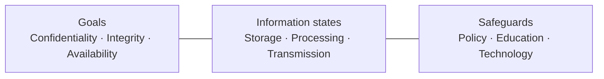
*Fig. 1: The three dimensions of the McCumber cube (drawn in the exam as a 3×3×3 cube).*

- Three dimensions, each with three parts: **3 × 3 × 3 = 27 cells**.
- Each cell is one area that must be covered. *Example:* Policy + Confidentiality + Transmission = "customer data must be encrypted when e-mailed". *Example:* Technology + Integrity + Storage = a host intrusion-detection system that alerts when stored files change.
- **Use:** a checklist to find gaps in a security programme.
- **Limitation:** says what to cover, not how; ignores governance and people's roles.

**Conclusion.** The seven characteristics define what makes information valuable, and the McCumber cube makes sure every characteristic is protected in every state with every kind of safeguard.
:::

## Q1 (b) Cyber security: domains and common threats

::: ans Answer

**Introduction.** India has hundreds of millions of Internet users and the world's largest real-time payment system (UPI). Everything from Aadhaar to online exams now runs in cyberspace, which makes cyber security a national need.

**Definition.** <u>Cyber security is the practice of protecting computers, servers, mobile devices, networks, programs and data from digital attacks, unauthorised access, damage or disruption.</u>

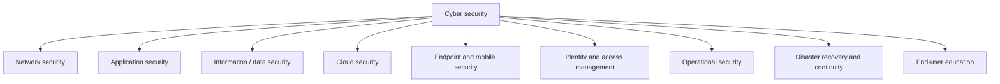
*Fig. 2: Domains of cyber security.*

**Domains.**
1. **Network security:** firewalls, IDS/IPS, VPN, segmentation.
2. **Application security:** secure coding, testing, WAF; stopping SQL injection and XSS.
3. **Data security:** encryption, backups, data loss prevention.
4. **Cloud security:** configuration, access control and encryption in AWS, Azure and others.
5. **Endpoint and mobile security:** antivirus, device encryption, mobile device management.
6. **Identity and access management:** passwords, MFA, single sign-on, least privilege.
7. **Operational security:** processes for handling and protecting data assets.
8. **Disaster recovery and business continuity:** restoring operations after an incident.
9. **End-user education:** the human firewall: training against phishing.

**Common cyber threats.**
1. **Malware:** viruses (attach to files), worms (spread by themselves), Trojans (look harmless), ransomware (encrypts data for ransom), spyware and keyloggers.
2. **Phishing and social engineering:** fake e-mails, SMS (smishing), calls (vishing) that trick users into revealing passwords or OTPs.
3. **Man-in-the-middle:** intercepting traffic on insecure Wi-Fi.
4. **Denial of service / DDoS:** flooding a service until it fails.
5. **SQL injection and cross-site scripting:** attacking web applications.
6. **Password attacks:** brute force, dictionary, credential stuffing.
7. **Insider threats:** employees misusing access.
8. **Zero-day exploits:** attacks on unknown, unpatched flaws.
9. **Advanced persistent threats:** long, targeted campaigns, often state-sponsored.

**Example.** The 2017 WannaCry ransomware worm spread through an unpatched Windows flaw and hit hospitals and companies worldwide; patching (application security) and backups (disaster recovery) were the defences.

**Conclusion.** Cyber security spans many domains because attackers use many routes. Technology, processes and trained people must work together to keep systems confidential, intact and available.
:::

## Q2 (a) X.800 security mechanisms and their relation to services

::: ans Answer

**Introduction.** X.800 separates the protection a user receives (services) from the techniques that provide it (mechanisms). This answer focuses on the mechanisms.

**Definition.** <u>A security mechanism is a process, or a device incorporating such a process, designed to detect, prevent or recover from a security attack.</u> No single mechanism provides every service, but most rely on cryptographic techniques.

**A. Specific security mechanisms** (built into a particular protocol layer):
1. **Encipherment:** using mathematical algorithms to transform data into an unintelligible form; reversal needs the algorithm and keys.
2. **Digital signature:** data appended to, or a transformation of, a data unit that lets the recipient prove its source and integrity and protects against forgery.
3. **Access control:** mechanisms that enforce access rights to resources.
4. **Data integrity:** mechanisms that assure the integrity of a data unit or stream (check values, hash, MAC, sequence numbers).
5. **Authentication exchange:** ensuring the identity of an entity by exchanging information (password, challenge–response).
6. **Traffic padding:** inserting bits into gaps in a data stream to frustrate traffic analysis.
7. **Routing control:** selecting physically secure routes; changing routes when a breach is suspected.
8. **Notarization:** using a trusted third party to assure properties of a data exchange.

**B. Pervasive security mechanisms** (not specific to any layer or service):
1. **Trusted functionality:** perceived to be correct with respect to the security policy.
2. **Security label:** marking a resource with its security attributes (for example "Secret").
3. **Event detection:** detecting security-relevant events.
4. **Security audit trail:** data collected for an independent review of records and activities.
5. **Security recovery:** handling requests from mechanisms and taking recovery actions.

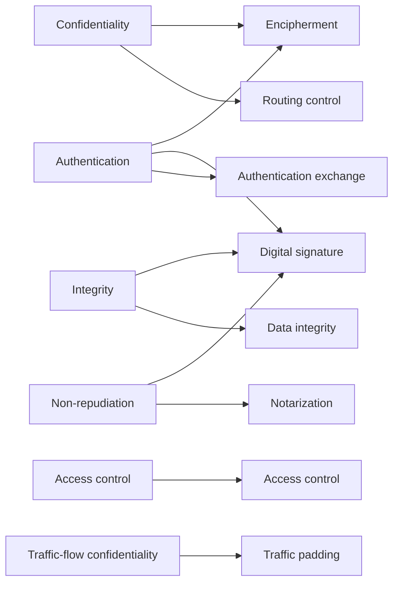
*Fig. 3: Which mechanisms implement which services.*

| Service | Mechanisms |
|---|---|
| Peer-entity authentication | Encipherment, digital signature, authentication exchange |
| Data-origin authentication | Encipherment, digital signature |
| Access control | Access control |
| Confidentiality | Encipherment, routing control |
| Traffic-flow confidentiality | Encipherment, traffic padding, routing control |
| Data integrity | Encipherment, digital signature, data integrity |
| Non-repudiation | Digital signature, data integrity, notarization |
| Availability | Data integrity, authentication exchange |

**Example.** When a student downloads a signed PDF mark-sheet from DigiLocker: encipherment (TLS) gives confidentiality, the digital signature gives data-origin authentication and integrity, and the signed record gives non-repudiation.

**Conclusion.** Mechanisms are the building blocks; services are the result. The X.800 table tells a designer exactly which mechanisms to combine for each required service.
:::

## Q2 (b) Information security techniques

::: ans Answer

**Introduction.** "Information security techniques" is the first line of Unit 3. It means the set of methods used in practice to provide the security services.

**Definition.** <u>Information security techniques are the technical, procedural and physical methods used to protect information and information systems so as to provide confidentiality, integrity, availability, authentication and non-repudiation.</u>

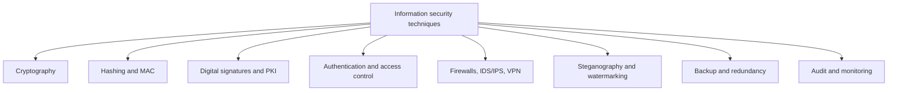
*Fig. 4: Families of information security techniques.*

1. **Cryptography (encryption):** symmetric (AES, DES, 3DES) and asymmetric (RSA, ECC) ciphers for **confidentiality**.
2. **Hash functions and MACs:** MD5, SHA-1, SHA-256, HMAC for **integrity** and message authentication.
3. **Digital signatures and PKI:** RSA and DSA signatures with certificates issued by certifying authorities, for **authentication and non-repudiation**.
4. **Authentication:** something you know (password, PIN), have (OTP, smart card) and are (fingerprint, face); multi-factor authentication.
5. **Access control:** discretionary (owner decides), mandatory (labels, as in the military), role-based (by job role); least privilege.
6. **Network security devices:** firewalls (packet filter, stateful, application gateway), IDS/IPS, VPNs, DMZ.
7. **Steganography and watermarking:** hiding information inside images or audio; marking ownership.
8. **Backup, redundancy and disaster recovery:** RAID, off-site backups, standby sites for **availability**.
9. **Audit, logging and monitoring:** audit trails and SIEM for **accountability** and detection.
10. **Antivirus and patch management:** against malware and known vulnerabilities.
11. **Physical security:** locks, guards, CCTV, biometric doors.

**Example.** A bank uses all of them: TLS encryption, hashed PINs, signed transactions, OTP authentication, role-based access for staff, firewalls, CCTV in the data centre and daily backups.

**Conclusion.** No single technique is enough. Defence in depth layers many techniques so that if one fails, another still protects the information.
:::

## Q3 (a) Caesar, monoalphabetic, homophonic and Vigenère ciphers

::: ans Answer

**Introduction.** Substitution ciphers replace letters with other letters. They range from the very simple Caesar cipher to the polyalphabetic Vigenère cipher, each designed to defeat the attacks that broke the one before.

**Definition.** <u>A substitution cipher replaces each plaintext character, or group of characters, with another character according to a key.</u>

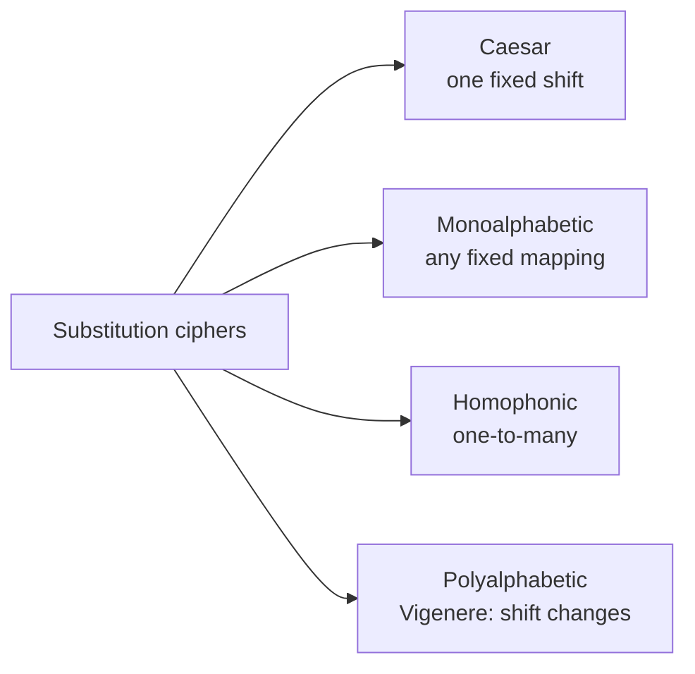
*Fig. 5: Types of substitution cipher.*

**1. Caesar (additive) cipher.** Each letter is shifted by a fixed key k. C = (P + k) mod 26; P = (C − k) mod 26.
*Example (k = 3):* HELLO → **KHOOR**; ATTACKATDAWN → **DWWDFNDWGDZQ**.
*Weakness:* only 25 keys; brute force breaks it instantly. ROT13 is Caesar with k = 13.

**2. Monoalphabetic (simple) substitution.** Each letter maps to a fixed but arbitrary other letter, for example via a keyword alphabet:

```text
Plain : A B C D E F G H I J K L M N O P Q R S T U V W X Y Z
Cipher: K E Y W O R D A B C F G H I J L M N P Q S T U V X Z
```
(keyword KEYWORD, then the rest of the alphabet). *Example:* FACE → **RKYO**.
*Key space:* 26! ≈ 4 × 10<sup>26</sup>. *Weakness:* **frequency analysis**: E, T, A, O, I, N are the commonest English letters, and their cipher equivalents stand out.

**3. Homophonic substitution.** Each plaintext letter can map to several cipher symbols, the number of symbols proportional to the letter's frequency (E gets many, Z gets one). *Example:* E → 17, 54 or 82 chosen at random. This flattens single-letter frequencies, but digraph statistics still help the cryptanalyst.

**4. Vigenère (polyalphabetic) cipher.** A keyword is repeated over the plaintext; each key letter gives a different Caesar shift. C<sub>i</sub> = (P<sub>i</sub> + K<sub>i</sub>) mod 26.

| Plain | A T T A C K A T D A W N |
|---|---|
| Key | L E M O N L E M O N L E |
| Cipher | L X F O P V E F R N H R |

**Ciphertext: LXFOPVEFRNHR.** The same plaintext letter (A) becomes L, O, E, N: frequency analysis on single letters fails. *Weakness:* the key repeats; the Kasiski test finds the key length, after which each column is a Caesar cipher.

**Comparison.**

| Cipher | Key space | Main attack |
|---|---|---|
| Caesar | 25 | Brute force |
| Monoalphabetic | 26! | Frequency analysis |
| Homophonic | Very large | Digraph statistics |
| Vigenère | 26<sup>m</sup> | Kasiski test + frequency analysis |

**Conclusion.** Each substitution cipher fixes a weakness of the previous one, but all leak statistical patterns. Only when the key is random and as long as the message (one-time pad) does substitution become unbreakable.
:::

## Q3 (b) Rail fence and columnar transposition

::: ans Answer

**Introduction.** Transposition ciphers do not change letters; they shuffle their positions. Because the letter frequencies stay exactly as in English, a cryptanalyst can recognise a transposition cipher, but must still find the permutation.

**Definition.** <u>A transposition cipher produces the ciphertext by applying a permutation to the positions of the plaintext letters.</u>

**1. Rail fence cipher.** The plaintext is written diagonally down and up on a number of "rails" and read off row by row.

*Example (depth 2):* MEETMEAFTERTHEPARTY

```text
M . E . M . A . T . R . H . P . R . Y
. E . T . E . F . E . T . E . A . T .
```
Ciphertext: **MEMATRHPRY ETEFETEAT** → **MEMATRHPRYETEFETEAT**.

*Decryption:* count the letters per rail (10 and 9), write them back on the rails and read diagonally. *Weakness:* the only key is the depth, which is easy to guess.

**2. Columnar (row) transposition.** Write the plaintext in rows under a numeric key; read the columns in the order of the key numbers.

*Example:* key **4 3 1 2 5 6 7**, plaintext **ATTACK POSTPONED UNTIL TWO AM** (padded with X):

```text
Key:   4 3 1 2 5 6 7
       A T T A C K P
       O S T P O N E
       D U N T I L T
       W O A M X X X
```

| Column order | Column | Letters |
|---|---|---|
| 1 | 3rd | T T N A |
| 2 | 4th | A P T M |
| 3 | 2nd | T S U O |
| 4 | 1st | A O D W |
| 5 | 5th | C O I X |
| 6 | 6th | K N L X |
| 7 | 7th | P E T X |

**Ciphertext: TTNAAPTMTSUOAODWCOIXKNLXPETX.**

*Decryption:* the receiver knows the key and the column length (28 / 7 = 4), fills the columns in key order and reads row by row.

**3. Double transposition.** Apply columnar transposition twice (with the same or another key). The result is far more scrambled and much harder to break; it was used in both World Wars.

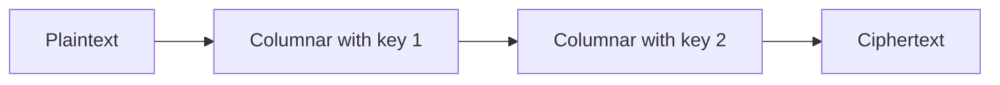
*Fig. 6: Double transposition.*

**Properties.** Letter frequencies unchanged; attacked by anagramming and by trying column orders. In modern ciphers, permutation (P-boxes) gives Shannon's **diffusion**.

**Conclusion.** Rail fence and columnar transposition hide the order of letters, not their identity. Alone they are weak, but repeated (double transposition) or combined with substitution they become strong.
:::

## Q4 (a) Symmetric vs asymmetric; Diffie–Hellman key exchange

::: ans Answer

**Introduction.** Symmetric ciphers are fast but need a shared secret key; public key methods solve the key-sharing problem. Diffie–Hellman (1976) was the first public key method: it lets two people agree on a secret key over an open channel.

**Comparison.**

| Basis | Symmetric (secret key) | Asymmetric (public key) |
|---|---|---|
| Keys | One shared key | Public + private key pair |
| Speed | Fast, suits bulk data | Slow, suits small data and keys |
| Key distribution | Must be shared secretly | Public key can be published |
| Keys for n users | n(n − 1)/2 | 2n |
| Services | Confidentiality | Confidentiality, signatures, key exchange |
| Examples | DES, 3DES, AES | RSA, Diffie–Hellman, DSA, ECC |

In practice both are combined: public key methods exchange a session key; the session key encrypts the data (hybrid encryption, as in TLS).

**Diffie–Hellman key exchange.** <u>A method by which two parties, without any prior shared secret, jointly compute a shared secret key over an insecure channel; its security rests on the difficulty of computing discrete logarithms.</u>

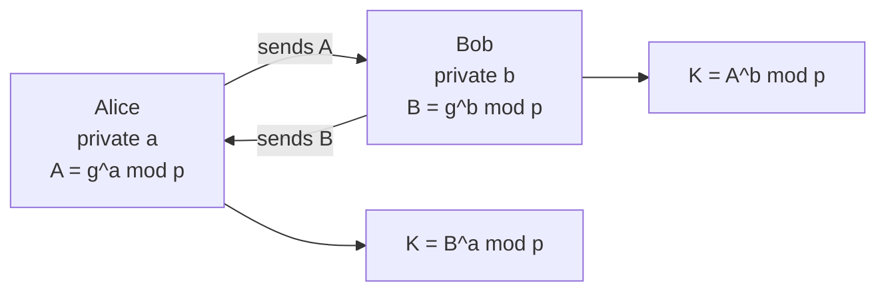
*Fig. 7: Diffie–Hellman key exchange.*

**Steps.**
1. Public values: a prime **p** and a primitive root **g** of p.
2. Alice chooses a private **a** and sends **A = g<sup>a</sup> mod p**.
3. Bob chooses a private **b** and sends **B = g<sup>b</sup> mod p**.
4. Alice computes **K = B<sup>a</sup> mod p**; Bob computes **K = A<sup>b</sup> mod p**. Both equal g<sup>ab</sup> mod p.

**Example.** p = 23, g = 5, a = 4, b = 3.
- A = 5<sup>4</sup> mod 23 = 625 mod 23 = **4**.
- B = 5<sup>3</sup> mod 23 = 125 mod 23 = **10**.
- Alice: K = 10<sup>4</sup> mod 23 = 10000 mod 23 = **18**.
- Bob: K = 4<sup>3</sup> mod 23 = 64 mod 23 = **18**. ✓ Shared key = 18.

An eavesdropper sees p, g, A = 4 and B = 10 but must solve a discrete logarithm to find a or b.

**Weakness.** Man-in-the-middle: Mallory can run separate exchanges with Alice and Bob. The fix is to authenticate the exchanged values with digital signatures or certificates.

**Conclusion.** Symmetric and asymmetric cryptography complement each other. Diffie–Hellman shows the power of public key ideas: a secret key agreed in public, used then by a fast symmetric cipher.
:::

## Q4 (b) Requirements of digital signatures; direct and arbitrated signatures

::: ans Answer

**Introduction.** Message authentication protects two parties from a third party, but not from each other: the receiver could forge a message, or the sender could deny sending one. Digital signatures solve this.

**Definition.** <u>A digital signature is a bit pattern, computed from the message and the signer's private key, that can be verified by anyone with the signer's public key, proving who signed the message and that it has not changed.</u>

**Properties.** It must verify the author and the date and time of the signature; authenticate the contents at the time of signing; and be verifiable by third parties to resolve disputes.

**Requirements (Stallings).**
1. The signature must be a bit pattern that **depends on the message** being signed.
2. It must use information **unique to the sender**, to prevent forgery and denial.
3. It must be **relatively easy to produce**.
4. It must be **relatively easy to recognise and verify**.
5. It must be **computationally infeasible to forge**, either by building a new message for an existing signature or a fraudulent signature for a given message.
6. It must be **practical to retain a copy** of the signature in storage.

**Direct digital signature.**
<u>Involves only the communicating parties: the sender signs the message (or its hash) with his private key; the receiver verifies with the sender's public key.</u>

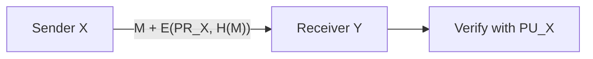
*Fig. 8: Direct digital signature.*

Confidentiality can be added by encrypting the message and signature with the receiver's public key or a shared key. *Weakness:* validity depends on the security of the sender's private key; a sender can falsely claim the key was stolen; timestamps help but do not fully solve this.

**Arbitrated digital signature.**
<u>Every signed message from X to Y goes first to a trusted arbiter A, who checks its origin and content, dates it, and sends it to Y with an indication that it has been verified.</u>

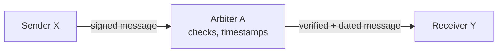
*Fig. 9: Arbitrated digital signature.*

*Advantages:* solves the "my key was stolen" problem; disputes are settled by the arbiter's records. *Disadvantages:* the arbiter must be fully trusted; the arbiter is a bottleneck and adds delay.

**Comparison.**

| Basis | Direct | Arbitrated |
|---|---|---|
| Parties | Sender and receiver only | Sender, arbiter, receiver |
| Trust | In the sender's private key | In the arbiter |
| Disputes | Hard if the key is "lost" | Settled by the arbiter |
| Speed | Faster | Slower |

**Standard schemes:** RSA signature (sign the hash with the private exponent d) and DSA (NIST DSS).

**Conclusion.** A digital signature must be tied to the message and to the signer, easy to make and check, and impossible to forge. Direct signatures are simple; arbitrated signatures add a trusted third party for stronger dispute resolution.
:::

## Q5 (a) Watermarking techniques, attacks, and steganography

::: ans Answer

**Introduction.** A watermark is useful only if it is embedded well and survives attempts to remove it. This answer covers how watermarks are embedded, how they are attacked, and how watermarking differs from steganography.

**Definition.** <u>Digital watermarking embeds a hidden or visible mark (logo, text, ID) into digital content in a way that can later be detected or extracted, to prove ownership, trace copies or detect tampering.</u>

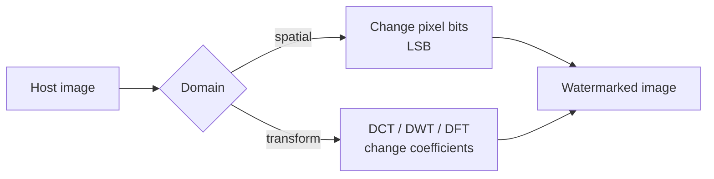
*Fig. 10: Spatial-domain and transform-domain embedding.*

**Techniques.**
1. **LSB (least significant bit) substitution:** replace the last bit of each pixel with a watermark bit. Changing pixel 10110110 to 10110111 is invisible. Simple and high capacity, but fragile: compression or noise destroys it.
2. **Patchwork:** choose random pairs of pixels using a key; raise one and lower the other slightly; the statistical difference reveals the mark.
3. **DCT domain:** split the image into 8×8 blocks, take the discrete cosine transform and modify mid-frequency coefficients. Survives JPEG compression.
4. **DWT domain:** embed in wavelet sub-bands; robust and fits human visual sensitivity.
5. **Spread spectrum:** spread the watermark signal over many frequencies at low power, as in radio communication; very robust.
6. **Visible watermark:** blend a semi-transparent logo into the image.

**Attacks on watermarks.**
1. **Removal attacks:** denoising, filtering, lossy compression, averaging several copies (collusion).
2. **Geometric attacks:** rotation, scaling, cropping, which desynchronise the detector.
3. **Cryptographic attacks:** brute-force search for the key; oracle attacks using a public detector.
4. **Protocol attacks:** inserting the attacker's own watermark to claim ownership (ambiguity / inversion attack); copy attack.

**Watermarking vs steganography.**

| Basis | Watermarking | Steganography |
|---|---|---|
| Purpose | Protect the cover (ownership, authenticity) | Hide a secret message inside the cover |
| What matters | The cover content | The hidden message |
| Secrecy of existence | Not required (can be visible) | Essential |
| Robustness | Must survive attacks | Less important |
| Capacity | Small | Large |
| Example | TV channel logo, film fingerprint | Secret text hidden in a holiday photo |

**Conclusion.** Spatial techniques are simple but fragile; transform-domain and spread-spectrum techniques survive attacks. Watermarking protects the cover, while steganography protects a secret hidden inside it.
:::

## Q5 (b) Applications of hash functions; MAC, HMAC and birthday attack

::: ans Answer

**Introduction.** Hash functions are among the most used tools in security, because a short fixed-length digest can stand in for a whole message.

**Definition.** <u>A cryptographic hash function maps a message of any length to a fixed-length digest; it is one-way and collision-resistant.</u>

**Applications.**
1. **Message integrity:** the receiver recomputes the hash and compares.
2. **Digital signatures:** the hash, not the long message, is signed (RSA, DSA).
3. **Password storage:** the system stores H(password + salt), never the password.
4. **File and software integrity:** download sites publish SHA-256 values.
5. **Message authentication codes (HMAC).**
6. **Intrusion detection:** tools like Tripwire store file hashes and alert on change.
7. **Pseudo-random number generation and key derivation.**
8. **Blockchain:** each block holds the hash of the previous block.

**MAC (message authentication code).** <u>A MAC is a short fixed-size block computed from the message and a secret key shared by sender and receiver: MAC = C(K, M).</u>

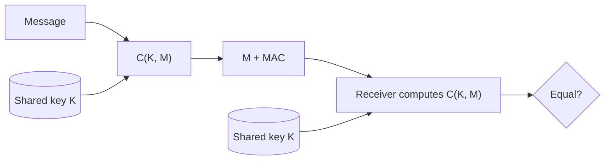
*Fig. 11: Message authentication with a MAC.*

A MAC gives **integrity** and **authentication** (only a key holder could compute it), but not non-repudiation, because both parties share the key.

**HMAC.** A MAC built from a hash function (RFC 2104), used in TLS and IPSec:

**HMAC(K, M) = H[ (K<sup>+</sup> ⊕ opad) ‖ H[ (K<sup>+</sup> ⊕ ipad) ‖ M ] ]**

where K<sup>+</sup> is the key padded to the block size, ipad = 00110110 repeated, opad = 01011100 repeated. It works with any hash (HMAC-SHA-256) and is as strong as the hash.

**Birthday attack.** The birthday paradox: in a group of only **23** people, the chance that two share a birthday is over 50%. Similarly, for an n-bit hash, an attacker finds two messages with the same hash after only about **2<sup>n/2</sup>** tries, not 2<sup>n</sup>.
- A 64-bit hash falls in about 2<sup>32</sup> tries (easy); MD5 (128-bit) in about 2<sup>64</sup>; SHA-256 needs 2<sup>128</sup> (safe).
- *Attack:* prepare many harmless variations of a contract and many fraudulent ones; find a pair with the same hash; get the victim to sign the harmless one; the signature is valid for the fraudulent one too.
- *Defence:* use long hashes (256 bits or more).

**Conclusion.** Hash functions underpin integrity, signatures and passwords; MACs and HMAC add a secret key for authentication; and the birthday attack is why hash outputs must be long.
:::

## Q6 (a) SSL/TLS and HTTPS

::: ans Answer

**Introduction.** Web traffic crosses many networks between browser and server. SSL (Secure Sockets Layer, Netscape) and its successor TLS (Transport Layer Security, IETF) secure this traffic and are the base of HTTPS.

**Definition.** <u>SSL/TLS is a protocol layered between the transport layer (TCP) and applications such as HTTP, which provides confidentiality, integrity and server (optionally client) authentication for data exchanged between two applications.</u>

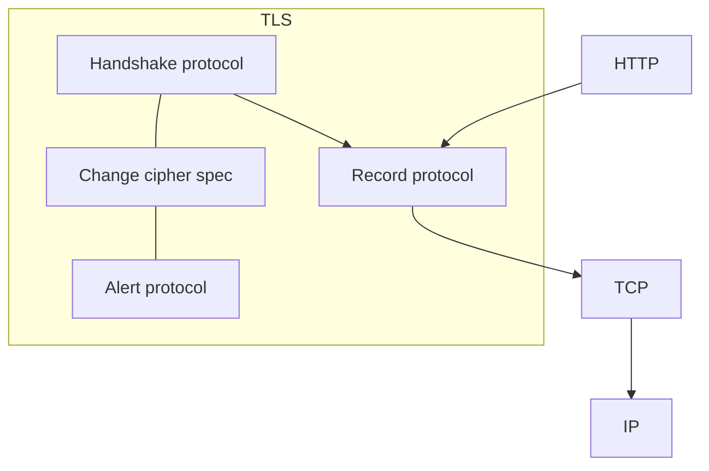
*Fig. 12: SSL/TLS protocol stack.*

**Two important concepts.** A **connection** is a transient peer-to-peer link; a **session** is an association created by the handshake that defines the security parameters shared by many connections.

**1. Record protocol** (confidentiality and integrity for every message):
fragment the data (≤ 16 KB) → optional compression → add a **MAC** → **encrypt** (AES, 3DES, ChaCha20) → add a record header.

**2. Handshake protocol** (agrees algorithms and keys, authenticates the server):
- *Phase 1:* client_hello and server_hello: version, random numbers, session ID, cipher suites.
- *Phase 2:* server sends its **certificate** (and key-exchange parameters); server_hello_done.
- *Phase 3:* client verifies the certificate, sends the key exchange (pre-master secret encrypted with the server's public key, or Diffie–Hellman values); optional client certificate.
- *Phase 4:* change_cipher_spec and finished messages; secure communication begins.

**3. Change cipher spec protocol:** one message that switches to the newly agreed algorithms.

**4. Alert protocol:** warnings and fatal errors (bad certificate, decryption failure).

**HTTPS.** HTTP over TLS, port 443. Encrypts the requested URL, page contents, form data, cookies and HTTP headers. The browser shows a padlock; clicking it shows the certificate issued by a certifying authority.

**Security provided:** confidentiality (encryption), integrity (MAC), server authentication (certificate), protection against eavesdropping and man-in-the-middle attacks.

**Example.** On a net-banking login page, TLS ensures the password is encrypted and the certificate proves the site is the real bank, not a phishing copy.

**Conclusion.** SSL/TLS secures the web at the transport level with a handshake for keys and authentication and a record protocol for every message; HTTPS is simply HTTP carried over it.
:::

## Q6 (b) E-mail security with PGP

::: ans Answer

**Introduction.** Ordinary e-mail travels as plain text through many servers, where it can be read, changed or forged. Pretty Good Privacy (PGP), created by Phil Zimmermann in 1991, adds encryption and signatures to e-mail.

**Definition.** <u>PGP is an e-mail and file security scheme that provides authentication, confidentiality, compression, e-mail compatibility and segmentation, using the best available public key and symmetric algorithms.</u>

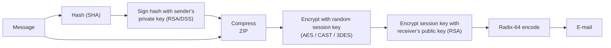
*Fig. 13: PGP sending process (signature, compression, encryption, encoding).*

**PGP services.**

| Service | Algorithms | How it works |
|---|---|---|
| **Authentication** (digital signature) | SHA + RSA or DSS | Sender hashes the message and signs the hash with his private key; receiver verifies with the sender's public key |
| **Confidentiality** | CAST-128 / IDEA / 3DES / AES + RSA or ElGamal | Message encrypted with a one-time session key; session key encrypted with the receiver's public key |
| **Compression** | ZIP | Applied after signing and before encryption: saves space and makes cryptanalysis harder |
| **E-mail compatibility** | Radix-64 | Converts binary output to printable ASCII so mail systems carry it |
| **Segmentation** | — | Splits long messages to fit mail-size limits |

**Order of operations.** Sign → compress → encrypt → radix-64 encode. Signing before compression lets the signature be stored with the uncompressed message.

**Keys and trust.** Each user keeps a **private-key ring** (own key pairs, encrypted with a passphrase) and a **public-key ring** (others' public keys). PGP uses a **web of trust**: users sign each other's keys instead of relying on a central certifying authority.

**Other e-mail security:** S/MIME (uses X.509 certificates from CAs), and SPF, DKIM and DMARC to stop sender spoofing.

**Example.** A professor sends a question paper with PGP: it is signed (the exam cell knows it is genuine and unchanged), encrypted with the exam cell's public key (nobody else can read it), compressed and encoded for e-mail.

**Conclusion.** PGP gives e-mail the same protection as a sealed, signed letter: confidentiality through hybrid encryption and authentication through digital signatures, made practical by compression and radix-64 encoding.
:::

## Q7 (a) ISO 27001 and other standards

::: ans Answer

**Introduction.** Organisations need a common, recognised way to manage security and to prove to customers and regulators that they do it well. International standards provide this, ISO/IEC 27001 above all.

**Definition.** <u>An information security standard is an agreed, documented set of requirements and best practices, issued by a recognised body, for protecting information. ISO/IEC 27001 specifies the requirements for an Information Security Management System (ISMS) and is the basis of certification.</u>

**ISO/IEC 27001.**
- **ISMS:** a systematic approach of policies, processes, people and technology to manage information risk.
- **History:** BS 7799 (1995) → ISO/IEC 17799 (2000) → ISO/IEC 27001:2005 → 2013 → **2022** (current).
- **Clauses 4–10:** context, leadership, planning (risk assessment and treatment), support, operation, performance evaluation (monitoring, internal audit, management review), improvement.
- **Annex A (2022):** **93 controls** in four themes: organisational (37), people (8), physical (14), technological (34).
- **Statement of Applicability** and **risk treatment plan** are key documents.
- **Certification:** stage 1 and stage 2 audits by an accredited body; valid 3 years with annual surveillance audits.

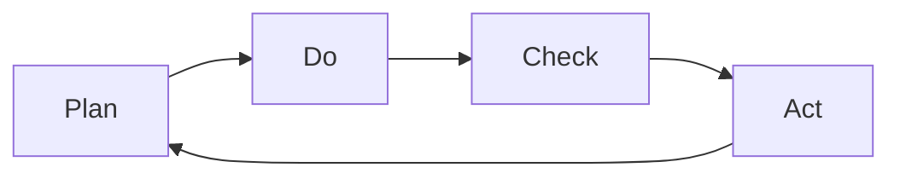
*Fig. 14: PDCA cycle of the ISMS.*

**ISO 27000 family.** 27000 (vocabulary), 27002 (controls guidance), 27003 (implementation guidance), 27004 (measurement), 27005 (risk management), 27017 (cloud), 27018 (personal data in cloud), 27035 (incident management), 27701 (privacy).

**Other standards and frameworks.**

| Standard | Purpose |
|---|---|
| ISO/IEC 15408 (Common Criteria) | Evaluating security of IT products (EAL 1–7) |
| ISO 22301 | Business continuity management |
| NIST Cybersecurity Framework 2.0 | Govern, Identify, Protect, Detect, Respond, Recover |
| PCI DSS | Security of payment-card data |
| COBIT | IT governance and control |
| ITIL | IT service management |
| GDPR (EU) / DPDP Act 2023 (India) | Personal-data protection laws |

**Benefits of standards.** A common language; a systematic, risk-based approach; legal and contractual compliance; customer and partner trust; benchmark for audits; continual improvement.

**Conclusion.** ISO 27001 is the global benchmark for managing information security, built on risk assessment and the PDCA cycle, and supported by the 27000 family and other frameworks for specific areas.
:::

## Q7 (b) Offences and penalties under the IT Act 2000

::: ans Answer

**Introduction.** The Information Technology Act, 2000 (in force from 17 October 2000, amended in 2008) gave India legal tools against cyber crime. Chapter IX deals with penalties and compensation; Chapter XI with offences.

**Definition.** <u>A cyber offence under the IT Act is an act involving a computer, computer system or network that the Act declares punishable with imprisonment and/or fine, while civil contraventions attract compensation to the victim.</u>

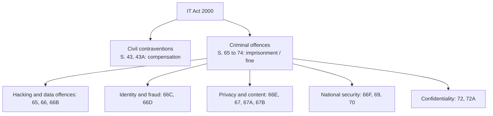
*Fig. 15: Structure of penalties and offences.*

| Section | Offence | Punishment |
|---|---|---|
| 43 | Unauthorised access, downloading, virus, damage, DoS | Compensation to the person affected |
| 43A | Failure of a company to protect sensitive personal data | Compensation (being replaced by the DPDP Act 2023) |
| 65 | Tampering with computer source documents | Up to 3 years or Rs 2 lakh, or both |
| 66 | Computer-related offences (S. 43 acts done dishonestly) | Up to 3 years or Rs 5 lakh, or both |
| 66B | Dishonestly receiving a stolen computer or device | Up to 3 years or Rs 1 lakh, or both |
| 66C | Identity theft (passwords, electronic signatures) | Up to 3 years and up to Rs 1 lakh |
| 66D | Cheating by personation using a computer (phishing) | Up to 3 years and up to Rs 1 lakh |
| 66E | Violation of privacy (capturing or publishing private images) | Up to 3 years or Rs 2 lakh, or both |
| 66F | Cyber terrorism | Up to life imprisonment |
| 67 | Publishing obscene material | 3 years + Rs 5 lakh (first); 5 years + Rs 10 lakh (repeat) |
| 67A | Sexually explicit material | 5 years + Rs 10 lakh (first); 7 years (repeat) |
| 67B | Child sexual abuse material | 5 years + Rs 10 lakh (first); 7 years (repeat) |
| 70 | Unauthorised access to a protected system | Up to 10 years and fine |
| 72 | Breach of confidentiality and privacy | Up to 2 years or Rs 1 lakh, or both |
| 72A | Disclosure in breach of lawful contract | Up to 3 years or Rs 5 lakh, or both |

**Important points.**
- **Section 66A** (offensive messages) was **struck down** as unconstitutional in *Shreya Singhal v. Union of India* (2015).
- **Section 77B:** offences punishable with three years or more are cognisable; most others are bailable.
- **Section 78:** an inspector-rank police officer can investigate.
- **Section 79:** intermediaries (ISPs, social media) are not liable if they follow due diligence and remove unlawful content on notice.
- **Adjudication:** adjudicating officers decide compensation; appeals go to TDSAT (formerly the Cyber Appellate Tribunal) and then the High Court.

**Example.** A fraudster who sends fake bank SMS links and empties accounts commits identity theft (S. 66C) and cheating by personation (S. 66D), and is liable to compensate victims under S. 43.

**Conclusion.** The IT Act provides compensation for civil wrongs and imprisonment for cyber crimes from hacking to cyber terrorism, making it the backbone of cyber law in India.
:::

## Q8 Short notes (write any two)

::: ans (i) DPDP Act 2023

The **Digital Personal Data Protection Act, 2023** is India's first comprehensive data-protection law, passed in August 2023 after the Supreme Court recognised privacy as a fundamental right (*K.S. Puttaswamy*, 2017). Its Rules were notified in 2025 and are coming into force in phases.

- **Applies to** digital personal data processed in India, and to processing outside India for offering goods or services to people in India.
- **Data principal:** the person the data is about. **Data fiduciary:** the organisation that decides why and how data is processed. **Significant data fiduciaries** have extra duties (data protection officer, audits).
- **Consent:** free, specific, informed and unambiguous; can be withdrawn; managed through consent managers.
- **Duties of fiduciaries:** purpose limitation, accuracy, reasonable security safeguards, breach notification to the Board and affected persons, deletion when no longer needed, verifiable parental consent for children's data.
- **Rights of data principals:** access, correction and erasure, grievance redressal, nominating another person.
- **Data Protection Board of India** handles complaints and imposes penalties **up to Rs 250 crore** per breach.
- It replaces Section 43A of the IT Act on data protection.
:::

::: ans (ii) Trademarks and domain-name disputes

A **trademark** is a mark (word, logo, symbol, shape, sound or colour combination) that distinguishes the goods or services of one business from others. In India: the **Trade Marks Act, 1999**. Registration lasts **10 years** and can be renewed indefinitely; ™ marks a claimed mark and ® a registered one.

- **Infringement:** using an identical or deceptively similar mark for similar goods; **passing off** protects even unregistered marks.
- **Domain names** act as online trademarks. **Cybersquatting** is registering a domain identical or similar to a famous trademark in bad faith, to sell it or misuse its reputation (typosquatting uses misspellings).
- **Remedies:** the **UDRP** (Uniform Domain-Name Dispute-Resolution Policy) of ICANN and, for .in domains, the **INDRP** run by NIXI. The complainant must show the domain is identical or confusingly similar to its mark, the holder has no legitimate interest, and it was registered and used in bad faith.
- **Indian case:** *Satyam Infoway v. Sifynet Solutions* (2004): the Supreme Court held that domain names are protected like trademarks.
:::

::: ans (iii) Acceptable use policy

An **acceptable use policy (AUP)** is an issue-specific policy that tells users what they may and may not do with the organisation's IT resources (computers, network, Internet, e-mail, software). Users usually sign it before getting an account.

**Typical sections:**
1. **Purpose and scope:** all users and all IT resources.
2. **Acceptable use:** official work; limited personal use if allowed.
3. **Prohibited use:** illegal activities, hacking or scanning, installing unlicensed software, accessing offensive content, sharing passwords, using resources for private business, sending spam, bypassing security controls.
4. **Security duties:** lock screens, report incidents, keep antivirus updated, use only approved storage.
5. **Privacy:** activity may be logged and monitored.
6. **Enforcement:** violations lead to loss of access and disciplinary or legal action.
7. **Acknowledgement:** the user signs to accept the policy.

**Importance:** sets clear expectations, reduces misuse and gives a legal basis for action. Example: a college AUP forbids using the campus Wi-Fi for torrent downloads and allows the IT cell to block offending devices.
:::

::: ans (iv) Unconditional vs computational security

**Unconditionally secure:** a cipher is unconditionally secure if the ciphertext does not contain enough information to determine the plaintext, **no matter how much ciphertext and computing power** the attacker has. Shannon proved this needs a key at least as long as the message, truly random and used once: only the **one-time pad** qualifies (**perfect secrecy**).

**Computationally secure:** a cipher is computationally secure if (1) the cost of breaking it exceeds the value of the encrypted information, or (2) the time required exceeds the useful lifetime of the information. Practically: no known attack faster than brute force, and a key space too large to search. *Examples:* AES-128 (2<sup>128</sup> keys), RSA-2048.

| Basis | Unconditional | Computational |
|---|---|---|
| Attacker's power | Unlimited | Limited, realistic |
| Key length | ≥ message length | Short, fixed (128–256 bits) |
| Example | One-time pad | AES, RSA |
| Practical? | Rarely (key distribution) | Yes, used everywhere |

**Note:** computational security can weaken over time as computers get faster (DES's 56-bit key fell in 1998) or new attacks appear (quantum computers threaten RSA).
:::
