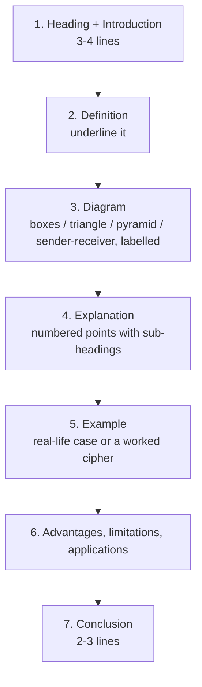
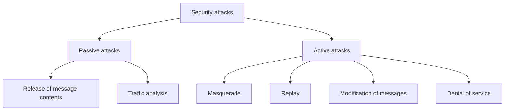

# How to write an MJPRU answer

MJPRU examiners mark long answers by **length, structure and a diagram**. A 14-mark question (two 7-mark parts) is expected to fill **4–5 pages** of the answer sheet, with **at least one diagram**. Cyber Security is a theory subject, so the diagram is what separates a 4/7 answer from a 6/7 answer: a CIA triangle, a pyramid of information systems, a sender–receiver block diagram or a 5×5 Playfair square all count. Every mock answer on this site follows the template below.

## The template for a long answer (7-mark part ≈ 2–2.5 pages)

1. **Introduction (3–4 lines).** Where the topic sits and why it matters (for example, "With online banking and UPI, protecting information has become essential…").
2. **Definition.** One crisp sentence, underlined. Use the book wording where possible (X.800, Stallings, Whitman), because examiners look for it.
3. **Diagram.** Draw it early, in pencil, with every box labelled and a caption ("Fig. 1: CIA triad").
4. **Explanation in numbered points.** Use sub-headings (i), (ii), (iii). One idea per point. 8–12 points for a 7-mark part.
5. **Example.** A real Indian example (UPI, Aadhaar, IRCTC, a college result portal) or a worked cipher. Examiners reward concrete examples.
6. **Advantages / limitations / applications** (3–4 each) where they fit.
7. **Conclusion (2–3 lines)** restating the main point.

## "How many types…?" questions

Three 2025-26 questions began "How many types/aspects…". Start with the number in the first line, then a tree diagram, then one sub-heading per type:

*Fig.: The tree-diagram opening for a "how many types" question.*

## For cipher and RSA questions

- Write the **rule or formula first**, then the **working in a table**, then the **final ciphertext in a box**.
- Playfair: draw the 5×5 square, list the digraphs, write the rule used for each pair.
- RSA: write the five steps (choose p, q → n → φ(n) → e → d), then encryption C = Me mod n and decryption M = Cd mod n, and **verify** that decryption gives back M.
- Always decrypt back to show your answer is correct. It takes one minute and proves the working.

## Short notes (Q8: any two)

A short note is half a 14-mark question, so **7 marks, about 1.5–2 pages each**: definition, 5–6 key points (sections, penalties, dates for laws), one example, one line on importance. Write the year and section numbers for the IT Act (2000, amended 2008; Section 43, 66, 66C, 66D, 67, 72); they look precise and score well.

## Time plan (3 hours, 5 questions)

| Activity | Time |
|---|---|
| Reading the paper and choosing 5 questions | 5 min |
| Each 14-mark question (2 parts) | 33 min |
| Revision and underlining | 10 min |

::: tip Choosing questions
Pick the questions you have rehearsed from the mocks first: CIA model, X.800, hashing, RSA, DSA. Then the full 14-mark single-topic question if you have a ready answer (watermarking in 2025-26). Leave the short notes for last; they are quick to write once the long answers are done.
:::

::: warn Common ways students lose marks
- No diagram in a long answer.
- One long paragraph instead of points with headings.
- Answering "how many types" without saying the number.
- RSA with arithmetic mistakes and no check by decryption.
- Mixing up services and mechanisms in X.800 (services are what you get; mechanisms are how).
- Writing (a) and (b) together without labelling the parts.
:::
