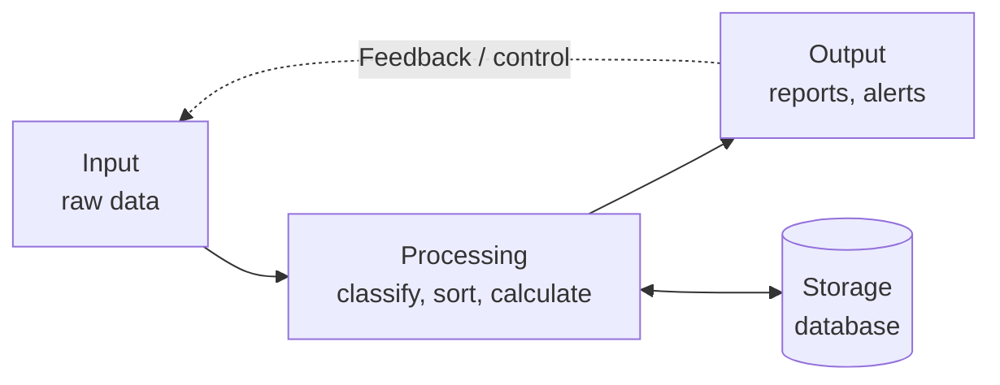
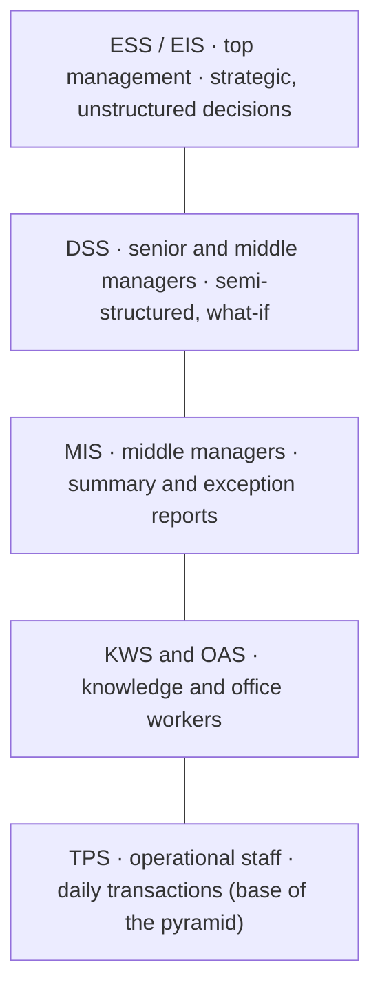
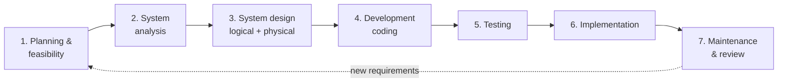
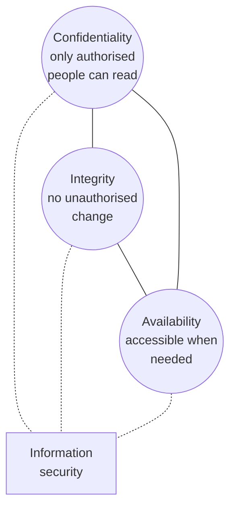

# Unit 1 · Information Systems and Information Security

> **Exam weight:** 3 parts of the 2025-26 end-sem (21 marks) and 2 of the 4 Mid-1 questions. "What is cyber security? Explain the CIA model" was asked in both Mid-1 and the end-sem, word for word.

**Prefer to watch first?** [Video lectures for Unit 1 →](#videos/unit1)

Based on the class notes and Mid-1 notes, which follow Whitman & Mattord (*Principles of Information Security*) and Stallings.

## 1.1 Introduction to information system

**Definition.** <u>An Information System (IS) is an organised combination of people, hardware, software, data, procedures and communication networks that collects, processes, stores and distributes information to support operations, decision-making and control in an organisation.</u>

**Data vs information.** Data is raw facts (72, 65, 88). Information is processed, meaningful data ("Average 75%, First Division"). Data → Processing → Information → Decision.

### Six components of an IS (Whitman)

| Component | What it is | Security angle |
|---|---|---|
| **People** | Users, managers, IT staff | The weakest link: phishing, mistakes, insiders |
| **Hardware** | Computers, servers, routers, phones | Theft and damage: needs physical security |
| **Software** | OS, applications, utilities | Bugs are the most common entry point: patching |
| **Data** | Files and databases | The main asset and main target: encryption, backup |
| **Procedures** | Written rules for using the system | If leaked, attackers learn how to misuse it |
| **Networks** | LAN, WAN, Internet | Opens the system to the world: firewalls, VPN |

### Functions: input → processing → output, with storage and feedback

*Fig. 1.1: Input–process–output model of an information system.*

**Qualities of useful information:** accurate, timely, complete, relevant, reliable/verifiable, cost-effective.

## 1.2 Types of information system  ⭐⭐ (End-sem 2025-26 Q1a)

Information systems are classified by the **level of management** they serve. There are **six main types** (Laudon & Laudon): TPS, OAS, KWS, MIS, DSS, ESS; Expert Systems are often added as a seventh.

*Fig. 1.2: Pyramid of information systems (top = fewest users, most summarised information).*

1. **Transaction Processing System (TPS).** Records routine daily transactions: sales, payments, bookings, payroll. Fast, accurate, high volume, fixed rules. Batch (monthly payroll) or online/real-time (ATM). *Examples:* IRCTC booking, supermarket billing, ATM. All other systems take their data from the TPS.
2. **Office Automation System (OAS).** Helps office workers with documents, e-mail, scheduling, video meetings. *Examples:* MS Office, Google Workspace.
3. **Knowledge Work System (KWS).** Helps engineers, designers, scientists create new knowledge; needs powerful graphics and computation. *Example:* AutoCAD, simulation software.
4. **Management Information System (MIS).** Takes TPS data and produces scheduled **summary** and **exception** reports for middle managers to plan and control. Structured decisions. *Example:* monthly sales report by region; attendance-shortage list.
5. **Decision Support System (DSS).** Interactive system for **semi-structured** decisions. Parts: database, model base, user interface. Supports **what-if** analysis. *Example:* "What happens to profit if we cut the price by 10%?"
6. **Executive Support System (ESS / EIS).** Dashboards, graphs and external data for top management's **strategic, unstructured** decisions; drill-down. *Example:* a CEO dashboard of all branches.
7. **Expert System (ES).** AI program that copies a human expert: knowledge base (IF–THEN rules) + inference engine + explanation facility. *Example:* MYCIN medical diagnosis; fraud detection.

| Type | Level | Decision | Output | Example |
|---|---|---|---|---|
| TPS | Operational | Structured | Detailed records, receipts | ATM, IRCTC |
| OAS | Clerical | — | Documents, mail | MS Office |
| KWS | Knowledge | — | Designs, models | AutoCAD |
| MIS | Middle management | Structured | Summary/exception reports | Monthly sales report |
| DSS | Middle/senior | Semi-structured | What-if analysis | Price planning |
| ESS | Top management | Unstructured | Dashboards, projections | CEO dashboard |
| ES | Any | Expert advice | Advice + explanation | MYCIN |

**Mnemonic (bottom to top):** "**T**he **O**ffice **K**nows, **M**anagement **D**ecides **E**verything" → TPS, OAS, KWS, MIS, DSS, ESS.

## 1.3 Development of information system (SDLC)  ⭐ (Mid-1 2025 Q1)

**Definition.** <u>An information system is developed through the System Development Life Cycle (SDLC): a structured, phased method of planning, analysing, designing, building, testing, implementing and maintaining an information system, where the output of each phase is the input to the next.</u>

*Fig. 1.3: Waterfall model of the SDLC.*

1. **Planning / preliminary investigation.** Define the problem and scope; **feasibility study** (TELOS: Technical, Economic, Legal, Operational, Schedule). Output: feasibility report, go/no-go.
2. **System analysis.** Study the present system; collect requirements by interviews, questionnaires, observation; DFDs. Output: SRS (Software Requirement Specification).
3. **System design.** *Logical design* (what: DFD, ER diagram) and *physical design* (how: screens, reports, database tables, hardware, **security controls**). Output: design document.
4. **Development (coding).** Programs written to the design; coding standards and secure coding.
5. **Testing.** Unit → integration → system → acceptance (alpha/beta).
6. **Implementation.** Install, convert data, train users, **changeover**: direct (cheap, risky), parallel (safe, costly), pilot (one branch first), phased (module by module).
7. **Maintenance and review.** Corrective (bugs), adaptive (new OS/law), perfective (new features), preventive (patches).

**Security in the SDLC (SecSDLC, Whitman):** investigation (security policy, goals) → analysis (threats, risks, laws) → logical design (security blueprint, incident response, continuity plans) → physical design (choose firewalls, IDS, encryption) → implementation (install, test, train) → maintenance (monitor, patch). Security must be built in from phase 1; adding it at the end costs more and works worse.

**Other models (one line each):** prototyping (quick model shown to users), spiral (risk analysis in every loop), incremental, agile/Scrum (2–4 week sprints), RAD, V-model.

## 1.4 CIA model of information characteristics  ⭐⭐⭐ (Mid-1 Q2, End-sem Q1b)

**Definition.** <u>The CIA model (CIA triad) states the three essential characteristics information must keep to be secure: Confidentiality (only authorised people can access it), Integrity (it is accurate and unaltered except by authorised means) and Availability (authorised users can access it when they need it).</u>

*Fig. 1.4: The CIA triad.*

### 1. Confidentiality
- **Meaning:** information is disclosed only to authorised people. Covers **data confidentiality** and **privacy** (individuals control what is collected about them).
- **Threats:** eavesdropping, shoulder surfing, stolen laptops, phishing, insiders leaking data.
- **Controls:** encryption, access control (passwords, roles), classification of data (public / internal / confidential / secret), training.
- **Example:** only you and the bank can see your account balance; exam papers are known only to the paper setter until the exam.

### 2. Integrity
- **Meaning:** information is whole, complete and uncorrupted; changed only by authorised people in authorised ways. Covers **data integrity** and **system integrity**.
- **Threats:** modification in transit, viruses that corrupt files, a clerk changing marks, accidental errors.
- **Controls:** hashing and checksums, MAC, digital signatures, access rights, audit logs, backups.
- **Example:** nobody may change "Rs 100" to "Rs 10,000" in a bank transfer.

### 3. Availability
- **Meaning:** authorised users can reach the information and systems, in the required format, when needed.
- **Threats:** DoS/DDoS attacks, hardware failure, ransomware, power failure, natural disaster.
- **Controls:** backups, redundancy (RAID, spare servers), anti-DDoS, UPS, disaster-recovery plan.
- **Example:** the MJPRU result site must stay up on result day; the ATM must work at night.

**Beyond CIA (Whitman's critical characteristics):** accuracy, authenticity, utility, possession; Stallings and X.800 add **authenticity, accountability and non-repudiation**. Mention them in one line for extra marks. The CIA triad is criticised for being too simple for today's threats, so Whitman extends it to these seven characteristics.

**Balance:** the three pull against each other. Very strong confidentiality (many passwords) reduces availability; perfect availability (open to all) hurts confidentiality. Security is a balance chosen by policy.

## 1.5 Introduction to information security

**Definition (CNSS).** <u>Information security is the protection of information and its critical elements, including the systems and hardware that use, store and transmit that information, from unauthorised access, use, disclosure, disruption, modification or destruction, in order to provide confidentiality, integrity and availability.</u>

- **History in one line:** physical security of mainframes in the 1960s (ARPANET) → computer security in the 1970s–80s → network and Internet security after the 1990s → today's cyber security.
- **Security is both an art and a science:** no perfect recipe, but measurable controls.
- **Approaches:** *bottom-up* (system administrators start it; weak, no budget) vs *top-down* (management sets policy and budget; works better).
- **Layers (Whitman):** physical, personnel, operations, communications, network and information security.

## 1.6 Need of information security

1. **Protect the organisation's ability to function:** a hacked system stops business.
2. **Protect data:** customer, financial and exam data are the main assets.
3. **Enable safe operation of applications:** e-commerce, e-governance, online exams run only if trusted.
4. **Safeguard technology assets:** servers, networks, cloud accounts.
5. **Legal compliance:** IT Act 2000, DPDP Act 2023 require protection of personal data; failure means fines.
6. **Prevent financial loss:** frauds, ransom payments, downtime.
7. **Reputation and trust:** a data leak makes customers leave.
8. **Rising threats:** ransomware, phishing, insider misuse, state-sponsored attacks; India's CERT-In handles lakhs of incidents a year.

## 1.7 Cyber security  ⭐⭐⭐

**Definition.** <u>Cyber security is the practice of protecting computers, servers, mobile devices, networks, programs and data from digital attacks, unauthorised access, damage or disruption.</u> Information security protects information in **any** form (paper, spoken, digital); cyber security is the part that protects information and systems in **cyberspace**.

| Basis | Information security | Cyber security |
|---|---|---|
| Scope | All information: paper, digital, spoken | Digital systems, networks, Internet |
| Focus | CIA of information | Defending against cyber attacks |
| Example control | Locked cupboard for files | Firewall, antivirus, IDS |

**Domains (types) of cyber security:** network security, application security, information/data security, cloud security, endpoint and mobile security, IoT security, identity and access management, operational security, disaster recovery and business continuity, end-user education.

**Common cyber threats:** malware (virus, worm, Trojan, ransomware, spyware), phishing and social engineering, man-in-the-middle, DoS/DDoS, SQL injection, password attacks, zero-day exploits, insider threats.

**Example:** in a UPI payment, encryption (confidentiality), the PIN and OTP (authentication), the bank's integrity checks (integrity) and redundant servers (availability) all work together.

## 1.8 Business need for information security

Whitman lists four business needs:

1. **Protecting the functionality of the organisation:** security is a management issue, not only an IT issue; managers must fund and support it.
2. **Enabling the safe operation of applications:** the organisation's systems (ERP, e-mail, payment) must run without interruption.
3. **Protecting data that organisations collect and use:** data at rest, in processing and in transmission. This is the most valuable asset.
4. **Safeguarding technology assets:** the infrastructure (servers, firewalls, PKI) must grow with the business.

Add: legal compliance, competitive advantage (customers trust secure companies), cost of breaches.

## 1.9 Ethical and professional issues of security  ⭐ (End-sem Q2a)

**Definitions.** **Laws** are rules that mandate or prohibit behaviour, enforced by the state. **Ethics** are the socially acceptable behaviours (right and wrong) based on cultural values. **Professional ethics** are the codes that guide IT professionals.

### Ethical issues
1. **Privacy:** collecting, storing and sharing personal data only with consent; employee monitoring.
2. **Software piracy and licence violations:** copying software without paying.
3. **Unauthorised access ("hacking"):** even "just looking" is wrong; ethical hacking only with written permission.
4. **Misuse of resources:** using office computers for personal or illegal work.
5. **Accuracy of information:** not publishing false data.
6. **Intellectual property:** respecting copyright, patents, trade secrets.
7. **Whistle-blowing vs loyalty:** reporting a breach versus loyalty to the employer.
8. **Cultural differences:** what is acceptable (for example, sharing software) differs between countries.

### The Ten Commandments of Computer Ethics (Computer Ethics Institute)
Do not use a computer to harm people; do not interfere with others' work; do not snoop in others' files; do not use it to steal; do not use it to bear false witness; do not copy or use proprietary software you have not paid for; do not use others' resources without authorisation; do not appropriate others' intellectual output; think about the social consequences of your program; use the computer with consideration and respect.

### Causes of unethical behaviour (Whitman)
**Ignorance** (not knowing the rule), **accident**, **intent**. Deterrence works only when three conditions hold: **fear of penalty**, **probability of being caught**, **probability of penalty being applied**.

### Professional issues
- **Codes of ethics** of professional bodies: ACM (Association for Computing Machinery), (ISC)² (CISSP), ISACA (CISA, CISM), SANS (GIAC), IEEE.
- **Certifications** show competence: CISSP, CISM, CISA, CEH.
- **Due care and due diligence:** professionals must take reasonable steps to protect data; failure brings liability.
- **Confidentiality of client data**, honesty about vulnerabilities, avoiding conflicts of interest, continuous learning.
- **Legal duties:** IT Act 2000 (Sections 43, 66, 72 on breach of confidentiality), DPDP Act 2023.

**Example:** a system administrator who reads employees' e-mails without a policy allowing it acts unethically and may break Section 72 of the IT Act.

## Exam checklist for Unit 1
- [ ] Pyramid of IS with seven types and one example each
- [ ] SDLC staircase diagram with seven phases and outputs
- [ ] CIA triangle with meaning, threat, control, example for each
- [ ] Definition of information security (CNSS) and cyber security
- [ ] Four business needs; eight needs of security
- [ ] Ethical issues, Ten Commandments, three causes, professional bodies
