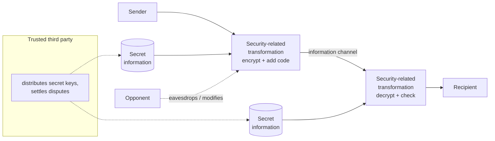
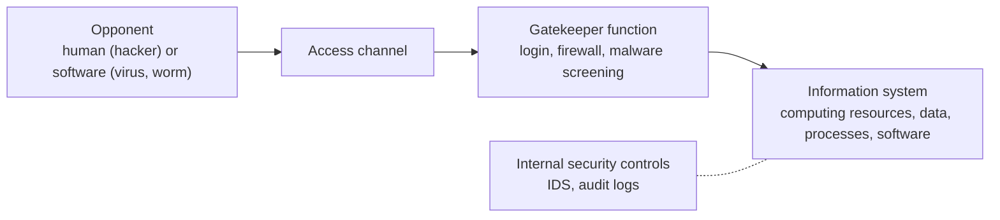
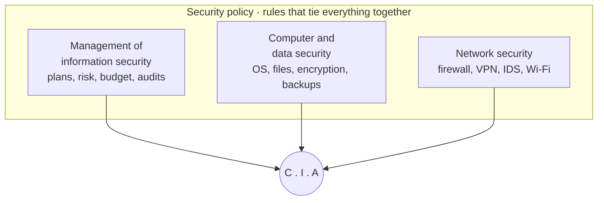
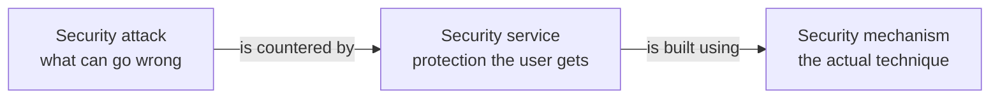
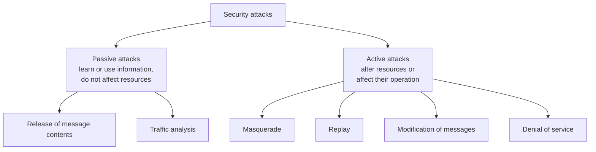

# Unit 2 · Security Model, Attacks, Services and Mechanisms (X.800)

> **Exam weight:** 3 parts of the 2025-26 end-sem (21 marks): aspects, X.800 services and mechanisms, and types of attacks. Mid-1 asked the components of information security.

**Prefer to watch first?** [Video lectures for Unit 2 →](#videos/unit2)

## 2.1 Information security model

**Definition.** <u>An information security model is a framework that describes the parties, assets, threats and protective controls of a system, and shows how the security goals (confidentiality, integrity, availability) are achieved.</u>

### A. Model for network security (Stallings)

*Fig. 2.1: Model for network security.*

- **Principals:** sender and receiver, who co-operate.
- **Information channel:** the logical route through the network (TCP/IP).
- **Security-related transformation:** encryption, and a code added so the receiver can check the sender and contents.
- **Secret information:** the key, unknown to the opponent.
- **Trusted third party:** distributes keys or arbitrates disputes (a certificate authority).
- **Opponent:** the attacker on the channel.

**Four design tasks:** (1) design the algorithm, (2) generate the secret key, (3) distribute and share the key, (4) specify the protocol that uses them. *Mnemonic: A Good Design Plan.*

### B. Network access security model (Stallings)

*Fig. 2.2: Network access security model.*

The **gatekeeper** is the first line of defence; **internal controls** detect intruders who get past it. Threats: **information access threats** (read or change data) and **service threats** (stop genuine users).

### C. McCumber cube (CNSS model)
A 3×3×3 cube = 27 cells. Sides: **goals** (confidentiality, integrity, availability) × **information states** (storage, processing, transmission) × **safeguards** (policy, education, technology). Every cell is an area to secure. *Example cell:* technology + integrity + storage = a host IDS that alerts when a stored file changes.

## 2.2 Components of information security  ⭐ (Mid-1 2025 Q3)

**Definition.** <u>The components of information security are the parts of an information system that must be protected (hardware, software, data, people, procedures and networks) together with the areas of protection (management of information security, computer and data security, and network security, joined by security policy) that preserve the C.I.A. of information.</u>

*Fig. 2.3: Components of information security (Whitman).*

**A. What must be protected (six components of an IS):** hardware (theft: locks, CCTV), software (bugs: patching), data (encryption, backup), people (weakest link: training), procedures (keep confidential), networks (firewalls). *Mnemonic: Happy Students Download PDFs Pretty Nicely.*

**B. Areas of protection:** management of information security; computer and data security; network security; policy around all of them.

**C. Three safeguards (CNSS):** policy, education, technology. Also summarised as **People, Process, Technology**.

**D. Layers of security:** physical, personnel, operations, communications, network, information security.

**Conclusion line:** "A system is only as strong as its weakest component, and people are usually the weakest link."

## 2.3 Aspects of information security  ⭐ (End-sem Q2b)

**Definition (X.800 / Stallings).** <u>The OSI security architecture focuses on three aspects of information security: security attack, security mechanism and security service.</u>

- **Security attack:** any action that compromises the security of information owned by an organisation.
- **Security mechanism:** a process (or device) designed to detect, prevent or recover from a security attack.
- **Security service:** a processing or communication service that enhances security, counters attacks, and uses one or more mechanisms.

*Fig. 2.4: The three aspects of information security.*

**"Explain any four with example":** after the three aspects, explain four **security goals**:

| Goal | Meaning | Example | Achieved by |
|---|---|---|---|
| Confidentiality | Only authorised people can read | Your account balance | Encryption, access control |
| Integrity | No unauthorised change | Transfer amount not altered | Hash, MAC, digital signature |
| Availability | Accessible when needed | Result site up on result day | Backups, redundancy, anti-DoS |
| Authenticity | User/message is genuine | OTP proves it is you | Passwords, OTP, certificates |
| Accountability | Actions traced to a person | Audit log shows who deleted a record | Logs, unique IDs |
| Non-repudiation | Sender cannot deny sending | Signed online order | Digital signature |

Writing both readings (three aspects + four goals) is the safe answer.

## 2.4 Threats, vulnerabilities and attacks

- **Threat:** a potential for violation of security (a danger that may exploit a vulnerability).
- **Vulnerability:** a weakness in a system (unpatched software, weak password).
- **Attack:** an intentional act that exploits a vulnerability (an assault on security from an intelligent threat).
- **Risk** = threat × vulnerability × impact.

**Whitman's categories of threats:** human error, intellectual-property compromise (piracy), espionage/trespass, information extortion (ransomware), sabotage/vandalism, software attacks (virus, worm, DoS), technical hardware/software failures, forces of nature, deviations in service (power, ISP), theft, technological obsolescence.

## 2.5 Security attacks: passive and active  ⭐⭐ (End-sem Q3b)

There are **two types** of security attacks (X.800 / RFC 4949): **passive** and **active**.

*Fig. 2.5: Classification of security attacks.*

### Passive attacks (eavesdropping, monitoring)
1. **Release of message contents:** the opponent reads a phone call, e-mail or file in transit. *Example:* reading login details on open café Wi-Fi.
2. **Traffic analysis:** even if messages are encrypted, the opponent studies their pattern (who talks to whom, how often, how long) to guess their nature. *Example:* frequent messages between two companies before a merger.

Passive attacks are **hard to detect** (no data is changed), so the emphasis is on **prevention** (encryption, traffic padding).

### Active attacks
1. **Masquerade:** one entity pretends to be another (usually with one of the other active attacks). *Example:* using a stolen password to log in as the teacher.
2. **Replay:** capturing data and retransmitting it later to produce an unauthorised effect. *Example:* re-sending a captured "pay Rs 500" message.
3. **Modification of messages:** part of a genuine message is altered, delayed or reordered. *Example:* "Allow Ram to read file" changed to "Allow Shyam to read file".
4. **Denial of service (DoS):** prevents normal use of communication facilities, by flooding or disabling. *Example:* a DDoS botnet flooding a bank website.

Active attacks are **hard to prevent** (too many weak points), so the emphasis is on **detection and recovery**.

| Basis | Passive attack | Active attack |
|---|---|---|
| Action | Reads/monitors only | Modifies, fakes or blocks |
| Goal violated | Confidentiality | Integrity, authenticity, availability |
| Detection | Very hard | Easier |
| Defence | Prevention (encryption) | Detection and recovery |
| Victim aware? | Usually not | Usually yes |
| Examples | Eavesdropping, traffic analysis | Masquerade, replay, modification, DoS |

## 2.6 Security services (X.800)  ⭐⭐ (End-sem Q3a)

**Definition (X.800).** <u>A security service is a service provided by a protocol layer of communicating open systems that ensures adequate security of the systems or of data transfers.</u> X.800 divides them into **five categories and fourteen specific services**:

| Category | Specific services | Meaning |
|---|---|---|
| **1. Authentication** | Peer-entity authentication; data-origin authentication | Assures that the communicating entity / source of data is who it claims |
| **2. Access control** | — | Prevents unauthorised use of a resource |
| **3. Data confidentiality** | Connection, connectionless, selective-field, traffic-flow confidentiality | Protects data from unauthorised disclosure |
| **4. Data integrity** | Connection integrity with recovery, without recovery, selective-field connection integrity, connectionless integrity, selective-field connectionless integrity | Assures data received is exactly as sent (no modification, insertion, deletion, replay) |
| **5. Non-repudiation** | Origin, destination | Protects against denial by one of the parties |

**Availability service:** X.800 and RFC 4949 also treat availability as a property to be protected (against DoS), using access control and other services.

## 2.7 Security mechanisms (X.800)

**Specific security mechanisms** (may be built into a protocol layer):
1. **Encipherment:** mathematical transformation of data into unreadable form (encryption).
2. **Digital signature:** data appended to a unit that proves its source and integrity.
3. **Access control:** mechanisms that enforce access rights.
4. **Data integrity:** mechanisms that assure integrity of data units (hash, MAC).
5. **Authentication exchange:** proving identity by exchanging information (passwords, challenge–response).
6. **Traffic padding:** inserting dummy bits into gaps to frustrate traffic analysis.
7. **Routing control:** selecting physically secure routes; changing route when a breach is suspected.
8. **Notarization:** a trusted third party assures certain properties of a data exchange.

**Pervasive security mechanisms** (not specific to any layer): trusted functionality, security label, event detection, security audit trail, security recovery.

### Relationship between services and mechanisms

| Service ↓ / Mechanism → | Encipherment | Digital signature | Access control | Data integrity | Auth. exchange | Traffic padding | Routing control | Notarization |
|---|---|---|---|---|---|---|---|---|
| Peer-entity authentication | Y | Y | | | Y | | | |
| Data-origin authentication | Y | Y | | | | | | |
| Access control | | | Y | | | | | |
| Confidentiality | Y | | | | | | Y | |
| Traffic-flow confidentiality | Y | | | | | Y | Y | |
| Data integrity | Y | Y | | Y | | | | |
| Non-repudiation | | Y | | Y | | | | Y |
| Availability | | | | Y | Y | | | |

**Key line for the exam:** *services are what the user receives; mechanisms are the tools used to provide them.*

## Exam checklist for Unit 2
- [ ] Stallings network-security model diagram + four design tasks
- [ ] Components diagram (Whitman) + six IS components + layers
- [ ] Three aspects (definitions) + six goals table
- [ ] Attack tree: 2 passive, 4 active, with examples and the comparison table
- [ ] X.800: 5 service categories, 8 specific mechanisms, the service–mechanism table
