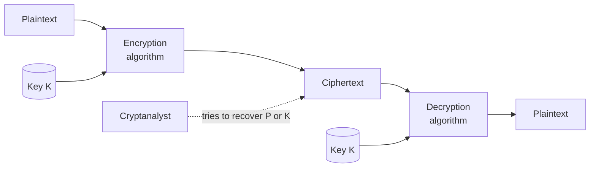
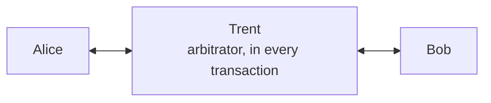
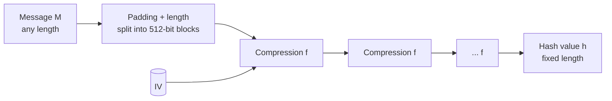
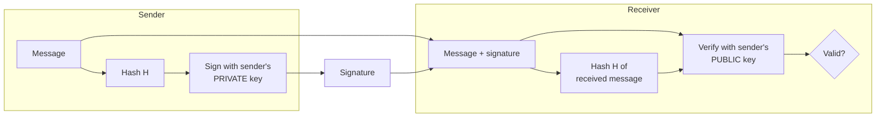
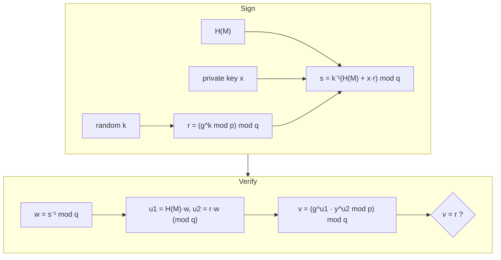
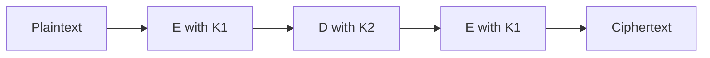
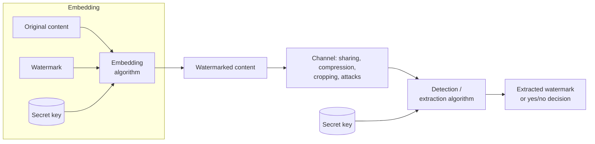

# Unit 3 · Cryptography, Hash Functions, Digital Signatures and Watermarking

> **Exam weight:** the heaviest unit: 3 of the 8 questions in 2025-26 (42 marks), including a full 14-mark question on watermarking. Playfair (Mid-1), one-way hashing and DSA (Mid-2) were all asked in the mids; hashing and DSA came back in the end-sem.

**Prefer to watch first?** [Video lectures for Unit 3 →](#videos/unit3)

Every worked example on this page (Playfair, Caesar, rail fence, columnar, XOR, one-time pad, RSA, DSA) was checked by computer.

## 3.1 Information security techniques

The techniques used to provide the X.800 services: **cryptography** (encryption for confidentiality), **hash functions and MACs** (integrity), **digital signatures** (authentication, non-repudiation), **steganography and watermarking** (hiding / marking information), **access control and authentication** (passwords, biometrics, tokens), **firewalls, IDS/IPS, antivirus**, and **backup and redundancy** (availability).

## 3.2 Introduction to cryptography: terminology

**Cryptography** (Greek *kryptos* = hidden, *graphein* = writing) is <u>the art and science of keeping messages secure by transforming them into an unreadable form, so that only the intended recipient can read them.</u>

| Term | Meaning |
|---|---|
| Plaintext (P or M) | The original readable message |
| Ciphertext (C) | The scrambled, unreadable message |
| Encryption (E) | Converting plaintext to ciphertext: C = E<sub>K</sub>(P) |
| Decryption (D) | Converting ciphertext back: P = D<sub>K</sub>(C) |
| Cipher (algorithm) | The mathematical function used for encryption/decryption |
| Key (K) | Secret value that controls the cipher; the **key space** is the set of all possible keys |
| Cryptanalysis | The art and science of breaking ciphertext without the key |
| Cryptology | Cryptography + cryptanalysis |
| Symmetric (secret-key) | Same key for encryption and decryption (Caesar, DES, AES) |
| Asymmetric (public-key) | Public key to encrypt, private key to decrypt (RSA) |


*Fig. 3.1: Symmetric cipher model (Schneier, Stallings).*

**Kerckhoffs's principle:** the security of a cipher must depend only on the secrecy of the key, never on the secrecy of the algorithm.

## 3.3 Cryptanalysis and security of algorithms

**Cryptanalysis** is recovering the plaintext or the key without knowing the key. **Brute force** tries every key (average: half the key space).

**Types of cryptanalytic attack (Schneier)**, from weakest to strongest attacker:
1. **Ciphertext-only:** attacker has only ciphertext.
2. **Known-plaintext:** has some plaintext–ciphertext pairs.
3. **Chosen-plaintext:** can encrypt plaintexts of his choice.
4. **Adaptive chosen-plaintext:** chooses later plaintexts based on earlier results.
5. **Chosen-ciphertext:** can decrypt ciphertexts of his choice.
6. **Chosen-key / rubber-hose:** knows relations between keys / threatens a person to get the key.

**Security of algorithms (Schneier):**
- **Unconditionally secure:** cannot be broken however much ciphertext and computing power the attacker has (only the **one-time pad**).
- **Computationally secure:** cannot be broken with available resources in a useful time; the cost of breaking is more than the value of the data, or the time needed is longer than the data's useful life.
- Lars Knudsen's categories of breaking: **total break** (key found), **global deduction** (equivalent algorithm found), **instance deduction** (one plaintext found), **information deduction** (some information about key or plaintext).
- Complexity of an attack is measured by **data**, **processing time** and **storage** needed.

## 3.4 Substitution ciphers  ⭐⭐ (End-sem Q4a, Mid-1 Q4)

**Definition.** <u>A substitution cipher replaces each character (or group of characters) of the plaintext with another character, number or symbol; the positions stay the same but the identities change.</u>

**Four types (Schneier):** simple (monoalphabetic), homophonic, polygram, polyalphabetic.

### Caesar cipher (additive, monoalphabetic)
C = (P + k) mod 26, P = (C − k) mod 26. With k = 3:

| Plain | A T T A C K A T D A W N |
|---|---|
| Cipher | D W W D F N D W G D Z Q |

Only 25 keys, so brute force is trivial. **ROT13** is Caesar with k = 13.

### Monoalphabetic (keyword) substitution
Any permutation of the 26 letters: 26! ≈ 4 × 10<sup>26</sup> keys, but **frequency analysis** breaks it (E, T, A, O, I, N are the most common letters in English).

### Homophonic substitution
Each plaintext letter maps to several ciphertext symbols (E → 17, 54, 82…), flattening the letter frequencies.

### Polyalphabetic: Vigenère
Uses a repeating keyword; each key letter gives a different Caesar shift. Ci = (Pi + Ki) mod 26. Defeats simple frequency analysis.

### Polygram: Playfair cipher  ⭐⭐ (Mid-1 2025 Q4)

Encrypts **pairs of letters (digraphs)** using a 5×5 key square (I and J share a cell).

**Rules:**
1. Build the square: write the keyword without repeated letters, then the rest of the alphabet.
2. Split plaintext into pairs; if a pair has two same letters, insert **X** between them; if one letter is left, add **X**.
3. **Same row:** replace each letter with the letter to its **right** (wrap around).
4. **Same column:** replace each letter with the letter **below** (wrap around).
5. **Rectangle:** replace each letter with the letter in **its own row** and the **other letter's column**.

**Worked example.** Key = **MONARCHY**, plaintext = **INSTRUMENTS**.

| | | | | |
|---|---|---|---|---|
| **M** | **O** | **N** | **A** | **R** |
| **C** | **H** | **Y** | B | D |
| E | F | G | I/J | K |
| L | P | Q | S | T |
| U | V | W | X | Z |

Pairs: IN ST RU ME NT SX (an X is added to complete the last pair).

| Pair | Rule | Cipher |
|---|---|---|
| IN | rectangle (I: row 3 col 4; N: row 1 col 3) | GA |
| ST | same row (row 4) | TL |
| RU | rectangle | MZ |
| ME | same column (column 1) | CL |
| NT | rectangle | RQ |
| SX | same column (column 4) | XA |

**Ciphertext: GATLMZCLRQXA.** Decrypting with the reverse rules (left, up, rectangle) gives INSTRUMENTSX. ✓

*Second example for practice:* BALLOON → pairs BA LX LO ON → **IBSUPMNA**.

**Strengths:** 25×25 = 600 digraphs, so single-letter frequency analysis fails. **Weakness:** digraph frequencies still leak; broken with a few hundred letters of ciphertext. Used by British forces in World War I.

### Hill cipher (polygram)
Encrypts m letters at a time with an m×m key matrix: C = K·P mod 26; decryption uses K<sup>−1</sup> mod 26.

## 3.5 Transposition ciphers

**Definition.** <u>A transposition cipher keeps the plaintext letters but rearranges their order (a permutation).</u> Letter frequencies stay the same, which is how they are recognised.

**Rail fence (depth 2).** MEETMEAFTERTHEPARTY written in a zig-zag on two rails, read row by row:

```text
M . E . M . A . T . R . H . P . R . Y
. E . T . E . F . E . T . E . A . T .
```
Ciphertext: **MEMATRHPRYETEFETEAT**.

**Row (columnar) transposition.** Key 4 3 1 2 5 6 7, plaintext ATTACKPOSTPONEDUNTILTWOAM (padded with X):

```text
Key:   4 3 1 2 5 6 7
       A T T A C K P
       O S T P O N E
       D U N T I L T
       W O A M X X X
```
Read columns in key order 1, 2, 3 … → **TTNA APTM TSUO AODW COIX KNLX PETX**. **Double transposition** applies it twice and is much stronger.

## 3.6 Substitution vs transposition  ⭐⭐ (End-sem Q4a)

| Basis | Substitution cipher | Transposition cipher |
|---|---|---|
| What changes | Identity of letters | Position (order) of letters |
| Letter frequencies | Changed (except one-to-one mapping keeps a pattern) | Exactly the same as plaintext |
| Key | Mapping table / shift / keyword | Permutation / number of rails / column order |
| Examples | Caesar, monoalphabetic, Vigenère, Playfair, Hill | Rail fence, columnar, double transposition |
| Example output | ATTACKATDAWN → DWWDFNDWGDZQ (Caesar 3) | ATTACKATDAWN → ACDTAKTANTAW (rail fence 3) |
| Attack | Frequency analysis | Anagramming, trying permutations |
| Modern use | S-boxes in DES/AES (confusion) | P-boxes in DES (diffusion) |

**Product cipher:** combining both (substitution + transposition, many rounds) gives strong ciphers such as DES and AES (Shannon's confusion and diffusion). **Rotor machines** (Enigma) were multi-stage substitution ciphers.

## 3.7 Simple XOR and the one-time pad

### Simple XOR
XOR (⊕): 0⊕0 = 0, 0⊕1 = 1, 1⊕0 = 1, 1⊕1 = 0. Encryption C = P ⊕ K; decryption P = C ⊕ K, because (P ⊕ K) ⊕ K = P.

| | H | I |
|---|---|---|
| Plaintext (ASCII) | 01001000 | 01001001 |
| Key | 10110011 | 01101100 |
| Ciphertext P ⊕ K | 11111011 | 00100101 |

Schneier calls simple XOR with a short repeating key "an embarrassment": it is broken in minutes by finding the key length and XORing ciphertext with itself shifted.

### One-time pad (Vernam, Mauborgne 1917)
- The key is **truly random**, **as long as the message**, and **used only once**, then destroyed.
- It is the only **unconditionally secure** (perfectly secret) cipher: every plaintext of that length is equally likely.
- *Letter example:* HELLO + key XMCKL (mod 26) = **EQNVZ**.
- **Problems:** generating and distributing huge random keys; keys can never be reused (reuse breaks it). Used for the Moscow–Washington hotline and in diplomatic and military communication.

## 3.8 Cryptographic protocols

**Protocol:** <u>a series of steps involving two or more parties, designed to accomplish a task.</u> Every party must know and agree to the steps, they must be unambiguous, and complete. Schneier's cast: **Alice** and **Bob** (parties), **Trent** (trusted arbitrator), **Eve** (eavesdropper), **Mallory** (active attacker).

### Arbitrated protocol
An **arbitrator (Trent)**, a disinterested trusted third party, takes part in **every** run of the protocol. *Example:* a lawyer or escrow agent in a property sale; a bank as intermediary.
- **Problems:** hard to find a trusted, neutral party on a network; slow (delay); the arbitrator is a **bottleneck** and a single point of attack; costly.



### Adjudicated protocol
Split into two sub-protocols: a **non-arbitrated** one run every time between Alice and Bob, and an **arbitrated** one executed **only if there is a dispute**. The special arbitrator is called an **adjudicator** (like a judge, who sees only the evidence after a dispute). It **detects** cheating rather than preventing it. Cheaper and faster than arbitrated.

### Self-enforcing protocol
The protocol itself guarantees fairness; no arbitrator. Cheating is detected immediately and the protocol stops. Best type, but not available for every problem.

**Attacks on protocols:** passive (eavesdropping) and active (insert, delete, replay, change messages); **cheaters** may be passive (follow the steps but try to learn more) or active (break the protocol).

## 3.9 One-way hash function  ⭐⭐⭐ (Mid-2 Q1, End-sem Q4b)

**Definition.** <u>A one-way hash function H takes a variable-length input message M and produces a fixed-length output h = H(M), called the hash value or message digest, such that it is easy to compute h from M but computationally infeasible to find M from h.</u>

**Properties:**
1. Works on any input length; fixed output length (MD5: 128 bits, SHA-1: 160 bits, SHA-256: 256 bits).
2. **Easy to compute** H(M).
3. **One-way (pre-image resistance):** given h, infeasible to find M.
4. **Weak collision resistance (second pre-image):** given M, infeasible to find M′ ≠ M with H(M′) = H(M).
5. **Strong collision resistance:** infeasible to find **any** pair M ≠ M′ with the same hash (birthday attack needs about 2<sup>n/2</sup> tries).
6. **Avalanche effect:** changing one bit of M changes about half the bits of h.


*Fig. 3.2: General (Merkle–Damgård) structure of a hash function.*

### MD5 (Message Digest 5, Rivest 1991)
1. **Append padding bits:** a 1 followed by 0s so the length ≡ 448 mod 512.
2. **Append length:** 64-bit original length → total is a multiple of 512 bits.
3. **Initialise MD buffer:** four 32-bit registers A, B, C, D (A = 67452301, B = EFCDAB89, C = 98BADCFE, D = 10325476 in hex).
4. **Process each 512-bit block:** 4 rounds × 16 steps = 64 steps, using functions F, G, H, I, a table T[1…64] from the sine function, left rotations and addition mod 2<sup>32</sup>.
5. **Output:** A‖B‖C‖D = 128-bit digest.

*Example:* MD5("abc") = 900150983cd24fb0d6963f7d28e17f72; MD5("Abc") = 35593b7ce5020eae3ca68fd5b6f3e031 (one letter changed, a completely different digest: avalanche).

### SHA-1 (Secure Hash Algorithm, NIST 1995)
Same padding (to 448 mod 512) and 64-bit length; **five** 32-bit registers A–E; 4 rounds × 20 steps = **80 steps**; output **160 bits**. SHA-1("abc") = a9993e364706816aba3e25717850c26c9cd0d89d. SHA-2 (SHA-256/512) is used today; MD5 and SHA-1 have known collisions.

**Applications:** password storage (store H(password), not the password), digital signatures (sign the hash), message integrity (MAC/HMAC), file checksums for downloads, blockchain.

## 3.10 Public key cryptography  ⭐⭐ (End-sem Q5a)

**Definition.** <u>Public key (asymmetric) cryptography uses a pair of mathematically related keys: a public key, known to everyone, and a private key, kept secret by its owner. What one key encrypts, only the other can decrypt, and the private key cannot feasibly be computed from the public key.</u> Proposed by Diffie and Hellman in 1976.


*Fig. 3.3: Encryption for confidentiality. For authentication, Alice encrypts (signs) with her own private key and anyone verifies with her public key.*

**Uses:** encryption/decryption (confidentiality), digital signatures (authentication), key exchange (Diffie–Hellman). **Algorithms:** RSA, Diffie–Hellman, DSA, ElGamal, elliptic-curve (ECC).

| Basis | Symmetric | Asymmetric |
|---|---|---|
| Keys | One shared key | Public + private key pair |
| Speed | Fast | 100–1000× slower |
| Key distribution | Hard (must share secret) | Easy (public key is public) |
| Keys for n users | n(n−1)/2 | 2n |
| Examples | DES, 3DES, AES | RSA, DSA, ECC |

### RSA (Rivest, Shamir, Adleman, 1977)

**Key generation:**
1. Choose two large primes **p** and **q**.
2. Compute **n = p × q**.
3. Compute **φ(n) = (p − 1)(q − 1)**.
4. Choose **e** with 1 < e < φ(n) and gcd(e, φ(n)) = 1.
5. Compute **d** with **d × e ≡ 1 (mod φ(n))**.
6. Public key **{e, n}**; private key **{d, n}**.

**Encryption:** C = M<sup>e</sup> mod n (M < n). **Decryption:** M = C<sup>d</sup> mod n.

**Example 1 (small, quick to write).** p = 3, q = 11 → n = 33, φ(n) = 2 × 10 = 20. e = 3 (gcd(3, 20) = 1). d = 7 because 3 × 7 = 21 ≡ 1 (mod 20).
- M = 4: C = 4<sup>3</sup> mod 33 = 64 mod 33 = **31**.
- Check: 31<sup>7</sup> mod 33 → 31 ≡ −2, (−2)<sup>7</sup> = −128, −128 mod 33 = −128 + 132 = **4**. ✓

**Example 2 (Stallings).** p = 17, q = 11 → n = 187, φ(n) = 16 × 10 = 160. e = 7, d = 23 (7 × 23 = 161 ≡ 1 mod 160).
- M = 88: C = 88<sup>7</sup> mod 187 = **11**.
- Decrypt: 11<sup>23</sup> mod 187 = **88**. ✓
- Working for 88<sup>7</sup>: 88<sup>1</sup> mod 187 = 88; 88<sup>2</sup> = 7744 mod 187 = 77; 88<sup>4</sup> = 77<sup>2</sup> = 5929 mod 187 = 132; 88<sup>7</sup> = 88 × 77 × 132 mod 187 = 894432 mod 187 = 11.

**Security:** based on the difficulty of factoring n into p and q. Use n of at least 2048 bits. **Attacks:** brute force, factoring, timing attacks, chosen-ciphertext attacks.

## 3.11 Digital signature and DSA  ⭐⭐⭐ (Mid-2 Q2, End-sem Q5b)

**Definition.** <u>A digital signature is an authentication mechanism that lets the creator of a message attach a code that acts as a signature: it is computed from the message hash with the signer's private key and can be verified by anyone with the signer's public key.</u>

**Properties:** verifies the **author**, date and time; **authenticates the contents**; can be verified by third parties to settle disputes. It provides **authentication, integrity and non-repudiation** (not confidentiality).


*Fig. 3.4: Generic digital signature process.*

### Digital Signature Algorithm (DSA)
Part of NIST's **Digital Signature Standard (DSS)**, FIPS 186 (1991). Based on the difficulty of **discrete logarithms** (ElGamal/Schnorr family). Uses SHA for the hash. Signature only; cannot encrypt.

**1. Global public components**
- **p:** prime of L bits (512–1024, now up to 3072).
- **q:** 160-bit (or 256-bit) prime divisor of (p − 1).
- **g = h<sup>(p−1)/q</sup> mod p**, where 1 < h < p − 1 and g > 1.

**2. User's keys**
- Private key **x**: random, 0 < x < q.
- Public key **y = g<sup>x</sup> mod p**.

**3. Signing** message M
- Choose a fresh random **k**, 0 < k < q (per message, kept secret).
- **r = (g<sup>k</sup> mod p) mod q**
- **s = [k<sup>−1</sup> (H(M) + x·r)] mod q**
- Signature = **(r, s)**.

**4. Verifying** (M′, r′, s′)
- **w = (s′)<sup>−1</sup> mod q**
- **u1 = [H(M′)·w] mod q**, **u2 = (r′·w) mod q**
- **v = [(g<sup>u1</sup> · y<sup>u2</sup>) mod p] mod q**
- Signature is valid if **v = r′**.


*Fig. 3.5: DSA signing and verification.*

**Toy example (to show the steps).** p = 23, q = 11 (11 divides 22), h = 2 → g = 2<sup>22/11</sup> mod 23 = **4**. Private x = 3 → y = 4<sup>3</sup> mod 23 = 64 mod 23 = **18**. Let H(M) = 6 and k = 5.
- r = (4<sup>5</sup> mod 23) mod 11 = (1024 mod 23) mod 11 = 12 mod 11 = **1**.
- k<sup>−1</sup> mod 11 = 9 (5 × 9 = 45 ≡ 1). s = 9 × (6 + 3 × 1) mod 11 = 81 mod 11 = **4**. Signature (r, s) = **(1, 4)**.
- Verify: w = 4<sup>−1</sup> mod 11 = 3; u1 = 6 × 3 mod 11 = 7; u2 = 1 × 3 mod 11 = 3; v = (4<sup>7</sup> × 18<sup>3</sup> mod 23) mod 11 = (8 × 13 mod 23) mod 11 = 12 mod 11 = **1 = r** ✓.

**DSA vs RSA signature:** DSA is faster at signing, slower at verifying; DSA signs only; DSA needs a fresh secret k each time (reusing k reveals x).

## 3.12 3DES with two keys (End-sem Q8 iv, beyond the syllabus)

DES has a 56-bit key, now too short. **Triple DES with two keys** (Tuchman) uses an **Encrypt–Decrypt–Encrypt (EDE)** sequence:

**C = E<sub>K1</sub>( D<sub>K2</sub>( E<sub>K1</sub>(P) ) )**, and **P = D<sub>K1</sub>( E<sub>K2</sub>( D<sub>K1</sub>(C) ) )**.



- Effective key length **112 bits** (2 × 56); defeats the meet-in-the-middle attack on double DES.
- Middle step is *decryption* so that with K1 = K2 it reduces to single DES (**backward compatibility**).
- Adopted in ANSI X9.17 and ISO 8732 (banking). Three-key 3DES (168-bit) is also used (PGP, S/MIME). Slow (three DES runs); now replaced by AES.

## 3.13 Digital watermarking  ⭐⭐ (End-sem Q6, full 14 marks)

**Definition.** <u>Digital watermarking is the technique of embedding a secret, often imperceptible, signal (the watermark: a logo, ID number or pattern) into digital content such as an image, audio, video or document, so that it can later be detected or extracted to prove ownership, authenticate the content or trace copies.</u>


*Fig. 3.6: Watermark embedding and extraction.*

### Characteristics (requirements)
1. **Imperceptibility (fidelity):** the watermark must not visibly or audibly degrade the content.
2. **Robustness:** survives normal processing and attacks: compression (JPEG), cropping, scaling, rotation, noise, filtering.
3. **Security:** cannot be detected, removed or forged without the secret key.
4. **Capacity (payload):** amount of information that can be embedded.
5. **Unambiguity:** the extracted watermark clearly identifies the owner.
6. **Computational cost:** fast embedding and detection.
7. **Trade-off:** robustness, imperceptibility and capacity pull against each other.

### Types of watermarking

| Basis | Types |
|---|---|
| **Human perception** | **Visible** (a logo on a TV channel or stock photo) vs **invisible** (hidden in the data) |
| **Robustness** | **Robust** (survives attacks; copyright proof), **fragile** (breaks at any change; tamper detection), **semi-fragile** (survives compression, breaks on malicious edits) |
| **Media** | Image, audio, video, text/document watermarking |
| **Working domain** | **Spatial domain** (change pixel values, e.g. LSB substitution) vs **frequency/transform domain** (embed in DCT, DFT or DWT coefficients; more robust) |
| **Detection** | **Non-blind / private** (needs the original), **semi-blind** (needs the watermark), **blind / public** (needs neither) |
| **Application** | Source tracking (fingerprinting: a different mark per buyer) vs broadcast monitoring |

### Techniques in one line each
**LSB:** replace the least significant bit of pixels with watermark bits (simple, fragile). **DCT/DWT:** add the watermark to mid-frequency coefficients (robust to JPEG). **Spread spectrum:** spread the watermark over many frequencies (very robust).

### Applications
Copyright protection and proof of ownership; fingerprinting to trace pirated copies (pre-release movies); content authentication and tamper detection (medical images, legal evidence); broadcast monitoring (checking that an advertisement was aired); copy control (DVD players refusing marked copies); currency notes (the watermark of Mahatma Gandhi on rupee notes is the physical idea).

### Attacks on watermarks
Removal attacks (filtering, compression), geometric attacks (rotation, cropping), cryptographic attacks (brute-force key search), protocol attacks (inserting a false watermark to claim ownership).

**Watermarking vs steganography:** steganography hides the **existence** of a secret message (the cover does not matter); watermarking marks the **cover** itself and need not be secret in existence (visible marks), but must be robust.

## Exam checklist for Unit 3
- [ ] Terminology table + symmetric cipher diagram
- [ ] Six cryptanalytic attacks; unconditional vs computational security
- [ ] Playfair: square for MONARCHY and the INSTRUMENTS example
- [ ] Caesar, rail fence, columnar examples; the substitution vs transposition table
- [ ] XOR table and one-time pad conditions
- [ ] Arbitrated vs adjudicated vs self-enforcing protocols
- [ ] Hash properties + MD5 steps (or SHA-1)
- [ ] RSA steps + Example 1 with verification
- [ ] DSA: four groups of formulas + diagram
- [ ] Watermarking: diagram, 6 characteristics, types table, applications
