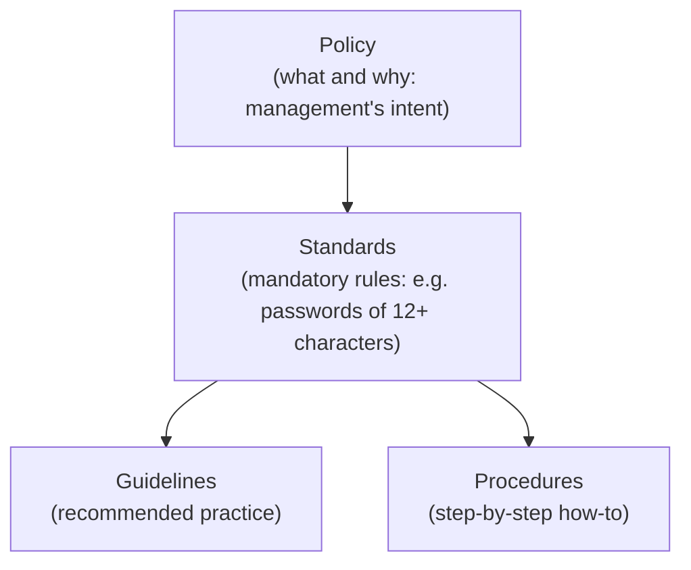
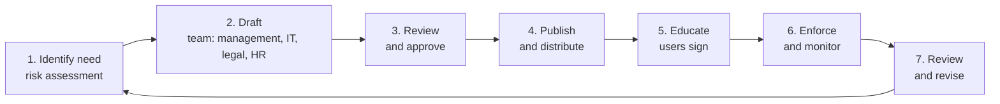
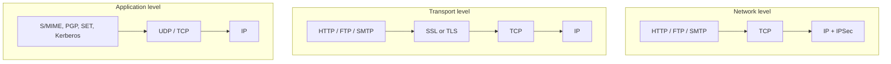

# Unit 4 · Security Policies

> **Exam weight:** one full question in 2025-26 (Q7: need of security policies + web security) and Mid-2 Q3 (e-mail security policy with an example). Easy marks: the answers are lists of policy clauses, which you can write from common sense once you know the structure.

**Prefer to watch first?** [Video lectures for Unit 4 →](#videos/unit4)

Based on Krause & Tipton (*Handbook of Information Security Management*) and Whitman & Mattord.

## 4.1 Security policy

**Definition.** <u>A security policy is a formal, written statement by management of the rules that people who are given access to an organisation's technology and information assets must follow; it states what is to be protected, why, and who is responsible, and is supported by standards, guidelines and procedures.</u>

*Fig. 4.1: Policy hierarchy: policy → standards → guidelines and procedures.*

**Characteristics of a good policy:** approved and supported by top management; clear, short and understandable; enforceable (with penalties); applicable to everyone it names; technology-neutral; reviewed regularly; legally sound; distributed, read and **agreed to** (signed) by users.

**Types of policy (Whitman):**
1. **Enterprise Information Security Policy (EISP):** the top-level policy; sets direction, scope and tone for the whole security programme.
2. **Issue-Specific Security Policy (ISSP):** one technology or issue: e-mail, Internet/WWW use, removable media, BYOD, social media.
3. **System-Specific Security Policy (SysSP):** rules for one system: firewall rules, access-control lists, configuration standards.

## 4.2 Why policies should be developed (need for security policies)  ⭐⭐ (End-sem Q7a)

1. **Foundation of the security programme:** "policy drives everything"; technology without policy is unmanaged. Whitman: policies are the least expensive control but the hardest to implement well.
2. **Protect assets:** say what information and systems are valuable and how to protect them (CIA).
3. **Define roles and responsibilities:** who owns data, who grants access, who responds to incidents.
4. **Set acceptable behaviour:** what users may and may not do; reduces mistakes and misuse.
5. **Legal and regulatory compliance:** IT Act 2000, DPDP Act 2023, RBI and CERT-In directions, ISO 27001 all require written policies.
6. **Legal protection and enforcement:** a published, signed policy lets the organisation discipline offenders and defend itself in court ("due care").
7. **Consistency:** the same rules across departments and branches.
8. **Incident response and continuity:** tells staff what to do in a breach or disaster.
9. **Awareness and training base:** training is built on the policy.
10. **Management commitment:** shows customers, auditors and partners that security is taken seriously; builds trust.
11. **Risk reduction and cost control:** prevents incidents that cost more than the policy.

**Example:** without a password policy, staff use "admin123"; one leak exposes the whole network. A policy saying "12+ characters, MFA, change after any suspected leak" plus enforcement closes the gap.

## 4.3 Policy development process

*Fig. 4.2: Policy life cycle.*

## 4.4 WWW policies and web security  ⭐ (End-sem Q7b "What is Web-Security?")

**Web security** is <u>the protection of web servers, web applications, browsers and the data exchanged between them from attacks that compromise confidentiality, integrity or availability.</u>

### Threats on the web
| Threat | Example |
|---|---|
| Integrity | Modifying user data, Trojan in the browser, changing messages in transit |
| Confidentiality | Eavesdropping, stealing data from the server or client |
| Denial of service | Flooding the server, killing user threads |
| Authentication | Impersonating users, forging data |
| Application attacks | **SQL injection, cross-site scripting (XSS), CSRF**, session hijacking, phishing sites, drive-by malware downloads |

### Web security approaches (Stallings)

*Fig. 4.3: Where security sits in the TCP/IP stack.*

- **SSL/TLS:** encrypts and authenticates the connection between browser and server (handshake, record protocol, certificates).
- **HTTPS:** HTTP over TLS; the padlock in the browser. Protects URL, form contents, cookies.
- **Other controls:** web application firewall (WAF), input validation, secure cookies, patching, strong authentication, CAPTCHA.

### WWW (Internet use) policy: typical clauses
1. **Acceptable use:** the Internet is for work; limited personal use allowed or not.
2. **Prohibited sites and content:** pornography, gambling, piracy, hacking tools; blocked by a proxy/URL filter.
3. **Downloads:** no unlicensed software; only IT-approved software; scan files.
4. **Web server policy:** only authorised staff publish content; content approved before publishing; servers in a DMZ; patched; logs kept.
5. **Privacy and monitoring:** users told that browsing is logged and monitored.
6. **Confidential data:** never posted on public sites, forums or AI tools; use HTTPS only.
7. **Social media:** no official statements without approval.
8. **Enforcement:** violations lead to disciplinary action.

## 4.5 E-mail security policies  ⭐⭐ (Mid-2 2025 Q3)

**Definition.** <u>An e-mail security policy is an issue-specific policy that defines the acceptable use of the organisation's e-mail system and the security controls for sending, receiving, storing and retaining e-mail.</u>

**E-mail threats:** phishing and spear-phishing, malware attachments, spoofing (forged sender), spam, eavesdropping on unencrypted mail, data leaks (wrong recipient), business e-mail compromise (fake CEO asking for a payment).

**Typical clauses:**
1. **Ownership:** the e-mail system and messages belong to the organisation; no expectation of privacy.
2. **Acceptable use:** business purposes; no offensive, harassing, chain or political mails; limited personal use.
3. **Confidential information:** must be **encrypted** (S/MIME or PGP); never sent to personal accounts.
4. **Attachments:** no executable attachments; all mail scanned for viruses; do not open unexpected attachments or links.
5. **Phishing:** verify unusual requests (payments, passwords) by phone; report suspicious mail to IT.
6. **Authentication:** strong passwords and MFA; SPF, DKIM and DMARC on the domain to prevent spoofing.
7. **Auto-forwarding** to outside addresses prohibited.
8. **Retention and archiving:** how long mail is kept (legal requirements); deletion rules.
9. **Monitoring:** the organisation may monitor mail for security and legal reasons.
10. **Disclaimer** added to outgoing mail.
11. **Enforcement:** violations lead to disciplinary action.

**Example (a college):** "Faculty must send question papers only as password-protected, encrypted attachments from the official @mjpru.ac.in account, with the password sent separately by SMS. Question papers must never be sent to or from personal Gmail accounts. Any mail asking for exam-portal passwords must be reported to the IT cell." This one example shows confidentiality, authentication, phishing control and enforcement.

**E-mail security technologies:** PGP (Pretty Good Privacy: signs with RSA/DSS and SHA, encrypts with a session key, compresses with ZIP, radix-64 encodes) and S/MIME (X.509 certificates).

## 4.6 Policy review process

Policies age as technology, laws and threats change. Whitman: **a policy must have a review schedule, a responsible individual (policy administrator), and a documented review procedure.**

1. **Schedule:** review at least once a year, and after major incidents, audits, new laws or new technology.
2. **Policy administrator / owner** collects comments and change requests.
3. **Gather input:** incident reports, audit findings, user feedback, legal changes.
4. **Gap analysis:** compare the policy with current practice and standards (ISO 27001).
5. **Revise the draft;** consult legal, HR, IT and business units.
6. **Approval** by management / steering committee.
7. **Version control:** date, version number, change log; **sunset clause** (expiry date) where useful.
8. **Re-communicate** and re-train users; collect fresh acknowledgements.

## 4.7 Corporate policies and sample security policies

**Corporate (organisation-wide) policies** usually include:

| Policy | Key content |
|---|---|
| Information security (EISP) | Purpose, scope, roles, compliance, review |
| Acceptable use policy (AUP) | What users may do with IT resources |
| Password / access control | Length, complexity, MFA, least privilege, account review |
| E-mail and WWW | As in 4.4 and 4.5 |
| Data classification and handling | Public, internal, confidential, secret; labelling, storage |
| Remote access / VPN / BYOD | Approved devices, encryption, MDM |
| Backup and disaster recovery | Frequency, off-site copies, test restores |
| Incident response | Report, contain, eradicate, recover, lessons learned; report to CERT-In within 6 hours |
| Physical security | ID cards, server-room access, CCTV |
| Third-party / vendor | Contracts, NDAs, audits |
| Clean desk and clear screen | Lock screens, no papers left out |

### Sample security policy: password policy (format to copy)
1. **Purpose:** to protect accounts by setting a standard for strong passwords.
2. **Scope:** all employees, students and contractors with an account on college systems.
3. **Policy:** passwords must have at least 12 characters with upper case, lower case, digits and symbols; must not contain the user name; must not be reused across the last 5 passwords; MFA for e-mail and admin accounts; never shared or written down; changed immediately if compromise is suspected; accounts locked after 5 failed attempts.
4. **Responsibilities:** users keep passwords secret; IT enforces technically; HR includes in induction.
5. **Enforcement:** violation may lead to disciplinary action, up to termination.
6. **Review:** annually by the IT security officer. **Version:** 1.0, dated.

**Every sample policy has these sections:** purpose, scope, policy statements, roles and responsibilities, enforcement, definitions, review and revision history.

## Exam checklist for Unit 4
- [ ] Definition of policy + policy → standards → procedures diagram
- [ ] EISP, ISSP, SysSP
- [ ] 10 reasons why policies are needed
- [ ] Web threats table, SSL/TLS/HTTPS, WWW policy clauses
- [ ] E-mail threats, 10 e-mail policy clauses, the college example
- [ ] Policy review process and the sections of a sample policy
