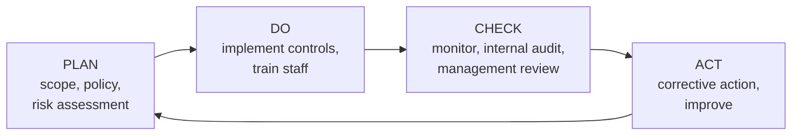

# Unit 5 · Information Security Standards and Cyber Law

> **Exam weight:** Q8 of 2025-26 was short notes ("any two of": IT Act and Copyright Act, cyber law, ISO and IPR, 3DES), and Mid-2 Q4 asked "cyber law and copyright law standards". Prepare a 1.5–2 page note on each heading below; section numbers and years earn marks.

**Prefer to watch first?** [Video lectures for Unit 5 →](#videos/unit5)

::: warn Check the current law
Indian cyber law changes often. The IT Act 2000 (as amended in 2008) is the base; the Digital Personal Data Protection (DPDP) Act 2023 and its 2025 Rules are being brought into force in phases. Write the IT Act sections below; add one line on the DPDP Act for extra marks.
:::

## 5.1 Information security standards: ISO

**Standard:** <u>a document, agreed by consensus and approved by a recognised body, that gives rules, guidelines or characteristics for activities or their results, to achieve the best degree of order.</u> ISO = International Organization for Standardization (Geneva), working with IEC on IT standards.

### ISO/IEC 27001: Information Security Management System (ISMS)
**Definition.** <u>ISO/IEC 27001 is the international standard that specifies the requirements for establishing, implementing, maintaining and continually improving an Information Security Management System (ISMS), against which an organisation can be certified.</u>

- **History:** BS 7799 (UK, 1995) → ISO/IEC 17799 (2000) → ISO/IEC 27001 (2005) → 2013 revision → **current ISO/IEC 27001:2022**.
- **Clauses 4–10 (mandatory):** 4 context of the organisation, 5 leadership, 6 planning (risk assessment and treatment), 7 support (resources, awareness, documents), 8 operation, 9 performance evaluation (monitoring, internal audit, management review), 10 improvement.
- **Annex A (2022): 93 controls in 4 themes:** organisational (37), people (8), physical (14), technological (34). (The 2013 version had 114 controls in 14 domains.)
- **Statement of Applicability (SoA):** lists which controls apply and why.
- **Certification:** an accredited body audits the ISMS (stage 1 documents, stage 2 implementation); certificate valid 3 years with yearly surveillance audits.

*Fig. 5.1: PDCA cycle used in ISO 27001.*

**Benefits:** systematic risk management; legal and contractual compliance; customer trust and competitive advantage; fewer incidents; clear roles; internationally recognised certificate.

### The ISO 27000 family and other standards
| Standard | Covers |
|---|---|
| ISO/IEC 27000 | Overview and vocabulary |
| ISO/IEC 27002 | Code of practice: guidance for each control |
| ISO/IEC 27005 | Information security risk management |
| ISO/IEC 27017 / 27018 | Cloud security / personal data in the cloud |
| ISO/IEC 27701 | Privacy information management (extension of 27001) |
| ISO/IEC 27035 | Incident management |
| ISO/IEC 15408 | Common Criteria: evaluating security of IT products (EAL 1–7) |
| ISO 22301 | Business continuity management |
| Others | NIST Cybersecurity Framework (Govern, Identify, Protect, Detect, Respond, Recover), PCI DSS (card payments), COBIT (IT governance), GDPR (EU privacy law) |

## 5.2 Introduction to digital (cyber) law

**Cyber law** is <u>the body of law that deals with the legal issues of cyberspace: the use of computers, the Internet, electronic records and digital communication, covering cyber crimes, electronic commerce, digital signatures, data protection and intellectual property in the digital environment.</u>

**Need:** traditional laws (IPC 1860, Evidence Act 1872) did not recognise electronic records, digital signatures or offences such as hacking; e-commerce and e-governance needed legal validity; cross-border crimes needed new rules.

**Areas of cyber law:** (1) cyber crimes (hacking, fraud, identity theft, cyber stalking, child pornography, cyber terrorism); (2) electronic commerce and contracts; (3) electronic records and digital signatures; (4) data protection and privacy; (5) intellectual property (copyright, patents, trademarks, domain names); (6) intermediary liability (ISPs, social media); (7) jurisdiction.

**Types of cyber crime:** against individuals (stalking, harassment, identity theft, phishing), against property (hacking, virus, IP theft, credit-card fraud), against organisations/government (DoS, cyber terrorism, data theft), against society (obscenity, fake news, online gambling).

## 5.3 IT Act 2000: provisions  ⭐⭐ (End-sem Q8 i, Mid-2 Q4)

**The Information Technology Act, 2000** is India's primary cyber law. It received the President's assent on 9 June 2000 and came into force on **17 October 2000**. Based on the **UNCITRAL Model Law on Electronic Commerce (1996)**. Originally 13 chapters, 94 sections, 4 schedules. Major **amendment in 2008** (in force from 27 October 2009) added many offences (66A–66F, 67A–67B) and changed "digital signature" to "electronic signature".

**Objectives:**
1. Legal recognition of **electronic records** and transactions (e-commerce).
2. Legal recognition of **digital/electronic signatures**.
3. **E-governance:** electronic filing of documents with government.
4. Define **cyber crimes** and penalties.
5. Set up **Certifying Authorities** under the **Controller of Certifying Authorities (CCA)**.
6. Amend the IPC, Evidence Act, Bankers' Books Evidence Act and RBI Act for electronic records.

**Important sections (write a table):**

| Section | Provision | Punishment |
|---|---|---|
| 3 | Authentication of electronic records by digital signature (asymmetric crypto + hash) | — |
| 4, 5 | Legal recognition of electronic records and digital signatures | — |
| 17–34 | Controller and Certifying Authorities; Digital Signature Certificates | — |
| 43 | Unauthorised access, downloading, introducing virus, DoS, damage to a computer system | Compensation to the victim |
| 43A | Body corporate failing to protect sensitive personal data | Compensation (to be replaced by the DPDP Act 2023) |
| 65 | Tampering with computer source documents | Up to 3 years or fine up to Rs 2 lakh, or both |
| 66 | Computer-related offences (acts in S. 43 done dishonestly or fraudulently): hacking | Up to 3 years or fine up to Rs 5 lakh, or both |
| 66A | Offensive messages | **Struck down** by the Supreme Court in *Shreya Singhal v. Union of India* (2015) |
| 66B | Receiving stolen computer resource | Up to 3 years or Rs 1 lakh, or both |
| 66C | **Identity theft** (misusing password, digital signature) | Up to 3 years and fine up to Rs 1 lakh |
| 66D | **Cheating by personation** using a computer (phishing) | Up to 3 years and fine up to Rs 1 lakh |
| 66E | Violation of privacy (capturing/publishing private images) | Up to 3 years or Rs 2 lakh, or both |
| 66F | **Cyber terrorism** | Up to **life imprisonment** |
| 67 | Publishing obscene material electronically | 3 years + Rs 5 lakh (first); 5 years + Rs 10 lakh (repeat) |
| 67A / 67B | Sexually explicit material / child sexual abuse material | Up to 5 years + Rs 10 lakh (first) |
| 69 / 69A | Government power to intercept, monitor, decrypt / block websites | — |
| 70, 70B | Protected systems (critical infrastructure); **CERT-In** as national incident-response agency | Up to 10 years for S. 70 |
| 72 | Breach of confidentiality and privacy by a person with powers under the Act | Up to 2 years or Rs 1 lakh, or both |
| 72A | Disclosure of information in breach of lawful contract | Up to 3 years or Rs 5 lakh, or both |
| 79 | Safe harbour for intermediaries (ISPs, platforms) with due diligence | — |

**Adjudication:** adjudicating officers decide compensation claims; appeals went to the Cyber Appellate Tribunal (merged into TDSAT in 2017), then to the High Court.

**Limitations:** weak on privacy and data protection (hence the DPDP Act 2023), cross-border jurisdiction problems, low conviction rates, no specific law on spam or cyber bullying.

**DPDP Act 2023 (one line):** governs processing of digital personal data: consent, purpose limitation, rights of data principals, duties of data fiduciaries, Data Protection Board of India, penalties up to Rs 250 crore.

## 5.4 Intellectual property rights (IPR)  ⭐ (End-sem Q8 iii)

**Definition.** <u>Intellectual property is the creation of the human mind (inventions, literary and artistic works, designs, symbols, names); intellectual property rights are the legal rights that give the creator exclusive control over the use of that creation for a limited period.</u> International basis: WIPO, the Paris and Berne Conventions, and the WTO's **TRIPS** agreement (1995).

| IPR | Protects | Indian law | Term |
|---|---|---|---|
| **Copyright** | Literary, artistic, musical works, films, **software code** | Copyright Act 1957 | Author's life + 60 years |
| **Patent** | New inventions (product or process) | Patents Act 1970 | 20 years from filing |
| **Trademark** | Brand names, logos, slogans | Trade Marks Act 1999 | 10 years, renewable indefinitely |
| **Industrial design** | Shape, pattern, look of a product | Designs Act 2000 | 10 + 5 years |
| **Geographical indication** | Products from a place (Darjeeling tea, Banarasi saree) | GI Act 1999 | 10 years, renewable |
| **Trade secret** | Confidential business information (formula, source code) | No specific Act; contracts, NDAs | As long as kept secret |
| Semiconductor layout | Chip layout designs | SICLD Act 2000 | 10 years |

**IPR issues in cyberspace:** software piracy, copying web content, **domain-name disputes (cybersquatting)**, linking and framing, peer-to-peer file sharing, plagiarism.

## 5.5 Copyright law

- **Copyright Act, 1957** (amended 1994, 1999, 2012). **Computer programs are protected as literary works** (since 1994); databases too.
- **Rights of the owner (S. 14):** reproduce, issue copies, perform/communicate to the public, adapt, translate; for software, also sell or rent copies.
- **Automatic protection:** no registration needed (registration is optional evidence). Protects the **expression**, not the idea.
- **Fair dealing (S. 52):** private study, research, criticism, review, news reporting; making a backup copy of software you own.
- **Infringement (S. 63):** imprisonment 6 months to 3 years and fine Rs 50,000 to Rs 2 lakh. **S. 63B:** knowingly using an infringing copy of a computer program: 7 days to 3 years and fine Rs 50,000 to Rs 2 lakh.
- **S. 65A (2012):** circumventing technological protection measures (DRM) is an offence.
- **Copyright in cyberspace:** web pages, images, music and software online are protected; downloading pirated movies or software is infringement; Section 79 of the IT Act gives intermediaries a notice-and-takedown duty.

## 5.6 Patent law

- **Patents Act, 1970** (amended 1999, 2002, 2005 for TRIPS). A patent gives the inventor an exclusive right to make, use, sell or import the invention for **20 years**, in exchange for publicly disclosing it.
- **Criteria:** **novelty**, **inventive step** (not obvious), **industrial applicability**.
- **Not patentable — Section 3(k):** "a mathematical or business method or a **computer programme per se** or algorithms". Software is patentable in India only when it gives a **technical effect** with hardware (a computer-related invention).
- **Process:** file application at the Indian Patent Office → publication after 18 months → request for examination → objections → grant → annual renewal fees.
- **Infringement:** civil remedies: injunction, damages, account of profits.

## 5.7 Software licence

**Definition.** <u>A software licence is a legal agreement between the copyright owner of software and the user, which grants the user permission to use the software under stated conditions without transferring ownership.</u> The user buys the right to use, not the software.

| Type | Meaning | Example |
|---|---|---|
| **Proprietary / commercial (EULA)** | Paid; source closed; copying and modification prohibited | MS Windows, MS Office |
| **OEM** | Sold with hardware; tied to that machine | Windows pre-installed on a laptop |
| **Volume / site licence** | Many installations for one organisation | College campus licence |
| **Subscription / SaaS** | Pay per month or year; online | Microsoft 365, Adobe Creative Cloud |
| **Freeware** | Free to use, source closed | Google Chrome, Zoom basic |
| **Shareware / trial** | Free for a period or with limited features | WinRAR trial |
| **Open source: copyleft** | Source open; modified versions must stay open under the same licence | GNU GPL: Linux kernel |
| **Open source: permissive** | Source open; may be used in closed products with credit | MIT, BSD, Apache 2.0 |
| **Public domain** | No copyright; anyone can use | — |

**Common terms in a licence:** number of users/devices, territory, duration (perpetual or term), no reverse engineering, warranty disclaimer, limitation of liability, termination on breach, audit rights. **Piracy** (using software beyond the licence) is copyright infringement under S. 63B.

## Exam checklist for Unit 5
- [ ] ISO 27001: definition, history, clauses 4–10, Annex A (93 controls, 4 themes), PDCA diagram
- [ ] Cyber law: definition, need, areas, types of cyber crime
- [ ] IT Act 2000: dates, objectives, the sections table with punishments, 2008 amendment, 66A struck down
- [ ] IPR table (7 rows) with laws and terms
- [ ] Copyright: S. 14, 52, 63, 63B; software as literary work
- [ ] Patent: three criteria, 20 years, Section 3(k)
- [ ] Software licence types table
